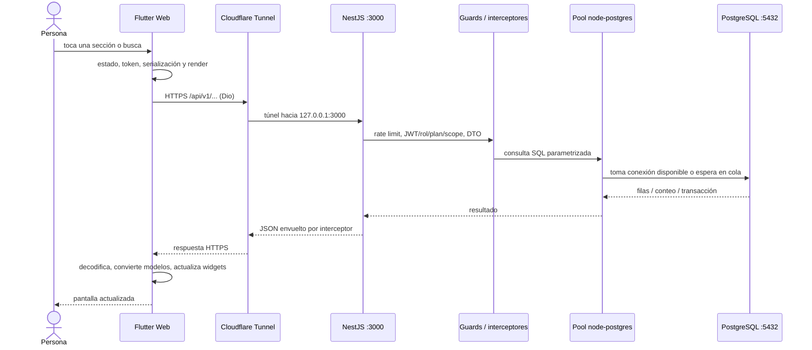

# Auditoría de rendimiento de Foody — punta a punta

> **Fecha de revisión:** 2026-11-22  
> **Alcance:** lectura del código, configuración operativa, mediciones HTTP livianas al entorno local y por Cloudflare Tunnel, consulta de estadísticas actuales de PostgreSQL y contraste con las auditorías anteriores.  
> **Modo inicial:** auditoría de solo lectura, con un script de lecturas GET de baja intensidad. Una actualización posterior el 2026-11-23 documenta una optimización acotada del POS; no se cambiaron configuraciones ni datos de negocio.

## Resumen ejecutivo

Foody no está lento por una sola razón. El tiempo que percibe una persona incluye Flutter arrancando, la red del usuario, Cloudflare Tunnel hasta el PC de desarrollo, autenticación, cola del proceso NestJS, espera por conexión SQL, ejecución de consultas, transferencia y renderizado en Flutter. Cada capa suma.

La muestra puntual de hoy encontró:

| Ruta medida | Tiempo | Resultado |
|---|---:|---|
| API local `127.0.0.1:3000/api/v1/salud` | 113 ms primera solicitud; luego 8, 3 y 2 ms | HTTP 200, 1.129 bytes |
| API pública `api.foodyy.store/api/v1/salud` | 593 ms | HTTP 200, 1.129 bytes |
| Entrada Equipo por túnel `/admin/login` | 720 ms | HTTP 200, 6.378 bytes |
| Entrada Cliente por túnel `/` | 533 ms | HTTP 200, 6.378 bytes |
| JavaScript Flutter Cliente local `main.dart.js` | 131 ms | HTTP 200, 6.476.749 bytes |
| JavaScript Flutter Cliente por túnel `main.dart.js` | 2.676 ms | HTTP 200, 6.476.749 bytes |

Es una muestra secuencial de una sola computadora, hecha con `Invoke-WebRequest`; **no es una prueba de carga ni una medición de navegador**. La diferencia en las rutas públicas incluye DNS, TLS, Cloudflare, el túnel, transferencias y variación de red. La respuesta HTML es pequeña; el artefacto JavaScript principal pesa 6,48 MB en esta descarga. El navegador además pide fuentes, iconos, assets, APIs e imágenes, y esta prueba no mide ese conjunto.

La versión auditada inicialmente demoraba Inicio al cargar resumen, mesas, pedidos, alertas e inventario en cinco esperas secuenciales. El estado de código más reciente ya ejecuta resumen, mesas, alertas e inventario en paralelo; solo pide pedidos activos en forma condicional si la respuesta de resumen no incluye `domicilios_tardios`. La consolidación por sedes en Nest aún consulta cada sede en un `for` con `await`, de manera serial.

Las pruebas históricas de carga del 6 de agosto de 2026 reportaron degradación muy alta a 50 y 200 solicitudes concurrentes. Sirven como señal de riesgo, pero no como capacidad vigente certificada: se hicieron en la PC local, con una muestra chica y distintos métodos de carga, y desde entonces cambiaron índices, consultas, paginación y cachés. La base local actual sigue siendo muy pequeña (47 MB; `pedidos` ~440 KB, `movimientos_caja` ~232 KB), así que no representa cientos de locales con historial real.

**Conclusión:** es razonable para desarrollo y pruebas funcionales. No hay evidencia actual que permita afirmar que la infraestructura soporte cientos o miles de usuarios concurrentes. Antes de optimizar a ciegas hay que instrumentar cuánto tarda cada tramo y probar en un entorno aislado parecido al despliegue esperado.

### Actualización 2026-11-25 — muestra breve API/Equipo actual

Después de publicar el bundle Equipo actual se midieron GET pequeñas (`/api/v1/salud` y `/`) secuenciales desde el mismo PC. API local: 12/12 HTTP 200, p50 2 ms, p95 4 ms, máximo 79 ms. API por Tunnel: 12/12 HTTP 200, p50 438 ms, p95 520 ms, máximo 606 ms. Sitio Equipo local: 12/12 HTTP 200, p50 2 ms, p95 3 ms, máximo 65 ms. Equipo por Tunnel: 4/4 HTTP 200, p50 437 ms, máximo 709 ms (muestra demasiado pequeña para reportar p95 con valor útil).

La parte pública agrega aproximadamente 430–440 ms frente a localhost en esta muestra. Esto apunta a la ruta externa (cliente→Cloudflare→Tunnel→PC) para el retardo de solicitudes pequeñas, no identifica cuál tramo exacto domina. **No es profiling Flutter ni del SQL de pantallas autenticadas, ni prueba de carga; no extrapolar a usuarios simultáneos.** La muestra es GET de salud/HTML, sin datos sensibles ni escrituras. El proceso API sigue siendo anterior al artefacto en `dist`; sus tiempos no validan la nueva consulta de dashboard.

### Actualización 2026-11-25 — descarga del bundle Equipo por Tunnel

Tres `fetch` consecutivos a `https://equipo.foodyy.store/main.dart.js` desde el mismo PC recibieron HTTP 200 y el cuerpo decodificado de **6.960.485 bytes**; tiempos completos: **1.677 ms, 586 ms y 495 ms** (n=3, p50=586 ms; muestra insuficiente para p95). Cloudflare reportó `Content-Encoding: br` y `cf-cache-status: REVALIDATED` en las tres respuestas. La petición no autenticada midió el asset público, no el arranque completo del panel ni una sesión real. Es coherente con el build servido; el release candidato nuevo pesa 6.961.504 bytes, un cambio de aproximadamente 1 KB. No hay base para atribuir la variación solo a Tunnel, CPU del PC o Cloudflare, ni para estimar concurrencia.

La transferencia muestra que Cloudflare entrega Brotli; merece medirse con una waterfall de navegador si las visitas repetidas aprovechan caché de cliente/edge de forma efectiva, ya que en esta muestra el estado fue `REVALIDATED`, no `HIT`. No se alteró política de caché ni configuración de Tunnel.

## Recorrido de una acción y dónde se consume el tiempo

### Actualización 2026-11-23 — lecturas iniciales del POS

`PedidoCajeroScreen._cargar` esperaba en serie menú, mesas y caja, aunque son tres lecturas independientes de la misma sede. Ahora inicia las tres antes de esperar resultados (`Future.wait`); la duración de espera deja de ser la suma de las tres latencias y se aproxima a la más lenta, más renderizado. No se midió un antes/después real en la red ni se incluyeron estas lecturas en la prueba HTTP previa. Si falla la consulta de caja sigue aplicando el comportamiento anterior (continuar como si no hubiera caja); si fallan menú o mesas, se presenta el error de carga.

Evidencia: `test/pedido_cajero_screen_test.dart` confirma con `Completer` que menú, mesas y caja se invocan antes de resolver cualquiera de ellas (6/6 pruebas POS); `flutter analyze --fatal-infos` sobre los dos archivos editados no reporta hallazgos. La secuencia no crea ni modifica datos.

### Actualización 2026-11-23 — estimación autoritativa para el POS

El POS ahora envía una cotización `POST /pedidos/estimar` luego de cambios al carrito/canal/mesa/dirección, con debounce de 300 ms y descarte de respuestas antiguas. Eso corrige consistencia del pago mixto, pero **no es una optimización de latencia**: añade una petición de lectura/cálculo por cada edición asentada, y para editar el método de pago no se vuelve a cotizar. No se midió p50/p95 de la ruta ni el tiempo percibido con Tunnel. En conexiones lentas, el panel indica que está cotizando y bloquea únicamente el pago mixto; para pago simple muestra el total aproximado si el endpoint falla. Mantener Nest como autoridad en alta.

Evidencia runtime de solo lectura: un `POST /api/v1/pedidos/estimar` con un producto demo devolvió HTTP exitoso, subtotal/total 2500 COP e IVA informativo 399,16; no insertó pedido. Se validó el flujo de render y pago con suite Flutter POS 7/7 y analyzer focalizado limpio. Pendiente: medir ruta con repetición baja por localhost y Tunnel con carga/auth controlada, identificar consultas SQL de estimación y correlacionar con logs. No ejecutar alta para “medir” contra datos activos.

Este es el camino usual de una lectura protegida. Hay variantes: login y refresh no siguen las mismas guardas; imágenes servidas por Storage, autenticación/realtime de Supabase y geocodificación van a otros servicios; Wompi es una llamada externa desde el backend. Algunas pantallas también hacen polling o reciben eventos Realtime que disparan nuevas lecturas.

## Hallazgos priorizados

### Optimización aplicada, falta medición de red — cargas del Inicio

`DashboardResumenWidget._cargar()` ya inicia resumen, mesas, alertas e inventario juntos con `Future.wait`, conserva errores por fuente y evita que una falla tumbe las demás. Pedidos activos es una llamada de compatibilidad que solo inicia después de recibir el resumen cuando este no devuelve `domicilios_tardios`; por tanto, una API vieja aún puede introducir una espera serial.

Prueba `test/dashboard_resumen_widget_test.dart`: cuatro fuentes se comprueban iniciadas antes de liberar cualquiera de sus respuestas; suite 10/10, analyzer de widget y prueba sin incidencias. Esto prueba concurrencia en Flutter, no p50/p95 de red, SQL ni tiempo hasta primer render. El render espera a las cuatro respuestas del centro; una medición de waterfall autenticada debe decidir si conviene carga progresiva. La consulta de pedidos fallback podría retirarse cuando el runtime de todas las instalaciones garantice el contrato nuevo.

### P0 — Túnel a una máquina de desarrollo y tamaño de arranque web

`config/foody-entorno.env` dirige el navegador al PC: `foodyy.store` → `127.0.0.1:8081`, `equipo.foodyy.store` → `:8080`, API → `:3000` y Supabase → `:8000`. Esto añade una dependencia de red y del equipo doméstico a cada llamada dinámica. En la muestra pública, salud local calentado fue de 2–8 ms y por túnel 593 ms. La comparación no aísla todos los factores, pero muestra que el trayecto remoto importa.

El JS principal del cliente se descargó completo (6,48 MB; 2,68 s por túnel en esa muestra). Esto no equivale al tiempo total de carga ni a su tamaño comprimido, pero sí marca un costo de red/parseo inicial. Flutter inicializa Supabase antes de `runApp`; Firebase también se inicializa antes, y FCM se deja en segundo plano. En web, la demora de inicialización puede retrasar el primer frame si falla o se demora un proveedor.

**Mejora:** mantener el túnel para pruebas remotas; medir en Chrome DevTools el waterfall y el primer frame en una red móvil real. Reducir arranque diferido solo tras comprobar qué inicialización bloquea la vista y preservar login, deep links y manejo de errores. Cuando el producto esté listo, comparar hosting estático/CDN para Flutter y API en un host próximo a PostgreSQL; no es necesario comprar VPS para diagnosticar el PC actual.

### P1 — Consultas corporativas por sede en serie

`DashboardService.consolidado()` obtiene las sedes y por cada una hace `await resumenSucursalSql(s.id)` dentro de un bucle. La pantalla consolidada espera el endpoint completo. Con una sede el costo es pequeño; con decenas o cientos crece linealmente en rondas SQL.

**Mejora:** agregar métricas por sede en una sola consulta agrupada, o usar paralelismo acotado si una consulta no es viable. Evitar `Promise.all` sin límite para cientos de sedes porque puede saturar el pool.

### ✅ PERF-PEDIDO-CATALOGO-01 — catálogo consultado por lote (fuente corregida)

El hallazgo siguiente es histórico, previo a la optimización del 2026-11-25. La implementación actual de `PedidosCrearService` recolecta IDs y carga productos, toppings y bebidas con consultas agrupadas y `ANY(uuid[])`; combos y componentes se cargan por lote cuando existen. La validación y el cálculo siguen en Nest y en la transacción, y conserva orden de DTO/errores. No es cierto en el código actual que se ejecute una consulta SQL por cada línea/extras.

Prueba y medición previas: build, regresión 51 suites/128 unitarias y E2E QR 6/6; benchmark 12 muestras por tamaño (1 línea p50 12,88 ms, 30 líneas 13,69 ms). Repetición actual 26-nov en QA :3001, 8 muestras: 1 línea p50/p95 9,94/22,75 ms; 30 líneas 11,56/13,32 ms, subtotal exacto lineal y dispositivo de prueba anonimizado. Son benchmarks secuenciales, instancia/DB pequeña y caliente; no representan Tunnel ni capacidad.

Pendiente menor: DTO tiene límite para líneas principales, pero no se confirmó un máximo funcional explícito para arreglos anidados de toppings/bebidas; el límite del cuerpo HTTP mitiga volumen bruto sin expresar una regla de selección. Revisar la cardinalidad configurada por producto antes de imponer límites para no reducir funcionalidad.

### P1 — Búsqueda de pedidos en cliente, polling y actualización de listas

Kanban tiene polling de respaldo, canal Realtime y refrescos; el reloj refresca cada 30 segundos. Mesas también tiene un timer de pulso cada 1.200 ms, aunque hace `setState` solo si encuentra estados que necesitan pulso. Si Realtime está sano, el polling redundante puede hacer trabajo extra; si muchas pantallas/usuarios lo usan, las solicitudes se multiplican por usuarios × vistas abiertas × intervalo.

**Mejora:** registrar motivo y frecuencia de cada lectura, evitar consultas idénticas cuando el canal acaba de actualizar, pausar polling cuando la app está en segundo plano y ajustar intervalo a una política común con backoff ante fallos. No reducir refresco de caja/KDS sin validar que no se afecte la operación en tiempo real.

La búsqueda del Kanban se filtra sobre la lista cargada en el cliente, no es una búsqueda global en servidor. Esto es rápido mientras el conjunto acotado siga pequeño; para historial grande hay que usar filtros y paginación en API, no descargar todo.

### P1 — Llamadas externas sin límite explícito de espera

La configuración común de Dio marca timeout de conexión 15 s, respuesta 45 s y envío 15 s. El máximo de respuesta puede percibirse como congelamiento en acciones interactivas; no se reduce globalmente hasta separar operaciones normales de reportes, cargas y procesos extensos. La búsqueda Photon ahora tiene tope de 5 s con `AbortSignal`, respuesta 504 por demora y sin reintentos; el caché solo guarda respuestas válidas. Nest 3/3 y build OK. Las llamadas Wompi aún carecen de timeout explícito. Un timeout en `POST /transactions` sería ambiguo: Wompi documenta `reference` única pero su guía de idempotencia consultada aplica a dispersiones/payouts, no prueba idempotencia de transacciones con payment source. Ya hay asociación webhook por referencia y reserva concurrente cron/manual; aún se requiere estado ambiguo durable y una ruta comprobable de reconciliación antes de abortar o reintentar un cobro.

**Mejora pendiente:** cerrar timeout seguro de Wompi con estado ambiguo durable, reconciliación por referencia/estado e identificación de transporte vs rechazo definitivo. La reserva por fila de suscripción ya evita la carrera entre cron y renovación manual. No añadir reintentos automáticos hasta demostrar idempotencia. Los presupuestos deben ser por operación, sin compartir el timeout interactivo con tareas diferidas.

### P1 — Pool PostgreSQL no publica su saturación ni aplica límites de espera en código

`DatabaseService` ahora fija `connectionTimeoutMillis` en 5 s por defecto y permite cambiarlo con `DB_POOL_CONNECT_TIMEOUT_MS`. Esto limita la espera para obtener/abrir una conexión, no cancela consultas que ya empezaron. Siguen sin configuración de `query_timeout`/`statement_timeout` ni métricas de `totalCount`, `idleCount` y `waitingCount`; por ello no se mide la cola ni el tiempo dentro de SQL. `DB_POOL_MAX` continúa como estaba y la validación de producción exige mínimo 25, valor que debe contrastarse con el límite real del Postgres, PgBouncer y número de instancias antes de desplegar.

**Mejora:** medir espera por conexión, duración de consulta y conexiones ocupadas/ociosas/en espera; etiquetar consultas por endpoint sin registrar secretos ni valores personales. Definir límites de consulta y transacción, revisar junto con `max_connections` de PostgreSQL y la cantidad de réplicas. Calcular presupuesto global: `conexiones por réplica × réplicas` más conexiones de Supabase y administración.

### P1 — Costo de caja depende de todos los movimientos del turno

La API pagina `GET /caja/:caja_id/movimientos` y consulta en paralelo la página y el total. Caja solo presenta los 80 movimientos recientes, pero descargaba páginas secuenciales hasta 50 páginas antes de truncar a 80. Ahora obtiene como máximo dos páginas (50 por página), conserva esos mismos 80 registros visibles y evita traer el resto del historial. La prueba de repositorio verifica dos solicitudes y el límite. El saldo de cierre continúa calculándose en backend, por fuera de esta lista visual.

**Mejora:** solicitar una primera página para pintar la caja y cargar más bajo demanda o virtualizar con paginación; el total puede obtenerse aparte o con conteo eficiente. Validar que los indicadores del cierre tengan datos completos antes de limitar el historial.

### P1 — Reportes y analítica deben probarse con volumen realista

La auditoría de agosto encontró SQL con casts de fecha, expresiones `COALESCE`, joins y reportes de periodos amplios que podían forzar scans. En el código actual el resumen usa una caché de 30 s, top productos ya agrega toppings/bebidas mediante joins agrupados y caja ya tiene índices secundarios sobre `movimientos_caja`. La base actual tiene 47 MB, y las tablas de pedidos/movimientos son pequeñas; por eso los `EXPLAIN` de esa instancia no demuestran el comportamiento con millones de filas.

**Mejora:** volver a ejecutar `EXPLAIN (ANALYZE, BUFFERS)` sobre las consultas actuales con datos sintéticos representativos en una base aislada, incluyendo varias sucursales y periodos largos. Confirmar límites de reporte y que los filtros de fecha conservan los índices. No ejecutar esta carga en la instancia de uso diario.

### P2 — Caché en memoria útil para una instancia; inválida para varias sin coordinación

`CacheModule` es global con TTL por defecto 900.000 ms y `max=200`; menú tiene TTL explícito de 15 min y single-flight por sucursal; dashboard resumen usa 30 s. Esto evita lecturas repetidas en un proceso Nest. Con varias réplicas cada proceso tendrá caché independiente: invalidez de catálogo en una réplica no borra las demás, y el máximo 200 se comparte entre claves del proceso. La caché de geografía también es un `Map` por instancia, máximo 300 y sin TTL visible.

**Mejora:** no introducir Redis solo por anticipación. Primero medir hit ratio, misses, invalidaciones, cardinalidad y diferencias entre réplicas. Si se despliega más de una API y se necesita consistencia, mover solo cachés compartidas con una política explícita de TTL/invalidation.

### P2 — Listas e imágenes en el panel

El cliente y varias vistas ya emplean listas builder y algunos tamaños de caché de imagen; la auditoría de agosto que decía `cacheWidth=0` para todo quedó obsoleta (hay usos actuales en catálogo, restaurantes, sucursales y menú cliente). Sigue habiendo varias listas `shrinkWrap` y widgets `Wrap`; por ejemplo, la vista de tarjetas de Kanban debe revisarse para confirmar si construye todas las tarjetas a la vez. El inventario de API y renderizado debe medirse con cientos de elementos, no con los pocos registros demo.

**Mejora:** en DevTools inspeccionar frames lentos, reconstrucciones y memoria; virtualizar filas/cards grandes; usar dimensiones de decode cercanas al tamaño físico mostrado; evitar volver a pedir/decodificar imágenes idénticas. Medir bytes reales servidos por Storage/CDN y cache headers.

### P2 — Timers de refresh y métricas en dashboard

Inicio refresca cada 75 s y Caja/Kanban tienen sus propios mecanismos de Realtime/polling. Es saludable para datos recientes, pero aumenta el tráfico de fondo y puede generar rafagas al abrir varias vistas o reconectar. Hay cron de suscripciones, mesas, impresión, domicilios, promociones, pedidos QR y notificaciones dentro del mismo proceso Nest; muchos comparten CPU/pool con las solicitudes interactivas.

**Mejora:** medir la tasa de consultas de fondo y su impacto. Aleatorizar (jitter) arranques de polling cuando corresponda, limitar solapamiento si una vuelta tarda más que el intervalo, y mover trabajos costosos solo cuando haya medición que muestre interferencia. Los locks advisory existentes ayudan a que ciertas tareas no se repitan entre instancias; comprobar cada cron antes de escalar.

## Evidencia de base de datos y configuración actual

Consulta de solo lectura a PostgreSQL local el 2026-11-22:

- Base `postgres`: tamaño total **47 MB**, **17** conexiones reportadas; agrupación de actividad observó 2 activas y 13 idle en esa captura (los estados restantes pueden corresponder a otras etiquetas o carreras durante la consulta).
- `pedidos` ~440 KB; `movimientos_caja` ~232 KB; `pedido_items` ~440 KB; `notificaciones_pendientes` ~22 MB.
- Índices presentes ahora: `movimientos_caja(caja_id)`, `movimientos_caja(sucursal_id, created_at DESC)`, `pedidos(sucursal_id, created_at DESC)`, `pedidos(sucursal_id, estado)` y `pedido_items(pedido_id)`.
- La base está demasiado pequeña para validar escalabilidad. El tamaño actual de `notificaciones_pendientes` sugiere que conviene vigilar su retención y archivado, pero su tamaño por sí solo no demuestra un cuello de botella.

No se inspeccionaron ni publicaron valores de secretos. No se hizo `EXPLAIN ANALYZE` con consultas nuevas ni se modificaron estadísticas.

## Inventario de llamadas por flujo

El formato común de lecturas Nest es: controller/DTO → autenticación y autorización aplicables → servicio de dominio → SQL parametrizado por `DatabaseService`/`pg.Pool` → PostgreSQL → `RespuestaInterceptor` (`exito/datos/mensaje`) → Dio/modelos/repositorio → estado y widgets Flutter. Los controladores tienen guardas por ruta, no una única cadena idéntica: pueden incluir JWT, usuario activo, suscripción, plan, rol, permisos y scope de sucursal. El guard global de rate limit corre como proveedor global. Las escrituras de pedido/caja suelen envolver reglas y auditoría en transacción; Realtime se notifica después de mutar.

| Flujo/pantalla | Llamadas y trabajo detectado | Qué mirar en la traza |
|---|---|---|
| Inicio admin | `GET /dashboard/resumen`, mesas, alertas e ingredientes en paralelo; pedidos activos solo como fallback secuencial cuando faltan domicilios tardíos en resumen | duración individual y total, bytes JSON, waterfall autenticada, efecto del fallback y tiempo al primer render |
| Dashboard de gráficos | `GET /dashboard/graficos`; varias agregaciones en pedidos, items y ventas | tiempo de cada SQL, rango de fechas, buffers, bytes de respuesta |
| Consolidado cadena | `GET /dashboard/consolidado`; sedes y resumen SQL secuencial por sede | número de sedes, consultas emitidas, duración total |
| Kanban pedidos | GET lista activa/cerrados, detalle y estados; Realtime más poll de respaldo y reloj | frecuencia de polling, query params/limit, eventos duplicados, tiempo de build con 100 cards |
| Caja | caja activa, cuentas por cobrar, movimientos paginados `page/limit`; cliente pagina secuencialmente y carga hasta 5.000 | número de páginas; primer paint; duración API vs total hasta lista completa; tamaño de fila |
| Menú cliente | `GET /menu/:sucursal_id` o menú de QR; caché 15 min, single-flight, varias consultas de catálogo en Nest y luego consulta de resumen de pedidos para QR | hit/miss de caché, conteo de queries, tamaño de menú e imágenes |
| Catálogo admin | repositorios de productos/combos/categorías y refresco de la pantalla tras operaciones | payload completo, duplicación de recarga, cantidad/bytes de fotos |
| Búsqueda de dirección | Nest → Photon (`photon.komoot.io`), cache local máximo 300 en proceso | tiempo DNS/HTTP de Photon, timeout, cache hit, debounce en cliente |
| Imágenes | Flutter → URLs almacenadas/Storage; cargas pasan por Nest y `sharp` WebP hasta 800 px en el flujo inspeccionado | bytes descargados, cache HTTP, dimensiones originales y bitmap decodificado |
| Login Google | Flutter Web → Supabase Auth/OAuth → callback de Supabase bajo `sb.foodyy.store` → redirect permitido de vuelta a la app; no es una llamada Nest normal | waterfall de redirects, duración Supabase/Google, callback y almacenamiento de sesión |
| Suscripción/pago | Nest → Wompi para crear/consultar pago; Wompi webhook → endpoint Foody → DB | latencia del proveedor, webhook, idempotencia, estado persistido; llamados `fetch` necesitan límite de espera |
| Tiempo real | Supabase Realtime/FCM directo o eventos Nest según módulo, con canales y respaldo de polling | mensajes por usuario, canales activos, reconexiones y lecturas que dispara cada evento |

### Directorio de rutas fuente

Los controladores que componen los flujos principales están en:

- Flutter: `lib/features/admin/presentation/widgets/dashboard_resumen_widget.dart`, `lib/features/admin/data/dashboard_repository.dart`, `lib/features/admin/presentation/widgets/pedidos_kanban_widget.dart`, `lib/features/caja/data/caja_repository.dart`, `lib/features/caja/presentation/caja_admin_screen.dart`, `lib/features/catalogo/presentation/menu_admin_screen.dart`, `lib/features/menu/presentation/menu_screen_foody.dart`, `lib/core/red/cliente_dio.dart`.
- Nest: `foody_backend/src/modulos/dashboard/dashboard.controller.ts` y `dashboard.service.ts`; `pedidos/pedidos.controller.ts` y `pedidos-public.controller.ts`; `caja/caja.controller.ts` y `caja.service.ts`; `menu/menu.controller.ts` y `menu.service.ts`; `inventario/inventario.controller.ts`; `pagos/wompi.service.ts`; `geografia/geografia.service.ts`.
- SQL y conexión: `foody_backend/src/core/database/database.service.ts`, `foody_backend/src/compartido/sql/ventas-metricas.sql.ts` y servicios SQL de los módulos.

La enumeración de cada ruta CRUD por módulo está en los decoradores `@Get/@Post/@Patch/@Put/@Delete` de esos controllers y en `docs/MAPA_FOODY.md`. No es correcto inferir el tiempo de todos los endpoints a partir de `/salud`; los endpoints autenticados requieren una sesión y medición de navegador o credenciales de prueba en un entorno aislado.

## Por qué las pruebas anteriores discrepan

`docs/archivo/auditorias-prompts/AUDITORIA_PERF_BACKEND.md` (2026-08-06) registra pruebas RunspacePool: entre 10 y 200 concurrentes la latencia p50 subió de cientos de ms a 7–10 s y el rendimiento rondó 8–23 RPS. Otra auditoría de estrés describe mezclas y cargas ligeras con otros RPS/percentiles. Son escenarios distintos, no se pueden combinar como una capacidad única.

Desde esas auditorías hay cambios verificables en código y BD: índices de movimientos de caja, página de API de caja, carga por páginas (aunque secuencial) en Flutter, menú sin N+1 por combo y agregación por joins en dashboard. El TTL de menú actual es 15 min (el informe antiguo dice 5 min); el TTL global es 15 min/`max=200`; el resumen de dashboard tiene TTL de 30 s. Hay que actualizar los hallazgos antiguos al cerrarlos, no presentarlos como estado vigente.

## Plan de medición para hallar cuellos de botella

1. **Una acción en Chrome DevTools (Network + Performance):** cargar una sección sin caché y repetirla con caché; guardar waterfall HAR localmente. Separar DNS, conexión/TLS, TTFB, descarga, JS parse/compile, first contentful paint y frame de Flutter. No compartir HAR sin revisar tokens/PII.
2. **Una petición representativa por pantalla:** marcar en frontend el inicio/fin y correlacionar con un `request-id` del backend. Registrar ruta, estado, bytes, espera de auth/refresh, duración Nest y tiempo total en Dio. No guardar body, JWT ni datos personales.
3. **Nest/DB:** medir guardas/controller/servicio/SQL y espera de pool por separado; obtener histogramas p50/p95/p99, tasa de error, pool waiting, duración SQL, lock waits y consultas más frecuentes. `pg_stat_statements` sirve para agregados; habilitarlo en un entorno apropiado y controlar costos/privacidad.
4. **Prueba aislada representativa:** generar datos sintéticos de varias sucursales, miles de productos/pedidos/movimientos y relaciones; perfilar GET, búsquedas, gráficos, pedido y caja con volumen gradual. Mantener una sola variable de carga a la vez; conservar percentiles, tasa de error y CPU/RAM/DB.
5. **Criterios de aceptación:** acordar objetivo de interacción, por ejemplo respuesta visual inicial ≤1 s en red objetivo, escrituras críticas p95 ≤1 s, lecturas analíticas p95 ≤2 s (ajustar con realidad operativa); cero duplicados/pérdida, permisos e idempotencia intactos. Son objetivos a decidir, no garantías actuales.

## Orden recomendado de optimización

| Orden | Trabajo cuando se autorice implementación | Impacto esperado | Riesgo/precaución |
|---|---|---|---|
| 1 | Medir carga por llamada en Inicio y paralelizar cargas independientes con fallo aislado | Alto, UI admin | Bajo/medio: no romper estados parciales |
| 2 | Waterfall de Flutter web por túnel; dividir y diferir inicialización no crítica | Alto si el arranque domina | Medio: OAuth, deep links, FCM y primer render |
| 3 | Primer página caja visible; paginar bajo demanda | Alto en turnos largos | Medio: totales y cuadre deben conservar consistencia |
| 4 | Reducir consultas seriales del consolidado; agregar por sede | Alto para cadenas grandes | Medio/alto: reglas multi-sucursal y filtros |
| 5 | Métricas Pool + endpoints + SQL, límites de timeout y alertas | Alto para localizar y contener colas | Bajo; los límites deben respetar operaciones críticas |
| 6 | EXPLAIN y carga sintética; ajustar consultas/índices con evidencia | Alto cuando crecen datos | Medio: costo de índices en escrituras y migración |
| 7 | Ajustar poll/realtime, listas e imágenes usando perfiles | Medio/alto en operación continua | Medio: no perder actualización operativa |
| 8 | Evaluar CDN/host, múltiples instancias, Redis o workers según métricas | Alto para escala si hay prueba | Alto costo/complejidad; no activar antes de demanda medida |

## Alcance pendiente para una conclusión de capacidad

- Waterfall real del navegador y métricas de primer render en celular / Wi-Fi / red móvil.
- Tiempos de API autenticada asociados a solicitudes concretas de dashboard, pedidos, caja, catálogo y analítica.
- `EXPLAIN (ANALYZE, BUFFERS)` actual sobre datos sintéticos representativos.
- Prueba de concurrencia en staging, con ambiente y límites aprobados; no sobre la PC que sirve el túnel de uso.
- Perfil de Flutter DevTools: frames, reconstrucciones, memoria, descarga/decodificación de imágenes y jornada larga.
- Inventario de consultas y tareas de fondo cuantificado por frecuencia, volumen y costo. Este documento traza rutas de negocio relevantes, pero no asigna latencia a cada endpoint autenticado porque no se midió con credenciales de prueba.

## Evidencia nueva: pruebas controladas y pantallas Cocina/Domiciliarios (2026-11-22)

### Actualización 2026-11-24 — catálogo inicial de Menú

`MenuAdminScreen._cargar()` ejecutaba en serie seis lecturas independientes de la sede: categorías, productos, toppings, bebidas, combos y cocinas; después solicitaba el resumen de costeo y esperaba su respuesta antes de mostrar el catálogo. En una conexión con RTT alto la demora se acumulaba, y una petición lenta de costeo prolongaba la carga aunque el menú base estuviera listo.

**Cambio:** las seis lecturas del catálogo se inician juntas con `Future.wait`. El request de costeo inicia al mismo tiempo pero se aplica en segundo plano después de renderizar el catálogo; si falla, los badges siguen ocultos como antes. Un contador de versión descarta respuestas atrasadas de una carga anterior. No se cambian endpoints, contratos, permisos ni datos.

**Verificación:** nueva prueba con `Completer` comprueba que las siete llamadas se inician sin esperar sus respuestas y que Menú aparece mientras costeo sigue pendiente. `menu_admin_screen_test.dart`: 10/10, incluidos 320/390/820/1440; analyzer focalizado limpio. Suite Flutter global actualizada: 220 aprobadas/5 omitidas/0 fallidas. No se midió latencia remota real; la reducción de espera serial está demostrada por el test, no se afirma una cifra en milisegundos.

### Actualización 2026-11-24 — publicador Windows PowerShell `-NoProfile`

La ruta exacta del launcher `scripts/iniciar1/iniciar-foody-subdominios.bat` volvió a fallar después del build Cliente: Windows PowerShell no resolvió `Get-FileHash` dentro de `Build-Web`, pese al import explícito del módulo en script. Para eliminar esa dependencia del ámbito de módulos se calcula SHA-256 con `System.Security.Cryptography.SHA256` y se convierte a hex con `BitConverter`.

**Verificación:** el publicador `powershell -NoProfile ...` compiló Cliente y Equipo y versionó bootstrap/index; luego el BAT diario terminó con exit 0. SHA-256 disco/local/público coincide en ambos `main.dart.js`; la versión aparece en `index.html` y `flutter_bootstrap.js`. Cliente, Equipo y API local/pública responden HTTP 200; API :3000 PID 17080, `cloudflared` PID 11112. `.env` conserva hash. Warnings de Wasm y CupertinoIcons no impidieron los builds.

### Pruebas HTTP de baja intensidad

Se creó [`scripts/perf/medir-lecturas-tunel.ps1`](../scripts/perf/medir-lecturas-tunel.ps1), que solo realiza GET a `/salud` y `/menu/:sucursalId`; no inicia sesión, no escribe datos y limita concurrencia a 5. Se usa `c0000000-0000-4000-8000-000000000001`, ID de sede confirmado por la prueba HTTP. Una ejecución local separada del túnel utilizó 3 repeticiones:

| Ruta local | Concurrencia | Correctas | p50 | p95 | Bytes aprox. |
|---|---:|---:|---:|---:|---:|
| `/salud` | 1 | 3/3 | 3,2 ms | 3,2 ms | 1.129 |
| `/salud` | 3 | 9/9 | 3,0 ms | 3,1 ms | 1.129 |
| `/salud` | 5 | 15/15 | 3,1 ms | 14,7 ms | 1.129 |
| `/menu/c000…0001` | 1 | 3/3 | 1,9 ms | 1,9 ms | 5.401 |
| `/menu/c000…0001` | 3 | 9/9 | 1,9 ms | 3,8 ms | 5.401 |
| `/menu/c000…0001` | 5 | 15/15 | 1,9 ms | 10,4 ms | 5.401 |

Son muestras cortas y calentadas de localhost; no prueban capacidad para cientos de usuarios, ni midieron llamadas autenticadas. En peticiones públicas por `api.foodyy.store`, `/salud` respondió en ~0,44–0,64 s en las respuestas que llegaron, pero en una ejecución previa agotó el límite de 15 s. El menú respondió en ~0,46–0,56 s en muestras exitosas y tuvo un timeout a los 6 s en otra. Se detuvieron pruebas remotas posteriores al primer error para no presionar el PC que hoy sirve como VPS. Como incluso `/salud` (sin lectura de negocio) presentó variación, hay evidencia de demora en el trayecto/nodo de túnel o red, pero no se puede atribuir exclusivamente a Cloudflare: las mediciones se lanzaron desde la propia máquina anfitriona, no desde una red móvil externa.

No se midió carga a 50/200 usuarios, no se midió el waterfall de DevTools ni se perfilaron CPU, heap o consultas SQL durante una ráfaga. La sesión abierta de Chrome usa `localhost:8082`; por tanto, la comprobación visual no certifica el build publicado por los puertos de túnel `8080/8081`. El uso visible de Chrome llegó a indicar aproximadamente 817–861 MB durante la navegación; son lecturas puntuales del proceso, no evidencia suficiente de fuga.

El chequeo estático `scripts/verificar-perf-flutter.ps1 -SkipAnalyze` terminó OK y reportó: 21 referencias a imágenes de red, 17 usos de `memCacheWidth/Height`, cero `.unsubscribe()` encontrados, 6 `removeChannel`, 26 constructores de listas, 8 usos de `shrinkWrap:true`, cero usos Dart de `FlutterImageCompress`; marcó como avisos el `Wrap` de las tarjetas Kanban y la dependencia de compresión sin uso Dart. Es un conteo por patrones, no profiling dinámico. El perfil de heap DevTools de jornada larga sigue pendiente.

### Cocina KDS — error reproducible en sesión Admin Demo

Al navegar a Cocina desde la sesión administrativa aparecía `RT-SEC: sin canal staff "cocina" ... — vuelve a iniciar sesión`. El KDS carga cocinas/tickets y luego intenta suscribir Realtime. Nest firmaba el topic al login solo para rol de cocina con `cocina_id`, pese a que migración 026 concede `ver_cocina` a admin/gerente y los endpoints KDS comprueban ese permiso y la sucursal. No era latencia SQL ni justificaba abrir topics adivinables.

**Corrección 2026-11-23:** al seleccionar una cocina, Flutter solicita `/auth/realtime-canales?sucursal_id=…&cocina_id=…`; Nest recalcula permiso efectivo, limita los roles de cocina a su estación y firma solo si la cocina está activa y pertenece a la sucursal autorizada. Se conserva HMAC opaco. Tests `auth.service.spec.ts`: cinco casos de permiso, sucursal y alcance; `cocinas_repository_test.dart`: persistencia y respuesta incompleta; `kds_screen_test.dart`: ocho casos responsive. Backend 16/16 + build, Flutter total 152 aprobadas/5 E2E mutadoras omitidas, análisis focalizado limpio. Build Equipo release local/público contiene la ruta y ambos sitios/API salud responden HTTP 200. **No validado en runtime autenticado:** el proceso Nest :3000 sigue con el build anterior hasta reinicio; la firma nueva aún no está activa en el Tunnel.

### Domiciliarios — excepción por contrato numérico

La pantalla `domiciliarios` abre con una excepción Flutter: un decimal como `"306000.00"` llega como `String`, donde la vista espera `num?`. La consulta de `resumenComisionesIndependientes()` agrega columnas PostgreSQL `numeric` (incluido `por_pagar`); `node-postgres` entrega `numeric` como cadena por defecto. El repositorio conserva el mapa de respuesta y `domiciliarios_admin_screen.dart` hace cast directo `(c['por_pagar'] as num?)` (también formatea `comision_foody`). La BD confirmó 6 filas de ganancias vinculadas a la sede `c000…`; `d000…` no es una sede y da 0 en esa unión.

Este es un defecto de contrato API/UI que rompe el renderizado, no lentitud: normalizar explícitamente el tipo en el límite del repositorio o enviar un contrato numérico estable desde Nest, añadir cobertura para decimales serializados y confirmar escala/precisión monetaria. No se pulsó Liquidar ni ninguna acción que escriba. En la pantalla también se detectó que `_cargarLiquidacion` espera endpoints secuenciales; medir y reducir ese tiempo es una mejora separada tras reparar el crash.

### Límites y siguiente paso seguro

La inspección visual se hizo en la sesión ya iniciada “Admin Demo”; no se probaron cuentas de rol cocina/domiciliario ni se renovaron tokens. No se tocaron autenticación, pagos, liquidaciones, configuración ni datos operativos. El script `medir-lecturas-tunel.ps1` quedó como herramienta de medición repetible de GET pequeñas, no como generador de estrés. Para cerrar la línea base hacen falta mediciones desde una red externa, DevTools Network/Performance en build servido por túnel, una sesión de prueba autorizada por rol y staging aislado con datos sintéticos antes de cualquier concurrencia superior a 5.

### Verificación de estado posterior

En una comprobación de solo lectura posterior, `GET /api/v1/salud` respondió HTTP 200 local en 144 ms y por `https://api.foodyy.store` en 951 ms (1.129 bytes). Los puertos 3000, 8080, 8081 y 8000 estaban escuchando. Es un snapshot, no demuestra estabilidad; el tiempo público vuelve a mostrar que hay variación frente a localhost. El defecto de tipo monetario de Domiciliarios se corrigió en el repositorio Flutter. El acceso administrativo KDS/Realtime se corrigió en fuente y se verificó en pruebas, pero su activación runtime espera el reinicio de Nest :3000. El estado de Git durante esa verificación histórica mostró únicamente entregables documentales y el script de medición como cambios de esa tarea.

**Actualización posterior (2026-11-22):** durante la siguiente pasada visual de Domiciliarios se corrigió el cast de importes en su repositorio Flutter y se agregó `test/domiciliarios_repository_test.dart`. El problema de tipo de Domiciliarios queda resuelto en cliente y validado con una respuesta sintética; estados de carga/error ahora permiten reintentar y no presentan una falla como lista vacía. Cocina/Realtime tenía pendiente alinear la firma con el permiso existente; se resolvió en fuente el 2026-11-23 (ver encima) y quedó pendiente el smoke autenticado tras reiniciar Nest :3000.

### Actualización 2026-11-25 — PERF-PEDIDO-CATALOGO-01

La creación/cotización de pedido consultaba dentro de la transacción cada producto, topping, bebida y combo según las líneas del DTO. En pedidos con muchas líneas y extras el número de viajes a PostgreSQL crecía con el contenido del pedido, aun cuando el catálogo de la sede era el mismo.

**Cambio en Nest:** las filas de catálogo se leen en lote dentro de la transacción. Combos y sus componentes se obtienen en dos lecturas cuando hay combos; productos, toppings y bebidas se resuelven en consultas agrupadas para el pedido. Nest conserva la autoridad de disponibilidad, sede, precios y cálculos; se mantiene el orden de validación/errores y el recorrido en memoria del DTO. No se añadió caché, Redis, endpoint, dependencia, ni lógica de negocio en Flutter. Para una cotización sin combos, las lecturas de catálogo se reducen a tres consultas agrupadas, independientemente del número de líneas (más lecturas de combos solo cuando el DTO los contiene).

**Pruebas y medidas en QA aislada:** build Nest correcto; unitarias 51 suites/128 pruebas; E2E de QR 1 suite/6 pruebas. El script [`scripts/perf/medir-estimacion-pedidos.cjs`](../scripts/perf/medir-estimacion-pedidos.cjs) mide 12 muestras de `POST /pedidos/estimar` en un clon local desechable y verifica tanto totales finitos como subtotal lineal (1 línea = $14.500; 30 líneas = $435.000). Resultado observado: 1 línea p50 12,88 ms, p95/máximo 23,91 ms; 30 líneas p50 13,69 ms, p95/máximo 14,62 ms. Se ejecutó en una sola instancia sin carga concurrente, contra localhost y con datos QA; no estima usuarios concurrentes, no incluye Tunnel/red móvil, no aísla el tiempo de SQL y no es SLO de producción. La mejora demostrada en fuente es que el conteo de lecturas ya no escala con la cantidad de renglones; la baja de latencia observada es orientativa.

**Límite de cobertura:** el clon de QA no tenía un combo disponible para la sede-fixture; la ruta de combo quedó cubierta por build y pruebas de servicio existentes, pero esta medición no ejercitó una cotización con combo real. La base QA persistente y la instancia activa :3000 quedaron fuera de las pruebas. Al terminar se detuvo el proceso temporal :3001 y se eliminó solo `foody_diseno_qa_codex_perf_20261125`; `foody_diseno_qa` siguió presente y :3000 conservó PID 10208 con salud HTTP 200. No se midió el camino por Cloudflare.

### Captura de navegador autenticado — KDS por Tunnel (2026-11-25)

Se recargó una sola vez la sesión autenticada de Cocina en `equipo.foodyy.store`, con DevTools Network y caché caliente. Chrome reportó `DOMContentLoaded: 634 ms`, `Load: 996 ms`, 71 solicitudes acumuladas tras dejar la vista abierta, 15,5 kB transferidos y 16,8 MB de recursos declarados/cargados (mayormente caché). El panel mantenía un WebSocket Realtime 101/Pending y sondeos; `Finish` llegó a 1,7 min por la conexión persistente, así que no representa el tiempo de carga útil. No se exportó HAR ni se guardó información de sesión.

En la tabla aparecen lecturas autenticadas de `/auth/perfil`, `/cocinas/:id`, `/cocina/tickets/:id`, `/auth/realtime-canales` y salud. Las lecturas de datos observadas tardaron aproximadamente 216–268 ms a través del Tunnel (304/200). Los preflight OPTIONS de API oscilaron entre 213 y 256 ms. La secuencia no atribuye por sí sola ese tiempo a Nest, DB, Cloudflare o red. Fue una sesión única, con recursos calientes, en el mismo computador que sirve el Tunnel; no es una muestra de usuario móvil ni percentil.

La inspección de fuente explica parte del tráfico acumulado: `ApiOfflineBanner` sondea `/salud` cada 20 s en todo el panel; `RealtimeAvisoBanner` verifica Realtime cada 2 min; `PollRealtimeRespaldo` de KDS revisa `/health/realtime` al programar cada respaldo (90 s si RT aparece sano, 30 s si no), además de cargar tickets cuando el temporizador vence. Esto se suma a consultas periódicas de salud que siguen en Network después del primer render. Conviene deduplicar/coordinar estos chequeos o justificar frecuencia por impacto operativo; cualquier ajuste debe preservar detección de caída y reconexión y probar que no crea sondeos solapados. La captura no basta para afirmar que los 71 requests ocurrieron en el arranque: el conteo es acumulado durante la observación.

El servidor configura `enableCors` con `origin` y `credentials`, pero no fija `maxAge` en la opción CORS de Nest. Network registró repetición de OPTIONS. La evidencia de tabla no confirma todos los headers efectivos del preflight; no se debe ampliar orígenes ni cambiar OAuth. Como mejora candidata, confirmar `Access-Control-Max-Age` y validar de forma controlada un TTL prudente para reducir viajes repetidos, conservando allowlist/credenciales y respetando caché del navegador. No se cambió CORS en esta pasada.

**Siguiente medición:** una recarga fría y una warm con ventanas temporales controladas (p. ej. 5 s, 30 s, 2 min); distinguir peticiones del inicio de las de operación continua; medir tiempo hasta primer frame útil y llamadas API por pantalla. Después instrumentar p50/p95 por ruta desde Nest y DB en QA/staging. Sin carga concurrente en el computador que hoy presta servicio.

### CORS preflight — mitigación de viaje repetido (2026-11-25)

OPTIONS de solo lectura a `https://api.foodyy.store/api/v1/health/realtime`, simulando origen `https://equipo.foodyy.store` y headers de la petición: HTTP 204; `Access-Control-Allow-Origin` conservó el origen esperado, credenciales `true` y los headers solicitados; `Access-Control-Max-Age` no estaba presente. Se agregó `maxAge: 300` (5 min) a la configuración CORS de Nest. Esto cachea solo la autorización preflight del navegador por un periodo corto; no amplía la allowlist ni modifica permisos de origen en servidor. OAuth, credenciales, Cloudflare y Tunnel no cambiaron.

`npm run build` de `foody_backend` terminó correctamente y el artefacto compilado contiene `maxAge: 300`. No se reinició el proceso de API activo, por lo que el OPTIONS público todavía no demuestra la mitigación. Tras el próximo arranque normal comprobar `Access-Control-Max-Age: 300` y comparar una secuencia de llamadas: el primer OPTIONS puede tardar ~0,2 s; solicitudes compatibles subsiguientes dentro de la ventana deberían evitar esa ida de red. Si el header no aparece en el proceso activo o Cloudflare interfiere, investigar sin alterar OAuth ni allowlist. La optimización no demuestra reducción de p95 global.

### Revalidación de CORS tras build (2026-11-25)

El proceso Nest QA :3001, iniciado contra `foody_diseno_qa_codex_abonomix_20261125`, respondió al OPTIONS de `https://equipo.foodyy.store` con HTTP 204, `Access-Control-Max-Age: 300`, `Access-Control-Allow-Origin: https://equipo.foodyy.store` y `Access-Control-Allow-Credentials: true`. Esto confirma que la opción compilada funciona y conserva la configuración exacta. La llamada equivalente al API público por Tunnel sigue sin `Access-Control-Max-Age`: el Nest :3000 no se reinició, así que el rendimiento público todavía no refleja el cambio. Se apagó el proceso de QA y se eliminó el clon con cero conexiones.

## Actualización 2026-11-26 — baseline GET anónimo local/Tunnel

Se ejecutó el script existente `scripts/perf/medir-lecturas-tunel.ps1` en la PC que sirve Foody: endpoints `GET /salud` y `GET /menu/c0000000-0000-4000-8000-000000000001`; concurrencia 1, 3 y 5, dos lotes por nivel (2/6/10 muestras por condición), timeout 8 s. Las 36 lecturas por base URL devolvieron HTTP 200 (18 salud y 18 menú), sin fallos.

| Ruta | Local p50 / máximo p95 | Tunnel p50 por concurrencia 1/3/5 | p95 Tunnel máximo |
|---|---:|---:|---:|
| Salud | 2,8–3,4 ms / 3,4 ms | 438 / 459 / 540 ms | 822 ms |
| Menú | 1,6–1,7 ms / 2,0 ms | 404 / 419 / 552 ms | 611 ms |

Warm-up fue 58 ms en salud local, 18 ms menú local, 948 ms salud Tunnel y 572 ms menú Tunnel; los warm-ups no se incluyen en percentiles. La tendencia en esta carga mínima apunta a latencia de borde/red/Tunnel como parte dominante de la diferencia local/remota en estos endpoints; no separa DNS, TLS, Cloudflare, espera del PC, Nest o DB. Las 2/6/10 muestras producen percentiles orientativos, no estadística robusta. No prueba rutas autenticadas/analítica, navegador, Flutter, consultas pesadas, pool, memoria/CPU bajo carga ni capacidad multi-tenant. No habilita una afirmación de capacidad para cientos de usuarios o un VPS de 2 vCPU/8 GB. No aplicar caché ni optimización SQL con este dato; siguiente evidencia requerida: waterfall real de una sesión autenticada con correlación servidor/SQL, y carga controlada de QA con recursos monitorizados. Script documentado como solo lectura, máximo 5 concurrentes; no se creó pedido ni se alteró configuración. API :3000 y Cloudflare Tunnel siguen activos.

## Actualización 2026-11-26 — latencia de cotización POS en QA

Se ejecutó `scripts/perf/medir-estimacion-pedidos.cjs` con `FOODY_PERF_API_BASE=http://127.0.0.1:3001/api/v1` y ocho muestras por tamaño. La API rechaza cualquier host/puerto distinto de localhost:3001. El script registra un dispositivo aleatorio, consulta `POST /pedidos/estimar` para 1 y 30 líneas, verifica subtotal lineal y en `finally` anonimiza el dispositivo. Resultado: 1 línea subtotal $14.500, p50 9,94 ms / p95 22,75 ms; 30 líneas subtotal $435.000, p50 11,56 ms / p95 13,32 ms; consistencia de suma lineal = true. Dispositivo anonimizado; no crea pedido ni cobra.

Las muestras son secuenciales en una sola API con calentamiento/caché de proceso y DB QA pequeña; el p95 de ocho puntos es orientativo, y que 30 líneas midan similar no descarta costo bajo concurrencia ni otros cuellos. No se midió el mismo POST por Tunnel, autenticación de usuario, tiempo de SQL por consulta, CPU/pool, Flutter ni creación+cobro. No justifica añadir Redis ni reescribir cotización. Próximo: trazas de consulta con `EXPLAIN (ANALYZE, BUFFERS)` en fixture aislada y medición autenticada de una pantalla real, con limitación de throughput bajo a partir de evidencia; no trasladar este benchmark a :3000 o a la base diaria. QA :3001 permanece activo y no se reinició :3000/Tunnel.

### Actualización 2026-11-26 — EXPLAIN de Rentabilidad en clon QA

Se ejecutó `EXPLAIN (ANALYZE, BUFFERS, TIMING)` sobre la consulta SQL generada por el Nest build para ventas cumplidas (domicilio entregado, otros tipos pagados), con fechas 2026-11-01 a 2026-11-26 y la sede demo, en el clon `foody_diseno_qa_codex_ledgerfull_20261126`. Cinco ejecuciones secuenciales devolvieron Execution Time **17,322 / 15,019 / 15,722 / 15,693 / 15,306 ms**; p50 15,693 ms y p95 nearest-rank 17,322 ms. El plan observado procesó 1.704 pedidos de la sede, de los que 581 cumplieron y tenían línea; leyó 11.315 shared buffers (hits) en la primera explicación. `pedidos` usó secuencial scan y los eventos de historial se consultaron por índice de pedido una vez por pedido; el CTE se escaneó en las subconsultas de ventas, COGS, cobertura y cargo de domicilio.

Es una referencia de SQL local y caliente en el clon pequeño: no incluye controller/auth, pool, red, API HTTP, CPU total ni concurrencia. No se cambia la consulta todavía; 15–17 ms no es por sí solo una regresión bajo esta muestra. El recorrido histórico crece con el número de pedidos de la sede; si p95 HTTP o CPU suben con el volumen, evaluar un timestamp de cumplimiento indexado o un diseño de agregación por fecha y verificar que las correcciones de estado/cancelaciones mantengan consistencia. No inferir que este volumen representa producción ni agregar Redis por este dato.
