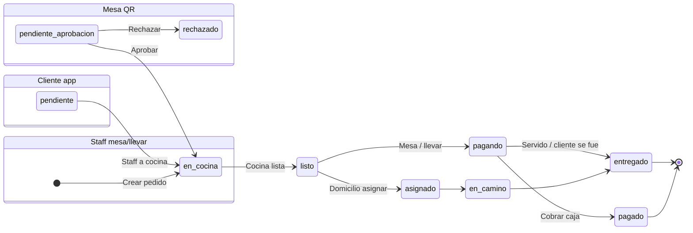

# Foody — flujo de estados de pedidos

> **Documento vivo** — actualizar si cambia `foody_backend/src/modulos/pedidos/pedido-estados.ts`  
> Implementación: `pedido-estados.ts`, `pedidos-estado.service.ts`, `PedidoAdminModel.accionRapida`

**Última actualización:** 2026-06-19 — P0 auditoría E2E: mesa no libera sin cobro; domicilio `entregado` solo desde `en_camino`; cobro contra entrega obligatorio.

---

## Principios

1. **«A cocina» = pedido confirmado** — no hay paso intermedio visible en el Kanban.
2. **`pendiente`** solo para pedidos que el staff debe revisar antes de cocina (cliente domicilio/llevar, domicilio creado por staff).
3. **`pendiente_aprobacion`** solo para mesa QR (cliente escaneó y mesero debe aprobar).
4. **`pagado`** solo vía caja (`POST /pedidos/:id/cobrar` o cobrar mesa), no con el botón del Kanban.
5. **`confirmado`** queda en BD por pedidos antiguos; en UI se muestra en columna **En cocina**.
6. **Mesa (`tipo=mesa` o `mesa_id`):** no usar botón Kanban «Entregado» — cerrar con **cobro** → `pagado` libera mesa.
7. **Domicilio:** `entregado` solo desde `en_camino` (app domiciliario); cobro contra entrega exige método de pago al confirmar.

---

## Flujo por tipo de pedido

### Mesa (staff: mesero/cajero/admin)

```
Crear pedido staff → en_cocina (stock se descuenta al crear)
  → listo → pagando → cobrar en caja → pagado (libera mesa)
```

### Mesa (cliente QR)

```
Cliente pide → pendiente_aprobacion
  → [Aprobar] → en_cocina
  → listo → pagando → cobrar → pagado (libera mesa)
  → [Rechazar] → rechazado
```

### Para llevar (staff)

```
Crear pedido → en_cocina
  → listo → pagando → entregado (sin mesa) | cobrar → pagado
```

### Para llevar / domicilio (cliente app)

```
Cliente pide → pendiente
  → [A cocina] staff → en_cocina
  → ...
```

### Domicilio

```
pendiente (cliente o staff) → en_cocina
  → listo → [asignar repartidor] → asignado → en_camino → entregado
  (sin pagando; cobro puede ser al crear o en caja según método de pago)
```

---

## Diagrama resumido



---

## Estados y significado

| Estado | Quién lo ve | Significado |
|--------|-------------|-------------|
| `pendiente_aprobacion` | Mesa QR | Esperando mesero/admin |
| `pendiente` | Cliente domi/llevar | Recibido, falta mandar a cocina |
| `en_cocina` | Todos | En preparación (KDS) |
| `listo` | Salón / domi | Listo para servir o despachar |
| `pagando` | Mesa / llevar | Cuenta presentada, falta cobrar o cerrar |
| `pagado` | Caja | Cobrado (terminal contable) |
| `asignado` | Domicilio | Repartidor asignado |
| `en_camino` | Domicilio | En ruta |
| `entregado` | Todos | Operación cerrada (comida entregada) |
| `cancelado` / `rechazado` | — | Fin anormal |

---

## Acciones rápidas Kanban (botón naranja)

| Estado actual | Mesa / llevar | Domicilio |
|---------------|---------------|-----------|
| Pendiente QR | Aprobar → `en_cocina` | — |
| Pendiente | A cocina | A cocina |
| En cocina | Listo | Listo |
| Listo | Pagando | Asignar repartidor (UI) |
| Pagando | Cobrar (sheet/caja) | — |
| En camino | — | Entregado |

**Cobro:** usar sheet de mesa o `POST /pedidos/:id/cobrar` → estado `pagado`.

---

## ¿Por qué se quitó «Confirmado»?

- Duplicaba «pendiente → confirmar → a cocina» cuando basta **pendiente → a cocina**.
- El stock se descuenta al entrar a **`en_cocina`** (o al crear pedido staff).
- La cocina (KDS) ya filtraba `confirmado` y `en_cocina`; un solo estado operativo reduce errores.

---

## Transiciones permitidas (backend)

Ver código fuente: `foody_backend/src/modulos/pedidos/pedido-estados.ts`

Cambio clave 2026-06-19 (P0): mesa bloquea `→ entregado` vía PATCH; domicilio `→ entregado` solo desde `en_camino`.

---

## Changelog

| Fecha | Cambio |
|-------|--------|
| 2026-06-19 | **P0 E2E:** mesa no libera sin cobro; domicilio sin saltar repartidor; KDS no regresa a `confirmado` |
| 2026-06-19 | Flujo unificado; sin columna Confirmado; aprobar QR → `en_cocina`; staff crea en `en_cocina`; fix ruta FCM cliente |
