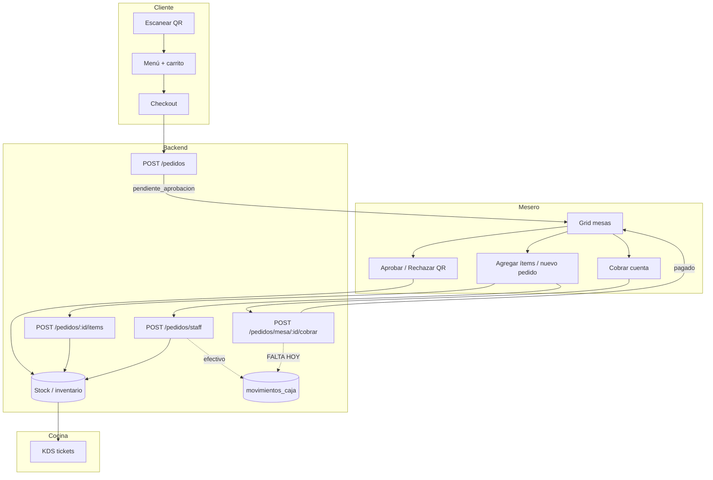

# Foody — Auditoría: mesas, pedidos, caja y roles

> **Propósito:** Validar que el flujo operativo de restaurante (mesas, meseros, caja, cocina, inventario) esté alineado con la spec (`INFRAESTRUCTURA/`) y con el código actual.  
> **Fecha:** 2026-06-12  
> **Estado del sistema:** parcialmente armónico — flujo principal usable; brechas críticas en **caja ↔ cobro mesa**, **Realtime cocina/domiciliario**, **eliminar ítem**, y **movimiento caja en QR pre-aprobación**.

**Documentos relacionados:** `INFRAESTRUCTURA/reglas_negocio_foody.md` · `endpoints_api_foody.md` · `foody_flujo_completo_pantallas.html` (A-MES, A-CAJ) · `docs/AVANCE_PROYECTO.md` · `docs/MULTI_SUCURSAL.md`

---

## Resumen de 1 minuto

| Pregunta | Respuesta |
|----------|-----------|
| **¿Qué flujo es el correcto (spec)?** | Mesa = cuenta viva durante la visita; varios pedidos por mesa; consumo en mesa + llevar/domi en la misma cuenta; cobro al final libera mesa. QR mesa requiere aprobación mesera (3 min). Stock al confirmar/aprobar. Caja: una abierta por sucursal; ventas registradas al cobrar. |
| **¿Qué flujo se usa hoy (código)?** | ✅ Cuenta acumulada (`total_acumulado`, agregar ítems, cobrar mesa). ✅ QR → `pendiente_aprobacion`. ✅ Staff mesa → `confirmado` directo. 🟡 Cobro mesa solo cambia estado a `pagado` **sin** movimiento de caja. 🟡 KDS y domiciliario planta **sin Realtime** (polling/manual). ❌ Eliminar ítem de pedido (spec A-MES-3) no implementado. |
| **¿Está todo conectado?** | Pedidos ↔ mesas ↔ stock: **sí** (transaccional). Pedidos ↔ caja: **parcial** (hueco en cobro mesa). Pedidos ↔ cocina: **sí** (API), Realtime **no**. Roles ↔ permisos: **coherente** salvo mesero sin caja (diseño). |
| **Próxima prioridad** | 1) Caja en `cobrarCuentaMesa`. 2) Realtime KDS + domiciliario. 3) `DELETE` ítem pedido. 4) Diálogo método de pago al cobrar mesa. |

---

## 1. Flujo correcto (especificación)

### 1.1 Modelo mental de restaurante real

```
Cliente sentado en MESA
    │
    ├── Pide en mesa (precio local) ──────────► pedido tipo=mesa
    ├── Pide más en la visita ────────────────► mismo pedido mesa O pedido adicional en mesa
    ├── Pide para llevar / domicilio ─────────► pedido tipo=para_llevar|domicilio, mesa_id conservado
    └── Paga y se va ─────────────────────────► todos los pedidos activos → pagado → mesa LIBRE
```

**Reglas clave** (`reglas_negocio_foody.md`):

| Regla | Valor spec |
|-------|------------|
| Varios pedidos abiertos por mesa | Sí |
| QR en mesa ocupada | Menú igual; pedido se agrega a la mesa |
| Cliente modifica pedido enviado | No |
| Aprobación mesera QR | 3 min recordatorio → 5 min alerta admin |
| Stock se descuenta | Al **confirmar/aprobar**, no al entregar |
| Caja abierta | Una por sucursal; gastos solo con caja abierta |

### 1.2 Estados del pedido (operación)

```
Cliente QR mesa     → pendiente_aprobacion → confirmado → en_cocina → listo → pagando → pagado/entregado
Staff mesa directo  → confirmado ────────────────────────────────────────────────► …
Para llevar/domi    → pendiente/confirmado → … → listo → (domi: asignado → en_camino → entregado)
```

**Nota spec vs código:** Kanban usa columna **Pagando** antes del cierre. `cobrarCuentaMesa` salta directo a **`pagado`** (válido operativamente, pero conviene unificar UX).

### 1.3 Roles y responsabilidades (objetivo)

| Rol | Mesas | Pedidos | Caja | Cocina | Inventario |
|-----|-------|---------|------|--------|------------|
| **Cliente (QR)** | Escanea, pide, sigue estado | POST público | No | No | No (backend valida) |
| **Mesero** | Grid, aprobar QR, agregar, cobrar cuenta | Crear staff, agregar ítems, marcar pagando | No abre | Ve estado cocina en sheet | No ajusta |
| **Cajero** | Puede crear pedido mesa/llevar | POS, descuentos, kanban | Abre/cierra, movimientos | No | No |
| **Cocina** | No | Marca ítems preparando/listo | No | KDS | No |
| **Admin/gerente** | CRUD mesas, transferir, QR | Todo + cancelar tardío + descuento alto | Todo + retiro parcial | Config cocinas | Ajustes stock |

---

## 2. Flujo implementado hoy (código)

### 2.1 Mapa de archivos

| Capa | Componente | Ruta |
|------|------------|------|
| Backend mesas | `MesasService` | `foody_backend/src/modulos/mesas/mesas.service.ts` |
| Backend pedidos | `PedidosService` | `foody_backend/src/modulos/pedidos/pedidos.service.ts` |
| Backend caja | `CajaService` | `foody_backend/src/modulos/caja/caja.service.ts` |
| Backend cocina | tickets KDS | `foody_backend/src/modulos/cocinas/cocina-tickets.controller.ts` |
| Realtime emit | `RealtimeBroadcastService` | `foody_backend/src/core/realtime/realtime-broadcast.service.ts` |
| Realtime Flutter | `FoodyRealtime` | `lib/core/realtime/foody_realtime.dart` |
| Grid mesas | `MesasGridWidget` | `lib/features/admin/presentation/widgets/mesas_grid_widget.dart` |
| Detalle mesa | `MesaPedidosSheet` | `lib/features/mesa/presentation/mesa_pedidos_sheet.dart` |
| POS staff | `PedidoCajeroScreen` | `lib/features/pedidos/presentation/pedido_cajero_screen.dart` |
| Panel mesero | `PanelMeseroScreen` | `lib/features/admin/presentation/panel_mesero_screen.dart` |
| Panel cajero | `PanelCajeroScreen` | `lib/features/admin/presentation/panel_cajero_screen.dart` |
| KDS | `KdsScreen` | `lib/features/cocinas/presentation/kds_screen.dart` |
| QR cliente | cadena mesa | `mesa_qr_entrada_screen` → menú → carrito → `checkout_screen` |

### 2.2 Endpoints activos (mesas / pedidos / caja)

#### Mesas (staff, JWT + `gestionar_mesas`)

| Método | Ruta | Uso |
|--------|------|-----|
| GET | `/mesas/:sucursal_id` | Grid con estado (pedido activo LATERAL) |
| POST | `/mesas` | Crear mesa |
| PATCH | `/mesas/:id` | Renombrar / activar |
| DELETE | `/mesas/:id` | Desactivar (bloquea si hay pedido activo) |
| GET | `/mesas/:id/qr` | Enlace QR (spec dice `qr-pdf`; hoy JSON/HTML) |
| POST | `/mesas/transferir` | Mover pedido mesa a otra mesa libre |

#### Pedidos staff

| Método | Ruta | Uso |
|--------|------|-----|
| GET | `/pedidos?solo_activos=true` | Kanban |
| GET | `/pedidos/mesa/:mesaId` | Cuenta acumulada + ítems + `total_acumulado` |
| POST | `/pedidos/staff` | Mesero/cajero crea pedido |
| POST | `/pedidos/:id/items` | **Agregar** a pedido abierto (cuenta acumulada) |
| POST | `/pedidos/mesa/:mesaId/cobrar` | **Cobrar** todos los pedidos activos de la mesa |
| PATCH | `/pedidos/:id/estado` | Kanban / pagando / cancelado |
| PATCH | `/pedidos/:id/aprobar` | Mesera aprueba QR |
| PATCH | `/pedidos/:id/rechazar` | Mesera rechaza QR (motivo) |
| POST | `/pedidos/:id/descuento` | Descuento manual |

#### Pedidos público (cliente)

| Método | Ruta | Uso |
|--------|------|-----|
| POST | `/pedidos` | Checkout cliente (QR mesa incluido) |
| GET | `/pedidos/:id/estado` | Seguimiento |
| GET | `/menu/mesa/:qr_token` | Entrada QR |

#### Caja

| Método | Ruta | Uso |
|--------|------|-----|
| GET | `/caja/activa/:sucursal_id` | ¿Hay caja abierta? |
| POST | `/caja/abrir` | Apertura turno |
| POST | `/caja/cerrar` | Cierre + arqueo |
| GET | `/caja/:caja_id/movimientos` | Movimientos del turno |

#### Cocina (rutas distintas a spec legacy)

| Método | Ruta spec antigua | Ruta real |
|--------|-------------------|-----------|
| Listar tickets | `GET /pedidos/cocina/:id` | `GET /cocina/tickets/:cocina_id` |
| Estado ítem | `PATCH /pedidos/items/:id/cocina-estado` | `PATCH /cocina/items/:item_id/estado` |

### 2.3 Lógica crítica backend

#### Crear pedido (`PedidosService.crear`)

| Origen | `tipo=mesa` estado inicial | Stock | Caja |
|--------|---------------------------|-------|------|
| Cliente QR | `pendiente_aprobacion` | Valida; **no descuenta** | Solo si `metodo_pago` ≠ pendiente |
| Staff mesero | `confirmado` | Valida + **descuenta** | Solo si método ≠ pendiente |
| Staff domicilio | `pendiente` | Valida; descuenta al confirmar | Igual |

Post-commit: `pedido_actualizado` + `estado_actualizado` (seguimiento cliente). **No** emite `mesas_actualizadas` en create (el grid se refresca vía `pedido_actualizado`).

#### Agregar ítems (`agregarItems`)

- Solo pedidos **no cerrados**.
- Recalcula subtotal/total/IVA en backend.
- Stock: valida siempre; descuenta si el pedido ya tenía `stock_descontado=true`.
- Caja: movimiento por **delta** si método de pago es efectivo/tarjeta/etc.
- Emite: `pedido_actualizado` + `mesas_actualizadas`.

#### Cobrar cuenta mesa (`cobrarCuentaMesa`)

- Todos los pedidos activos de la mesa → `pagado`.
- `liberarMesaSiSinPedidosActivos` → quita `mesera_asignada_id`.
- Emite Realtime por cada pedido + `mesas_actualizadas`.
- **⚠️ BRECHA:** no llama `registrarVentaEnCaja` → el turno de caja **no refleja** ese cobro.

#### Mesa ocupada vs libre (`MesasService.listarConEstado`)

Pedido activo = estado **NOT IN** (`entregado`, `cancelado`, `rechazado`, `pagado`).

---

## 3. Pasos operativos (guía paso a paso)

### 3.A Cliente — pedido por QR

| Paso | Quién | Acción | API / pantalla | Resultado |
|------|-------|--------|----------------|-----------|
| 1 | Cliente | Escanea QR | `/mesa/:qrToken` | `GET /menu/mesa/:token` |
| 2 | App | Fija sesión mesa | `MesaSesionService.activar` | No puede cambiar ciudad/sucursal |
| 3 | Cliente | Arma carrito | `MenuScreenFoody` → `CarritoScreen` | Estado local UI |
| 4 | Cliente | Checkout | `CheckoutScreen` | `tipo=mesa`, `mesa_id` |
| 5 | Backend | Crea pedido | `POST /pedidos` | `pendiente_aprobacion` |
| 6 | Mesero | Ve mesa naranja | `MesasGridWidget` + Realtime | Pulso + sheet aprobación |
| 7 | Mesero | Aprueba | `PATCH /pedidos/:id/aprobar` | `confirmado`, stock descontado, mesera asignada |
| 8 | Cocina | Ve ticket | `KdsScreen` (poll 8s) | Ítems pendientes |
| 9 | Cliente | Pide más | Repite 3–5 | **Nuevo** pedido en misma mesa (spec) |
| 10 | Mesero | Cobrar al irse | `POST /pedidos/mesa/:id/cobrar` | Mesa libre |

### 3.B Mesero — mesa libre (sin QR)

| Paso | Acción | API | Resultado |
|------|--------|-----|-----------|
| 1 | Tap mesa verde | `MesasGridWidget` modo mesero | Diálogo «Crear pedido» |
| 2 | POS: combo + confirmar | `POST /pedidos/staff` | `confirmado`, mesa ocupada |
| 3 | Cliente pide gaseosa | Mesa ocupada → **Agregar** | `POST /pedidos/:id/items` | Mismo pedido, total sube |
| 4 | Combo para llevar | **Agregar** → tipo Llevar | `POST /pedidos/staff` con `mesa_id` | Segundo pedido en mesa |
| 5 | Ver cuenta | Tap mesa → sheet | `GET /pedidos/mesa/:id` | `total_acumulado` |
| 6 | Cobrar | **Cobrar cuenta** | `POST /pedidos/mesa/:id/cobrar` | Mesa libre |

### 3.C Cajero — turno de caja

| Paso | Acción | API | Notas |
|------|--------|-----|-------|
| 1 | Login cajero | `/admin/login` | Permiso `ver_caja`, `abrir_caja` |
| 2 | Abrir caja | `POST /caja/abrir` | Obligatorio antes de POS (UI bloquea aviso) |
| 3 | Nuevo pedido llevar | `PedidoCajeroScreen` | `POST /pedidos/staff`, `tipo=para_llevar` |
| 4 | Con efectivo | `metodo_pago=efectivo` | **Sí** crea `movimientos_caja` tipo venta |
| 5 | Descuento | Kanban o API | `POST /pedidos/:id/descuento` |
| 6 | Cierre | `POST /caja/cerrar` | Diferencia > $5.000 → alerta |

**Mesero vs cajero:** mesero **no** abre caja ni aplica descuentos (permisos BD). Coherente con restaurante donde mesero cobra en mesa y cajero cierra turno — **pero** hoy el cobro mesa no alimenta caja (brecha).

### 3.D Cocina — KDS

| Paso | Acción | API | Realtime |
|------|--------|-----|----------|
| 1 | Login cocina | staff JWT | — |
| 2 | Ver tickets | `GET /cocina/tickets/:cocina_id` | ❌ Poll cada **8 s** |
| 3 | Marcar preparando/listo | `PATCH /cocina/items/:item_id/estado` | Backend emite `pedido_actualizado` (mesero/kanban sí escuchan) |

### 3.E Domiciliario planta

| Paso | Acción | Realtime hoy |
|------|--------|--------------|
| 1 | Pedido domi → listo | Dispatch automático | — |
| 2 | Asignación | API planta | ❌ Dashboard **solo refresh manual** |
| 3 | En camino / entregado | PATCH estado | Kanban admin sí tiene Realtime |

---

## 4. Simulaciones — escenarios reales

Cada simulación indica: **qué pasa hoy**, **¿armónico?**, **acción si falla**.

### Escenario 1 — Combo + gaseosa + llevar (tu caso)

| # | Evento | Sistema | ¿OK? |
|---|--------|---------|------|
| 1 | Mesero: combo en mesa 3 | `POST /pedidos/staff` → pedido A, `confirmado` | ✅ |
| 2 | Cliente pide gaseosa | Mesero **Agregar** → `POST /pedidos/A/items` | ✅ |
| 3 | Antes de irse: otro combo llevar | **Agregar** tipo Llevar → pedido B, misma `mesa_id` | ✅ |
| 4 | Ver total | Sheet: combo+gaseosa (A) + combo llevar (B) + domi si aplica | ✅ `total_acumulado` |
| 5 | Paga y se va | **Cobrar cuenta** → A y B → `pagado`, mesa verde | ✅ mesa |
| 6 | Turno caja | Movimientos caja | ❌ **No registra cobro** (brecha) |

### Escenario 2 — Cliente QR sin mesero cerca

| # | Evento | Sistema | ¿OK? |
|---|--------|---------|------|
| 1 | Cliente escanea, pide | `pendiente_aprobacion` | ✅ |
| 2 | Grid mesero | Naranja pulsante + timer 3/5 min UI | ✅ visual |
| 3 | Pasan 5 min sin aprobar | Alerta admin automática | ❌ **No hay job/FCM** (pospuesto S7) |
| 4 | Mesero aprueba | Stock descuenta, cocina recibe | ✅ |
| 5 | Mesero rechaza | Stock no descontado, mesa libre si no hay más pedidos | ✅ |

### Escenario 3 — Dos meseras, misma mesa

| # | Evento | Sistema | ¿OK? |
|---|--------|---------|------|
| 1 | Mesera Ana toma mesa 5 | `mesera_asignada_id = Ana` | ✅ |
| 2 | Mesera Beatriz intenta agregar | `MESA_ASIGNADA_OTRA_MESERA` + SnackBar Flutter | ✅ |
| 3 | Admin transfiere mesa | `POST /mesas/transferir` | ✅ |
| 4 | >2 transferencias mismo pedido | Alerta riesgo baja | ✅ |

### Escenario 4 — Stock se acaba mid-servicio

| # | Evento | Sistema | ¿OK? |
|---|--------|---------|------|
| 1 | Combo vendido, stock justo | Primer pedido OK | ✅ |
| 2 | Agregar ítem sin stock | `STOCK_INSUFICIENTE` + detalles | ✅ |
| 3 | Cliente QR pide producto agotado | Oculto en menú si `disponible=false` | ✅ |
| 4 | Costeo/margen | `margenes_venta` al insertar ítem | ✅ |

### Escenario 5 — Cliente quiere cancelar ítem ya en cocina

| # | Evento | Spec | Sistema | ¿OK? |
|---|--------|------|---------|------|
| 1 | Ítem en `en_cocina` | Mesero elimina con motivo → alerta alta | `DELETE /pedidos/:id/items/:item_id` | ❌ **No existe** |
| 2 | Workaround | Cancelar pedido entero (admin) | `PATCH estado=cancelado` | 🟡 Parcial |

### Escenario 6 — Cajero con caja cerrada

| # | Evento | Sistema | ¿OK? |
|---|--------|---------|------|
| 1 | Cajero abre POS sin caja | Banner aviso; pedido **sí se crea** | 🟡 Backend no exige caja abierta |
| 2 | Pedido efectivo | `registrarVentaEnCaja` skip silencioso | 🟡 Venta “perdida” en caja |

### Escenario 7 — QR pide con tarjeta en checkout

| # | Evento | Sistema | ¿OK? |
|---|--------|---------|------|
| 1 | Cliente elige tarjeta | `POST /pedidos` + `metodo_pago=tarjeta` | ✅ |
| 2 | Estado aún `pendiente_aprobacion` | **Ya hay movimiento caja venta** | ❌ **Desalineado** (cobró antes de aprobar) |
| 3 | Mesero rechaza | Restaura stock | ✅ stock |
| 4 | | Revierte movimiento caja | ❌ **No revierte** |

### Escenario 8 — Domiciliario recibe pedido nuevo

| # | Evento | Sistema | ¿OK? |
|---|--------|---------|------|
| 1 | Admin asigna en kanban | `PATCH estado` | ✅ |
| 2 | Domiciliario en app | Debe hacer pull-to-refresh | ❌ Sin Realtime |
| 3 | Independiente | Poll 15 s ofertas | 🟡 Aceptable para ofertas, no ideal |

### Escenario 9 — Cierre de caja con mesas ocupadas

| # | Evento | Sistema | ¿OK? |
|---|--------|---------|------|
| 1 | Mesas con pedidos `pagando` | Caja puede cerrar | 🟡 No hay regla que impida cierre |
| 2 | Cobros mesa no en movimientos | Cuadre incorrecto | ❌ Brecha caja |

### Escenario 10 — Multi-sucursal

| # | Evento | Sistema | ¿OK? |
|---|--------|---------|------|
| 1 | Mesero Norte ve mesas Sur | JWT `sucursal_id` | ✅ aislado |
| 2 | Admin corporativo | Selector sucursal pedidos/caja | 🟡 Fase 1 parcial |
| 3 | Módulo mesas scope guard | Sin `SucursalScopeService` en controller mesas | 🟡 Fase 2 |

---

## 5. Matriz de conexiones (armonía del sistema)

| De → A | Conexión | Estado | Detalle |
|--------|----------|--------|---------|
| Pedido → Mesa | `pedidos.mesa_id` | ✅ | LATERAL en listado mesas |
| Pedido → Stock | `PedidosInventarioService` | ✅ | Validar crear/agregar; descontar confirmar/aprobar |
| Pedido → Costeo | `margenes_venta` por ítem | ✅ | Al insertar línea |
| Pedido → Caja (crear staff efectivo) | `movimientos_caja` venta | ✅ | Si caja abierta |
| Pedido → Caja (cobrar mesa) | — | ❌ | **Falta implementar** |
| Pedido → Caja (QR tarjeta pre-aprobación) | venta prematura | ❌ | Mover caja a cobro/aprobación |
| Mesa → Mesera | `mesas.mesera_asignada_id` | ✅ | Asigna al confirmar/aprobar staff |
| Mesa → Realtime grid | `pedido_actualizado` / `mesas_actualizadas` | ✅ | `MesasGridWidget` |
| Cocina → Mesero | estado ítem en sheet | ✅ | Via GET mesa (sin RT ítem) |
| Kanban → Realtime | `pedido_actualizado` | ✅ | `PedidosKanbanWidget` |
| Cliente seguimiento → Realtime | `estado_actualizado` canal pedido | ✅ | `SeguimientoPedidoScreen` |
| Domiciliario → Realtime | — | ❌ | Manual refresh |
| KDS → Realtime | — | ❌ | Poll 8 s |
| Alertas riesgo | transferencias, descuentos, stock | ✅ | Parcial según trigger |

---

## 6. Realtime — estado y obligatoriedad

### 6.1 Infraestructura actual

**Backend** (`RealtimeBroadcastService`):

| Evento | Canal | Payload |
|--------|-------|---------|
| `pedido_actualizado` | `sucursal_{id}` | pedido_id, estado, numero_pedido |
| `mesas_actualizadas` | `sucursal_{id}` | sucursal_id |
| `estado_actualizado` | `pedido_{id}` | pedido_id, estado |

**Flutter** (`FoodyRealtime`):

| Suscriptor | Eventos escuchados |
|------------|-------------------|
| `MesasGridWidget` | sucursal: pedido + mesas |
| `PedidosKanbanWidget` | sucursal: pedido + mesas |
| `SeguimientoPedidoScreen` | pedido: estado |

### 6.2 Dónde Realtime es **obligatorio** (restaurante real)

| Pantalla | Prioridad | Hoy | Acción requerida |
|----------|-----------|-----|------------------|
| Grid mesas (QR pendiente) | 🔴 Alta | ✅ | Mantener; opcional: emitir `mesas_actualizadas` también en `crear()` QR |
| Kanban pedidos admin/cajero | 🔴 Alta | ✅ | OK |
| Seguimiento cliente | 🔴 Alta | ✅ | OK |
| **KDS cocina** (ticket nuevo) | 🔴 Alta | ❌ Poll 8s | Emitir `cocina_ticket_nuevo` o reutilizar `pedido_actualizado` filtrado; suscribir `KdsScreen` |
| **Dashboard domiciliario planta** | 🔴 Alta | ❌ Manual | Suscripción sucursal → recargar asignaciones |
| **Ofertas domiciliario independiente** | 🟡 Media | Poll 15s | Realtime al crear oferta (`dispatch`) |
| MesaPedidosSheet (detalle) | 🟡 Media | ❌ Solo al abrir sheet | Suscribir mientras sheet visible |
| Panel cajero movimientos | 🟡 Media | ❌ | Refrescar al `pedido_actualizado` si venta registrada |
| Alertas admin dashboard | 🟡 Media | ❌ | Evento `alerta_nueva` (futuro) |

### 6.3 Plan de implementación Realtime (pasos)

**Fase RT-1 — Cocina (1 sesión)**

1. Backend: en `crear` / `aprobarMesa` / `agregarItems`, si hay ítems con `cocina_id`, emitir broadcast `cocina_actualizada` en canal `sucursal_{id}` (o reutilizar `pedido_actualizado` con flag).
2. Flutter `FoodyRealtime`: añadir listener `cocina_actualizada`.
3. `KdsScreen`: suscribir en `initState`, cancelar poll o reducir a 60s fallback.
4. Probar: pedido mesa → ticket aparece < 2s sin refresh.

**Fase RT-2 — Domiciliario planta (1 sesión)**

1. Backend: al asignar domiciliario (`asignaciones_domicilio`), emitir `domicilio_asignado` con `domiciliario_id`.
2. Canal: `domiciliario_{usuario_id}` o filtrar en cliente.
3. `DashboardDomiciliarioScreen`: suscribir + `_cargar()` en evento.
4. Mantener botón refresh manual como respaldo.

**Fase RT-3 — Detalle mesa vivo**

1. `MesaPedidosSheet`: `FoodyRealtime.suscribirSucursal` mientras mounted → `_cargar()`.

---

## 7. Caja ↔ roles — validación restaurante real

| Situación real | Comportamiento esperado | Comportamiento actual | Gap |
|----------------|-------------------------|----------------------|-----|
| Mesero cobra efectivo en mesa | Entra al turno caja abierto | Solo `pagado` en BD | ❌ |
| Cliente QR paga tarjeta al pedir | Caja al **cobrar/aprobar** | Caja al **crear** | ❌ |
| Rechazo QR con pago registrado | Reversar venta caja | No revierte | ❌ |
| Cajero vende mostrador | Venta inmediata | ✅ si efectivo + caja abierta | ✅ |
| Mesero vende sin caja | ¿Permitir operación? | Sí, sin movimiento | 🟡 Definir política |
| Fiado / cuenta por cobrar | Módulo caja | ✅ API existe | 🟡 UI parcial |
| Cierre con mesas abiertas | Política: advertir o bloquear | No valida | 🟡 |

### Corrección caja recomendada (orden)

1. **`cobrarCuentaMesa`:** por cada pedido cobrado, `registrarVentaEnCaja(total, metodo_pago)` (diálogo UI método pago).
2. **QR mesa:** no registrar caja en `crear` si `pendiente_aprobacion`; registrar en `aprobarMesa` o en cobro final según política del restaurante.
3. **`rechazarMesa`:** si hubo movimiento caja, insertar movimiento compensatorio o no crear venta hasta aprobación.
4. **UI mesero cobro:** selector efectivo/tarjeta/transferencia/nequi (hoy hardcode `efectivo`).

---

## 8. Inventario, stock y costeo

| Momento | Acción | Implementado |
|---------|--------|--------------|
| Crear pedido (staff confirmado) | Validar + descontar | ✅ |
| Crear pedido (QR) | Validar; descontar al aprobar | ✅ |
| Agregar ítem a pedido abierto | Validar + descontar si ya confirmado | ✅ |
| Cancelar / rechazar | Restaurar stock | ✅ |
| Combo | Expande productos en inventario | ✅ |
| Empaque domicilio | `incluirEmpaques: tipo===domicilio` | ✅ |
| Alerta stock en pedido fallido | `STOCK_INSUFICIENTE` + detalles | ✅ |
| Costo al momento venta | `margenes_venta` | ✅ |
| Impacto costeo en admin | `GET /costeo/...` | ✅ (parcial Fase C) |

**Coherencia:** inventario y pedidos están bien conectados. El costeo refleja márgenes por línea de pedido; no hay brecha crítica en mesas.

---

## 9. Brechas vs documentación (`INFRAESTRUCTURA/`)

| Ítem spec | Estado | Notas |
|-----------|--------|-------|
| Varios pedidos por mesa | ✅ | |
| Cuenta acumulada + agregar ítems | ✅ | Extensión 2026-06-12 |
| Cobrar cuenta mesa | 🟡 | Falta caja + método pago UI |
| A-MES-3 eliminar ítem | ❌ | `DELETE` no implementado |
| Timer 3/5 min + FCM admin | 🟡 | Solo UI timer; sin push |
| QR PDF impreso | ❌ | Solo link HTML |
| Asignación mesas por turno (admin) | ❌ | Campo BD sí; UI admin no |
| Impresión ticket cocina (S10) | ❌ | Python pendiente |
| Endpoints cocina nombres legacy | 🟡 | Doc desactualizado |
| Multi-sucursal mesas scope | 🟡 | Fase 2 |

---

## 10. Checklist de validación manual (QA paso a paso)

Usar en entorno local (`docs/ENTORNO_LOCAL.md`). Reiniciar backend después de cambios.

### Bloque A — Mesa básica (mesero)

- [ ] Login `mesero@foody.demo` / `123456` → `/admin/mesero`
- [ ] Mesa libre → crear combo → mesa naranja/roja (ocupada)
- [ ] Mesa ocupada → Agregar → gaseosa → total sube en sheet
- [ ] Agregar → tipo Llevar → segundo pedido en lista
- [ ] `total_acumulado` = suma de ambos
- [ ] Cobrar cuenta → mesa verde
- [ ] Verificar kanban: pedidos desaparecen o pasan a pagado

### Bloque B — QR cliente

- [ ] Abrir `/mesa/demo-mesa-1` (o token seed)
- [ ] Pedir producto → seguimiento `pendiente_aprobacion`
- [ ] En grid mesero: mesa naranja pulsante
- [ ] Aprobar → estado confirmado; cocina ve ticket (≤8s o instantáneo post-RT)
- [ ] Segundo pedido QR misma mesa → aparece en sheet mesa

### Bloque C — Caja (cajero)

- [ ] Login cajero → abrir caja con monto inicial
- [ ] Pedido llevar efectivo → movimiento venta en caja
- [ ] **Pendiente fix:** cobrar mesa → debe aparecer movimiento
- [ ] Cierre caja → cuadre

### Bloque D — Stock

- [ ] Producto sin stock → agregar ítem falla con mensaje claro
- [ ] Rechazar QR → stock no descontado (si no aprobó)

### Bloque E — Realtime

- [ ] Dos navegadores: kanban + mesero → crear pedido en uno → otro actualiza sin F5
- [ ] Seguimiento cliente → mesero cambia estado → cliente ve cambio
- [ ] **Pendiente:** cocina sin F5; domiciliario sin F5

---

## 11. Roadmap de cierre de brechas (orden sugerido)

| # | Tarea | Sprint | Archivos principales |
|---|-------|--------|----------------------|
| 1 | Caja en `cobrarCuentaMesa` + UI método pago | S4 | `pedidos.service.ts`, `mesa_pedidos_sheet.dart` |
| 2 | No venta caja en QR hasta aprobar/cobrar | S4 | `pedidos.service.ts`, `pedidos-caja-auditoria.service.ts` |
| 3 | Realtime KDS | S4 | `realtime-broadcast.service.ts`, `kds_screen.dart`, `foody_realtime.dart` |
| 4 | Realtime domiciliario planta | S7 | `domiciliarios*.ts`, `dashboard_domiciliario_screen.dart` |
| 5 | `DELETE /pedidos/:id/items/:item_id` + alerta cocina | S4 | nuevo en `pedidos.controller.ts` |
| 6 | Realtime `MesaPedidosSheet` | S4 | `mesa_pedidos_sheet.dart` |
| 7 | Admin UI asignación mesas turno | S4+ | nuevo screen admin |
| 8 | FCM timer 3/5 min QR | S7 | pospuesto por acuerdo |
| 9 | PDF QR mesa | S5 | `mesas.service.ts` |
| 10 | Scope multi-sucursal mesas | Fase 2 | `mesas.controller.ts` |

---

## 12. Diagrama de flujo unificado (mesas + pedidos + caja)



---

## 13. Conclusión

**El flujo de mesas y pedidos está conectado y cubre el caso real principal** (cuenta viva, agregar consumo, llevar/domi en la misma mesa, liberar al cobrar). La spec de negocio y el código reciente (2026-06-12) van en la **misma dirección**.

**No está plenamente armónico con caja:** el cobro de mesa y parte del flujo QR desincronizan el turno de caja del resto del POS. **Realtime** cubre mesas/kanban/cliente pero **no cocina ni domiciliario**, lo que en hora pico genera retrasos operativos.

Usar este documento como guía de QA (sección 10) y roadmap (sección 11). Actualizar `docs/AVANCE_PROYECTO.md` al cerrar cada ítem del roadmap.

---

*Generado por auditoría de código + spec — 2026-06-12.*
