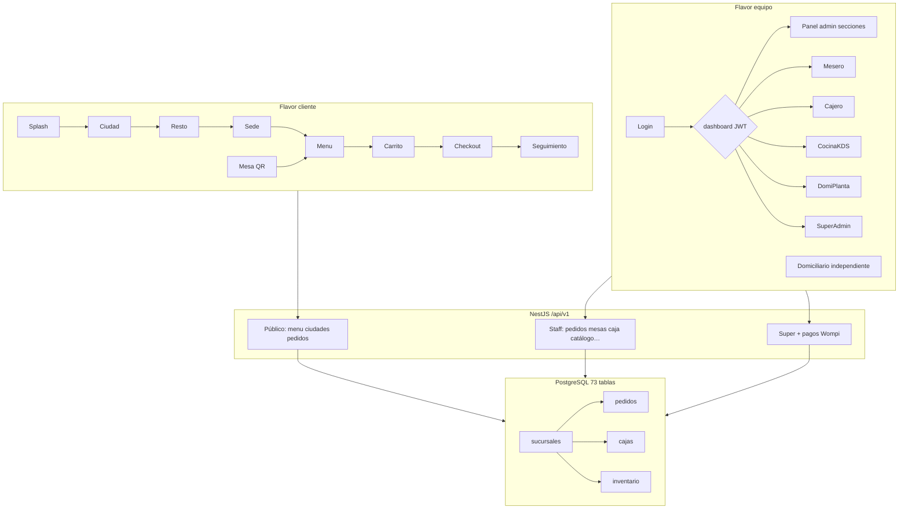

# MAPA_FOODY — mapa de referencia del proyecto

> **Propósito:** inventario vivo para prompts siguientes (auditoría, tests, refactors).  
> **No sustituye** `MASTER_STATUS.md` (estado del producto) ni `AVANCE_PROYECTO.md` (changelog + refs técnicas).  
> **Generado:** 2026-08-05 · fuente: código en `foody_backend/src`, `lib/features`, `foody_supabase/migrations`, `scripts/verificar-*.ps1`.

**Stack:** Flutter (UI) · NestJS (`/api/v1`) · PostgreSQL (Supabase self-hosted) · Cloudflare R2/Storage · FCM · Python impresión · Hetzner VPS/Nginx.

---

## Índice

1. [Convenciones API](#1-convenciones-api)
2. [Árbol backend NestJS](#2-árbol-backend-nestjs)
3. [Endpoints HTTP](#3-endpoints-http)
4. [Pantallas Flutter por rol](#4-pantallas-flutter-por-rol)
5. [Base de datos (73 tablas + FKs)](#5-base-de-datos)
6. [Cobertura de tests](#6-cobertura-de-tests)
7. [Diagrama mental](#7-diagrama-mental)

---

## 1. Convenciones API

| Ítem | Valor |
|------|--------|
| Prefijo | `/api/v1` |
| Respuesta OK | `{ exito, datos, mensaje }` |
| Respuesta error | `{ exito: false, error, mensaje }` |
| Guard global | `RateLimitGuard` |
| Interceptor | `RespuestaInterceptor` |
| Auth staff típica | `JwtAuthGuard` → `UsuarioActivoGuard` → `SuscripcionActivaGuard` → (`PlanFeaturesGuard`) → `RolGuard` |
| Permisos | `@Permisos('a','b')` (OR) + `RolGuard` |
| Features plan | `@RequiereModulo('…')` + `PlanFeaturesGuard` |
| Rate público | `@RateLimitPublico(n, ms)` |
| Omitir suscripción | `@OmitirSuscripcionActiva()` |

**Abreviaturas guards:** JWT · UA · SA · PF · ROL · SUPER · DI (`DomiciliarioIndependienteGuard`) · DC (`DomiciliarioCuentaGuard`) · RL-pub · OmitSA · Mod.

---

## 2. Árbol backend NestJS

### 2.1 Core (`foody_backend/src/core/`)

| Módulo | Controllers | Services | DTOs / guards | Propósito |
|--------|-------------|----------|---------------|-----------|
| `auth/` | `AuthController` | `AuthService`, `SupabaseAuthService`, `SucursalScopeService`, `PlanFeaturesService`, `SuscripcionesVencimientoService` | Login/Registro DTOs; Jwt/UsuarioActivo/Suscripcion/Rol/SuperAdmin/PlanFeatures/Domiciliario* | Login staff/domi, registro, JWT, FCM, scope multi-sede, plan |
| `database/` | — | `DatabaseService`, `TransactionHooksService` | — | Pool PG + hooks post-tx |
| `cache/` | — | `MenuCacheService` | — | Cache menú público |
| `caja/` | — | `CajaMovimientosService` | — | Movimientos caja compartidos |
| `impresion/` | `ImpresionController` | `ImpresionService` | — | Cola tickets → agente Python |
| `onboarding/` | — | `OnboardingRestauranteService` | — | Alta restaurante self-service |
| `realtime/` | — | `RealtimeBroadcastService` | — | Broadcast Supabase Realtime |
| `suscripciones/` | — | `SuscripcionesCronService` | — | Cron vencimiento SaaS |
| `config/` | — | `validar-config-produccion` | — | Validación env prod |

### 2.2 Compartido (`src/compartido/`)

Decoradores (`Permisos`, `UsuarioActual`, `RequiereModulo`, `OmitirSuscripcionActiva`), `PaginacionQueryDto`, `HttpExceptionFilter`, `RateLimitGuard`, `RespuestaInterceptor`.

### 2.3 Módulos de dominio (`src/modulos/`)

| Módulo | Controllers | Services clave | DTOs (archivos) | Propósito negocio |
|--------|-------------|----------------|-----------------|-------------------|
| `salud/` | `SaludController`, `HealthController` | `SaludService` | — | Healthchecks API/DB/RT/impresión |
| `ciudades/` | `CiudadesController` | `CiudadesService` | — | Catálogo ciudades + restos por slug |
| `restaurantes/` | `RestaurantesController`, `SucursalesStaffController` | `RestaurantesService` | CrearSucursal, Horario, Marca | Sucursales públicas + staff marca/horarios |
| `menu/` | `MenuController` | `MenuService` | — | Menú público / QR mesa |
| `dashboard/` | `DashboardController` | `DashboardService` | — | KPIs día / gráficos / consolidado |
| `pedidos/` | `PedidosController`, `PedidosPublicController` | 12 services (crear, items, estado, pagos, QR cron…) | CrearPedido, CobrarMesa, Descuento, Aprobar… | Cerebro pedidos cliente+staff |
| `dispositivos/` | `DispositivosController` | `DispositivosService` | — | device_id FCM + vínculo Google |
| `mesas/` | `MesasController` | `MesasService`, `MesasReservaCronService` | Crear/Actualizar/Transferir/Reservar/Unir… | Plano mesas, QR, turnos |
| `super-admin/` | `SuperAdminController` | `SuperAdminService` | Ciudades, Restos, Suscripciones, Usuarios, Docs | Panel SaaS Foody |
| `caja/` | `CajaController` | `CajaService` | Abrir/Cerrar/Retiro/Gasto/Devolución/CxC | Caja y fiados |
| `catalogo/` | Categorias, Productos, Toppings, Bebidas, Combos | `CatalogoService`, `CatalogoDisponibilidadService` | CRUD catálogo | Menú operativo admin |
| `cocinas/` | Cocinas, CocinaTickets, Impresoras | `CocinasService` | Cocina, Impresora, EstadoItem | Estaciones + KDS + impresoras |
| `inventario/` | `InventarioController` | `InventarioService` | Ingrediente, Compra, Receta, Conteo, Traslado | Stock multi-sede |
| `domiciliarios/` | Planta, App planta, Independientes, Documentos | Service + Independientes + Docs + Dispatch | Asignar, Entrega, Sesión, Oferta… | Planta + independientes + KYC |
| `reportes/` | `ReportesController` | `ReportesService` | `FiltroReporteDto` | Reportes por fechas |
| `analitica/` | `AnaliticaController` | `AnaliticaService` | `FiltroAnaliticaDto` | BI + export CSV + rentabilidad |
| `finanzas/` | `FinanzasController` | `FinanzasService` | costos-fijos, empleados, gastos, pagar* | Gastos fijos + nómina simple |
| `alertas/` | `AlertasController` | `AlertasService`, `AlertasRiesgoService` | — | Alertas + riesgo programado |
| `usuarios/` | `UsuariosController` | `UsuariosService` | Crear/Actualizar/Estado | Staff sucursal |
| `facturacion/` | `FacturacionController` | `FacturacionService` | `GuardarConfigFiscalDto` | Fiscal/DIAN (pausable) |
| `zonas/` | `ZonasController` | `ZonasService` | Zona, Ubicación, Cotizar | Cobertura domicilio |
| `promociones/` | `PromocionesController` | `PromocionesService`, Cron | Crear/Actualizar/Vista | Stories + códigos |
| `costeo/` | `CosteoController` | `CosteoService` | Subreceta, Producción, Popularidad | Costos / producciones |
| `geografia/` | `GeografiaController` | `GeografiaService` | — | Autocomplete Photon/OSM |
| `notificaciones/` | `NotificacionesController` | Fcm + Notificaciones + Cron | — | Cola FCM |
| `auditoria/` | `AuditoriaController` | `AuditoriaService` | — | Timeline turno (lectura) |
| `pagos/` | `PagosController` | Pagos + Wompi + Recurrentes | Checkout, Sync | Planes SaaS Wompi |
| `almacenamiento/` | `AlmacenamientoController` | `AlmacenamientoService` | — | Upload imágenes/video |

**Nota:** `AppController` existe en disco pero **no** está en `AppModule` (scaffold muerto).

---

## 3. Endpoints HTTP

Todas las rutas bajo `/api/v1`. Salida tipada vía interceptor (`datos`); abajo se indica el contrato de entrada.

### 3.1 Auth · Salud · Público

| Método | Ruta | Guards | Entrada | Salida (datos) |
|--------|------|--------|---------|----------------|
| POST | `/auth/login` | RL-pub 15/60s | `LoginDto` | JWT + perfil |
| POST | `/auth/login-domiciliario` | RL-pub | `LoginDto` | JWT independiente |
| POST | `/auth/registro-domiciliario` | RL-pub 10 | `RegistroDomiciliarioDto` | alta |
| POST | `/auth/registro-restaurante` | RL-pub 5 | `RegistroRestauranteDto` | resto + admin |
| POST | `/auth/login-google` | RL-pub 20 | `LoginGoogleDto` | JWT |
| GET | `/auth/perfil` | OmitSA+JWT+UA+SA | — | perfil |
| POST | `/auth/registrar-fcm` | idem | `{ fcm_token, plataforma? }` | ok |
| POST | `/auth/desactivar-fcm` | idem | `{ fcm_token? }` | ok |
| GET | `/salud` | — | — | salud básica |
| GET | `/health` | — | — | consolidada |
| GET | `/health/realtime` | — | — | Realtime |
| GET | `/health/impresion` | — | — | agente impresión |
| GET | `/ciudades` | — | — | ciudades |
| GET | `/ciudades/:slug/restaurantes` | — | — | restos |
| GET | `/restaurantes/:id/sucursales` | — | — | sedes |
| GET | `/menu/:sucursal_id` | — | — | menú |
| GET | `/menu/mesa/:qr_token` | — | — | menú + mesa |
| GET | `/geografia/buscar` | — | `q`, lat?, lng? | direcciones |
| GET | `/zonas/cotizar-domicilio` | — | sucursal_id, lat?, lng? | cotización |

### 3.2 Pedidos (público + staff)

| Método | Ruta | Guards / permisos | Entrada |
|--------|------|-------------------|---------|
| POST | `/pedidos` | RL-pub | `CrearPedidoDto` |
| GET | `/pedidos/mios` | RL-pub | `device_id` (+ Bearer Supabase opcional) |
| POST | `/pedidos/:id/cancelar` | RL-pub | `CancelarPedidoClienteDto` |
| POST | `/pedidos/:id/llamar-mesera` | RL-pub | `LlamarMeseraClienteDto` |
| POST | `/pedidos/:id/calificar` | RL-pub | `CalificarDomicilioClienteDto` |
| GET | `/pedidos/:id/estado` | RL-pub | device_id?, token? |
| GET | `/pedidos` | JWT…+ROL `ver_pedidos` | query paginación |
| GET | `/pedidos/cerrados-hoy` | `ver_pedidos` | — |
| GET | `/pedidos/:id/detalle` | `ver_pedidos` | — |
| GET | `/pedidos/mesa/:mesaId` | `ver_pedidos` | — |
| POST | `/pedidos/mesa/:mesaId/cobrar` | ver_pedidos\|crear_pedido | `CobrarMesaDto` |
| POST | `/pedidos/staff` | `crear_pedido` | `CrearPedidoDto` |
| POST | `/pedidos/:id/items` | `crear_pedido` | `AgregarItemsPedidoDto` |
| PATCH | `/pedidos/:id/items/:itemId` | `crear_pedido` | `ActualizarItemPedidoDto` |
| DELETE | `/pedidos/:id/items/:itemId` | `crear_pedido` | `{ motivo? }` |
| PATCH | `/pedidos/:id/estado` | `ver_pedidos` | `CambiarEstadoPedidoDto` |
| POST | `/pedidos/:id/descuento` | `aplicar_descuento` | `AplicarDescuentoDto` |
| POST | `/pedidos/:id/cobrar` | crear_pedido\|ver_pedidos | `CobrarMesaDto` |
| PATCH | `/pedidos/:id/items/:itemId/comensal` | crear\|ver | `ActualizarComensalDto` |
| PATCH | `/pedidos/:id/aprobar` | `aprobar_pedido_mesa` | `AprobarPedidoMesaDto` |
| PATCH | `/pedidos/:id/rechazar` | `aprobar_pedido_mesa` | `{ motivo }` |

### 3.3 Dispositivos · Mesas · Sucursales staff · Dashboard

| Método | Ruta | Guards / permisos | Entrada |
|--------|------|-------------------|---------|
| POST | `/dispositivos/registrar` | RL-pub | device_id, fcm?, ciudad?, plataforma? |
| POST | `/dispositivos/vincular-auth` | RL-pub | device_id, access_token |
| DELETE | `/dispositivos/anonimizar/:device_id` | RL-pub | — |
| GET/POST/PATCH/DELETE | `/mesas…` | JWT+ROL (`gestionar_mesas` / ver_*) | Crear/Actualizar/Transferir/Reservar/Unir/SalioSinPagar/AsignarTurno |
| GET | `/mesas/:id/qr` | gestionar_mesas | sucursal_id |
| GET | `/sucursales/mi-restaurante` | gestionar_sucursales\|ver_dashboard | — |
| GET/PATCH | `/sucursales/marca` | ver / gestionar | `ActualizarMarcaRestauranteDto` |
| POST | `/sucursales` | gestionar_sucursales | `CrearSucursalDto` |
| GET/PATCH | `/sucursales/…/horarios` | gestionar_sucursales | `ActualizarHorarioDto` |
| GET | `/dashboard/resumen` · `/graficos` · `/consolidado` | `ver_dashboard` | sucursal_id? |

### 3.4 Super-admin (`/super/*`) — JWT+UA+SUPER

`GET resumen|estadisticas|ciudades|restaurantes|suscripciones|usuarios|domiciliarios|configuracion`  
`POST ciudades|restaurantes|usuarios|…/cambiar-contrasena|aprobar-documento|rechazar-documento`  
`PATCH ciudades|restaurantes|suscripciones|usuarios|estado|domiciliarios|configuracion/:clave`

DTOs: `Crear/ActualizarCiudad`, `Crear/ActualizarRestaurante`, `ActualizarSuscripcion`, usuarios super, docs, config.

### 3.5 Caja · Catálogo · Cocina · Inventario

| Área | Prefijo | Permisos / Mod | Endpoints principales |
|------|---------|----------------|------------------------|
| Caja | `/caja` | ver_caja, abrir_caja, cerrar_caja, retiro | activa, abrir, cerrar, movimientos, retiro, gasto, devolución, CxC |
| Catálogo | `/categorias` `/productos` `/toppings` `/bebidas` `/combos` | `editar_productos` | CRUD + toppings/bebidas/items-incluidos + copiar menú |
| Cocinas | `/cocinas` `/impresoras` | Mod cocina; editar_productos | CRUD estaciones/impresoras |
| KDS | `/cocina` | `ver_cocina` | cocinas, tickets, estado/obs/prioridad ítem |
| Impresión | `/impresion` | ver_cocina | jobs, procesar-cola |
| Inventario | `/inventario` | Mod inventario; ver_/editar_ | ingredientes, compras, recetas, conteos, movimientos, costos, traslados, hermanas |

### 3.6 Domiciliarios

| Prefijo | Guards | Endpoints |
|---------|--------|-----------|
| `/domiciliarios-planta` | JWT+PF+ROL, Mod domiciliarios | disponibles, asignar, reasignar, dispatch, liquidación, config fiado/caja |
| `/domiciliario` | planta app | pedidos-asignados, en-camino, confirmar-entrega, ubicación, historial, stats |
| `/domiciliarios` | JWT+DI+ROL | sesión, ofertas, pedidos, ganancias |
| `/domiciliarios/documentos` | JWT+DC | tipos, listar, POST multipart `:tipo` |

### 3.7 Reportes · Analítica · Alertas · Usuarios · Facturación · Zonas · Promos · Costeo · Notif · Auditoría · Pagos · Storage

| Prefijo | Mod / permiso | Endpoints |
|---------|---------------|-----------|
| `/reportes` | reportes / ver_reportes | financiero, productos, pedidos |
| `/analitica` | analitica / ver_analitica\|ver_reportes (+ rentabilidad: ver_finanzas) | resumen, ventas, productos, cocinas, inventario, domiciliarios, caja, **rentabilidad**, riesgo, pedidos-recientes, export, comparativa-sedes |
| `/finanzas` | finanzas / ver_finanzas | costos-fijos, empleados, gastos (+ pagar) |
| `/alertas` | ver_alertas | evaluar, listar, revisar |
| `/usuarios` | gestionar_usuarios (+ meseros) | CRUD, estado, catalogo-roles, meseros-activos |
| `/facturacion` | facturacion | config, facturas, emitir, anular, pdf |
| `/zonas` | zonas_domicilio (staff) | CRUD, ubicación, config mapa (+ cotizar público) |
| `/promociones` | público RL-pub / staff editar_productos | listar, stories, validar-codigo, vista, admin CRUD |
| `/costeo` | costeo | resumen, subrecetas, combos, recalcular, popularidad, producciones |
| `/notificaciones` | ver_dashboard (diag/cola) | diagnostico, procesar-cola, prueba, prueba-web |
| `/auditoria` | reportes / ver_reportes | timeline |
| `/pagos` | OmitSA+JWT (checkout) / público webhook | checkout, estado, sincronizar, renovar, retorno-app, webhook-wompi |
| `/almacenamiento` | editar_productos | imagen, video, producto/promo/combo/categoría |

---

## 4. Pantallas Flutter por rol

**Entry:** `lib/main.dart` · **Router:** `lib/core/rutas/app_router.dart`  
**Flavors:** `cliente` (`app.foody.cliente`, init `/splash`) · `equipo` (`app.foody.equipo`, init `/admin/login`)  
**Post-login:** `redireccion_staff.dart` según `dashboard` del JWT.

### 4.1 Cliente / QR (flavor `cliente`)

| Widget | Archivo | Ruta | Propósito |
|--------|---------|------|-----------|
| `FoodySplashScreen` | `features/splash/…` | `/splash` | device_id → ciudad/mesa |
| `CiudadesScreenFoody` | `ciudades/` | `/cliente` | Elegir ciudad |
| `RestaurantesScreenFoody` | `restaurantes/` | `/ciudades/:slug/restaurantes` | Restos |
| `SucursalesScreenFoody` | `restaurantes/` | `/restaurantes/:id/sucursales` | Sedes |
| `MesaQrEntradaScreen` | `mesa/` | `/mesa/:qrToken` | Entrada QR |
| `EscanearQrMesaScreen` | `mesa/` | `/cliente/escanear-qr` | Cámara QR |
| `MenuScreenFoody` | `menu/` | `/menu/:sucursalId` | Menú |
| `CarritoScreen` | `pedidos/` | `/carrito/:sucursalId` | Carrito UI |
| `CheckoutScreen` | `pedidos/` | `/checkout/:sucursalId` | POST pedido |
| `SeguimientoPedidoScreen` | `pedidos/` | `/pedidos/:pedidoId/seguimiento` | Tracking |
| `MisPedidosScreen` | `pedidos/` | `/cliente/mis-pedidos` | Historial device/auth |

### 4.2 Admin / dueño / gerente — `/admin/panel?seccion=`

Shell: `PanelRestauranteScreen`. Secciones:

| seccion | Widget | Feature |
|---------|--------|---------|
| dashboard | `DashboardResumenWidget` + gráficos | admin |
| pedidos | `PedidosKanbanWidget` | admin |
| nuevo_pedido | `PedidoCajeroScreen` | pedidos |
| mesas | `MesasGridWidget` | admin |
| caja | `CajaAdminScreen` | caja |
| menu | `MenuAdminScreen` | catalogo |
| cocinas | `CocinasAdminScreen` | cocinas |
| cocina_kds | `KdsScreen` | cocinas |
| zonas | `ZonasAdminScreen` | zonas |
| horarios | `HorariosAdminScreen` | sucursales |
| domiciliarios | `DomiciliariosAdminScreen` | domiciliarios |
| promociones | `PromocionesAdminScreen` | promociones |
| sucursales | `SucursalesAdminScreen` | sucursales |
| insumos | `InventarioAdminScreen` | inventario |
| costos_margenes | `CostosMargenesScreen` | costeo |
| reportes | `ReportesAdminScreen` | reportes |
| analitica | `AnaliticaScreen` | analitica |
| finanzas | `FinanzasAdminScreen` | finanzas |
| facturacion | `FacturacionAdminScreen` | facturacion |
| mejorar_plan | `MejorarPlanScreen` | pagos |
| alertas | `AlertasAdminScreen` | alertas |
| usuarios | `UsuariosAdminScreen` | usuarios |

Auth: `/admin/login` (`StaffLoginScreen`), `/admin/registro` (`RestauranteRegistroScreen`).

### 4.3 Super-admin

| Widget | Ruta | Propósito |
|--------|------|-----------|
| `PanelFoodyControlScreen` | `/admin/foody-control` | SaaS: resumen, restos, planes, usuarios, ciudades, config, repartidores |

### 4.4 Mesero · Cajero · Cocina · Domiciliario

| Rol | Widget | Ruta |
|-----|--------|------|
| Mesero | `PanelMeseroScreen` (mesas + kanban) | `/admin/mesero` |
| Cajero | `PanelCajeroScreen` (POS + mesas + caja) | `/admin/cajero` |
| Cocina | `KdsScreen` standalone | `/admin/cocina` |
| Domi planta | `DashboardDomiciliarioScreen` | `/admin/domiciliario` |
| Domi indep. login | `DomiciliarioIndependienteLoginScreen` | `/domiciliario/login` |
| Domi registro | `DomiciliarioRegistroScreen` | `/domiciliario/registro` |
| Domi espera | `DomiciliarioEsperaScreen` | `/domiciliario/espera` |
| Domi docs | `DomiciliarioDocumentosScreen` | `/domiciliario/documentos` |
| Domi dashboard | `DashboardDomiciliarioIndependienteScreen` | `/domiciliario/independiente` |

### 4.5 Repositories Flutter → API

`ClienteDio` → `{host}/api/v1`. Principales: `Auth`, `Ciudades`, `Restaurantes`, `Menu`, `Mesa`/`Mesas`, `PedidosCliente`/`Pedidos`, `Dashboard`, `SuperAdmin`, `CatalogoAdmin`, `Caja`, `Cocinas`, `Inventario`, `Costeo`, `Sucursales`, `Zonas`, `Usuarios`, `Alertas`, `Analitica`, `Reportes`, `Facturacion`, `Pagos`, `Promociones`, `Domiciliarios`/`Independientes`, `Almacenamiento`, `Auditoria`, `Geografia`, `Salud`, `DispositivoService`.

**Legacy:** `lib/legacy/main_reserva_canchas.dart` (no prod). `lib/screens/` = 0.

---

## 5. Base de datos

**Fuente:** `foody_supabase/migrations/` · **001–079** (huecos 038–039) · **Última:** `079_cliente_auth_uid.sql`  
**73 tablas** · Sin `CREATE TYPE` (enums = `text` + `CHECK`) · RLS en `028`/`029`/`064`  
**No usar** `supabase/sql/000_schema_completo.sql` (legacy Cancha Fácil).

### 5.1 Tablas por dominio

| Dominio | Tablas |
|---------|--------|
| Geografía | `ciudades`, `restaurantes`, `sucursales`, `zonas_cobertura`, `horarios_sucursal` |
| Usuarios | `usuarios`, `roles_permisos` |
| Dispositivos | `dispositivos_cliente`, `tokens_push_admin`, `tokens_push_domiciliario` |
| Catálogo | `cocinas`, `impresoras`, `categorias`, `productos`, `toppings`, `producto_toppings`, `bebidas`, `producto_bebidas`, `combos`, `combo_items`, `producto_items_incluidos` |
| Pedidos/mesas | `mesas`, `pedidos`, `estados_pedido_historial`, `pedido_items`, `pedido_item_toppings`, `pedido_item_bebidas`, `pedido_combo_selecciones`, `transferencias_mesa`, `margenes_venta`, `pagos_pedido`, `pago_pedido_items`, `pedidos_idempotencia` |
| Inventario | `ingredientes`, `presentaciones_compra`, `compras_inventario`, `compra_items`, `movimientos_ingrediente`, `recetas`, `receta_items`, `costos_receta`, `ajustes_stock`, `conteos_inventario`, `conteo_items`, `traslados_inventario`, `producciones` |
| Caja | `cajas`, `movimientos_caja`, `gastos`, `cuentas_por_cobrar`, `costos_operativos_fijos` |
| Domicilio | `domiciliarios_independientes`, `documentos_domiciliario`, `domiciliarios_planta`, `domiciliarios_sesiones`, `ofertas_pedido`, `respuestas_oferta`, `asignaciones_domicilio`, `domiciliarios_ubicaciones_historial`, `ganancias_domiciliario`, `calificaciones_domiciliario` |
| Ops/SaaS | `alertas_riesgo`, `auditoria_logs`, `configuracion_fiscal_sucursal`, `facturas`, `estados_promociones`, `promocion_vistas`, `suscripciones_restaurante`, `configuracion_global_foody`, `pagos_suscripcion`, `fuentes_pago`, `notificaciones_pendientes`, `impresion_cocina_jobs` |

### 5.2 Relaciones FK (esqueleto)

```
ciudades
  └─ restaurantes ─┬─ sucursales ─┬─ catálogo / cocinas / mesas / caja / inventario / zonas / alertas
                   │              ├─ pedidos → pedido_items → toppings/bebidas/combos
                   │              ├─ usuarios (staff), domiciliarios_planta
                   │              └─ facturas, promociones, impresion_jobs
                   ├─ suscripciones_restaurante / pagos_suscripcion / fuentes_pago
                   └─ (ciudad) domiciliarios_independientes → sesiones / ofertas / docs

dispositivos_cliente ←→ pedidos.device_id (+ auth_uid / cliente_auth_uid)
auditoria_logs → solo INSERT (REVOKE UPDATE/DELETE)
```

FKs detalladas: ver inventario en sesión de generación (cada `*.id` de dominio apunta a `sucursales` / `pedidos` / `usuarios` según § migraciones 001–079). Polimórficas sin FK: `combo_items.item_id`, partes de `receta_items`.

### 5.3 CHECKs frecuentes (“enums”)

| Campo | Valores |
|-------|---------|
| `pedidos.tipo` | mesa, para_llevar, domicilio, encargo |
| `pedidos.metodo_pago` | efectivo, tarjeta, transferencia, nequi, pendiente |
| `pedido_items.estado_cocina` | pendiente, preparando, listo, no_disponible |
| `mesas.estado_operativo` | libre, ocupada, reservada, pagando |
| `cajas.estado` | abierta, cerrada |
| `suscripciones_restaurante.plan` | gratis, basico, pro, enterprise |
| `asignaciones_domicilio.tipo_domiciliario` | planta, independiente |

---

## 6. Cobertura de tests

### 6.1 Matriz por módulo

| Módulo / dominio | Jest unit/e2e Nest | Script `verificar-*.ps1` | Flutter test | Estado |
|------------------|-------------------:|--------------------------|--------------|--------|
| Scaffold AppController | ⚠ legado (`app.controller.spec`, `app.e2e`) | — | — | Desalineado (controller no registrado) |
| Auth / roles / scope | ❌ | `paso0`, `qa-roles-api`, `idor-scope`, `self-service`, `usuarios-editar` | ❌ | Cubierto por scripts |
| Salud / health | ❌ | `salud`, `paso0` | ❌ | OK scripts |
| Pedidos / mesa / QR | ❌ | `pagos-mesa`, `transferencia-mesa`, `operacion-mesas`, `cajero-mesas`, `pedido-items`, `pedidos-kanban`, `carga-qr`, `historial-cliente-auth` | ❌ | OK scripts |
| Caja / CxC / fiado | ❌ | `caja-coherencia`, `cuadre-caja`, `devolucion-caja`, `cxc`, `fiado-domiciliario`, `cobro-domicilio` | ❌ | OK scripts |
| Inventario / menú / costeo | ❌ | `inventario-menu`, `produccion-lote`, `receta-empaque`, `receta-extras`, `popularidad` | ❌ | OK scripts |
| Domicilio | ❌ | `flujo-domicilio`, `ofertas-independiente` | ❌ | OK scripts |
| Multi-sucursal | ❌ | `multi-sucursal`, `idor-scope`, `p2-pulido` | ❌ | OK scripts |
| Analítica / reportes / dashboard / finanzas | ❌ | `analitica`, `coherencia-pedidos-analitica`, `reportes-export`, `dashboard-graficos`, **`finanzas`** | ❌ | OK scripts |
| Cocina / impresión | ❌ | `rol-cocina`, `impresion` | ❌ | Scripts; impresora física = gap QA |
| Realtime / FCM | ❌ | `realtime*`, `fcm`, `ops-recomendaciones` | ❌ | OK scripts |
| Pagos SaaS / Wompi | ❌ | `self-service`, `wompi-tunel` | ❌ | Parcial (túnel/prod) |
| RLS / migraciones | ❌ | `rls`, `migraciones-prod` | ❌ | OK scripts |
| Flutter pantallas | — | `flutter-ui` (smoke DX) | ⚠ solo `test/widget_test.dart` counter legacy | **Sin suite UI real** |
| Facturación DIAN | ❌ | — | ❌ | **Sin test dedicado** (módulo pausable) |
| Promociones / zonas / geografía | ❌ | (indirecto en flujos) | ❌ | **Gap unitario** |
| Super-admin | ❌ | `p2-pulido` (config) | ❌ | Parcial |

### 6.2 Orquestadores

| Script | Rol |
|--------|-----|
| `scripts/verificar-ci.ps1` | Entrada CI (rápido / `-Completo`) |
| `scripts/verificar-todos-e2e.ps1` | Suite E2E dominio |
| `scripts/verificar-qa-manual.ps1` | Puerta QA + checklist UI |
| `scripts/verificar-flujo-cruzado-api.ps1` | Encadena varios dominios |
| `scripts/verificar-cierre-sin-vps.ps1` | Cierre local sin VPS |
| `scripts/verificar-preproduccion.ps1` / `verificar-listo-vps.ps1` | Preflight prod |

**58** scripts `verificar-*.ps1`. Doc: `docs/CI_E2E.md`.

### 6.3 Resumen gaps

| Tipo | Hay | Falta |
|------|-----|-------|
| Jest dominio Nest | Casi nada | Unit/integration por módulo (`pedidos`, `caja`, …) |
| E2E API (PowerShell) | Amplio | Facturación, promociones aisladas, zonas |
| Flutter widget/integration | 1 smoke legacy | Pantallas por rol / golden |
| Impresora física | Script cola | Validación hardware (R5 abierto) |

---

## 7. Diagrama mental



---

## Cómo usar este mapa en prompts siguientes

1. Acotar por **módulo Nest** (§2) + **endpoints** (§3) + **tablas** (§5).
2. Para UI: rol → pantalla (§4) → repository → ruta API.
3. Antes de declarar “probado”: cruzar §6; si no hay script, crear `verificar-*.ps1` mínimo.
4. Actualizar este archivo solo cuando se añadan módulos/endpoints/tablas/tests (no en cada UX polish).

**Relacionados:** `MASTER_STATUS.md` · `AVANCE_PROYECTO.md` · `MODULOS_ESTADO.md` · `CI_E2E.md` · `MULTI_SUCURSAL.md`
