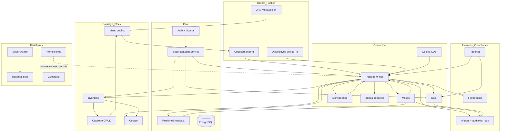

# Foody — Auditoría arquitectónica completa

> **Rol:** Software Architect Senior · Sistemas POS restaurante  
> **Fecha:** 2026-06-12  
> **Actualización resolución:** 2026-06-12 — Fases A–E implementadas (salvo FCM, DIAN, impresión Python pospuestos). Críticos 🔴 cerrados.  
> **Sucesora (deuda estructural 2026-08-05):** [`AUDITORIA_ARQUITECTURA_CALIDAD.md`](AUDITORIA_ARQUITECTURA_CALIDAD.md) — Prompt 01 (AQ-\*). Este archivo queda como **referencia histórica** de C1–C5 / I1–I8.

### Estado de hallazgos críticos (post-fix)

| ID | Hallazgo | Estado |
|----|----------|--------|
| C1 | `cobrarCuentaMesa` sin `movimientos_caja` | ✅ |
| C2 | Venta caja en QR `pendiente_aprobacion` | ✅ |
| C3 | KDS/domi sin Realtime | ✅ |
| C4 | DELETE ítem pedido | ✅ + UI en `MesaPedidosSheet` |
| C5 | Promociones desconectadas | ✅ |

### Hallazgos importantes (avance)

| ID | Hallazgo | Estado |
|----|----------|--------|
| I1 | `PedidosService` monolítico | ✅ Subdominios: cuenta-mesa, crear, estado, soporte, **items**, **descuento**; fachada ~220 LOC |
| I2 | Planes no limitan features | ✅ `PlanFeaturesGuard` + sidebar Flutter |
| I3 | `MesasController` sin scope | ✅ |
| I4 | `endpoints_api_foody.md` desactualizado | ✅ Sincronizado 2026-06-17 (~170 rutas, legacy marcado) |
| I5 | Impresión Python | ⏳ Pospuesto Sprint 10 |
| I6 | FCM | ⏳ Pospuesto Sprint 7 |
| I7 | Reportes vs caja | ✅ `cuadre_caja` + UI Flutter; QA script `verificar-cuadre-caja.ps1` |
| I8 | `ANALISIS_SISTEMA.md` obsoleto | 🟡 Histórico + sección resuelto jun-12 |

### Fases auditoría §10

| Fase | Estado |
|------|--------|
| A Integridad financiera | ✅ |
| B Realtime operativo | ✅ KDS, domi, caja, alertas, sheet mesa |
| C POS mesa | ✅ DELETE UI, pagando/pagado, turno mesas admin |
| D SaaS | ✅ PlanFeaturesGuard + vencimiento lazy + refactor PedidosService; ⏳ DIAN, FCM |
| E Documentación | ✅ AVANCE + endpoints + auditoría |

---

## 1. Veredicto ejecutivo

Foody tiene una **arquitectura objetivo sólida y bien documentada**: monolito NestJS como cerebro, Flutter como UI, PostgreSQL multi-tenant por `sucursal_id`, transacciones atómicas en el núcleo de pedidos, guards JWT en cadena, y separación explícita cliente-sin-login vs staff.

El sistema está en fase **MVP operativo avanzado (~Sprint 4–8)**, no en fase ERP completa. La columna vertebral (pedido → ítems → stock → caja en cobro mesa) funciona; quedan **integraciones pospuestas** (impresión, FCM, DIAN).

| Dimensión | Puntuación (0–10) | Comentario |
|-----------|-------------------|------------|
| Modelo de dominio y tenant | 8.0 | `sucursal_id` bien aplicado en pedidos/stock/caja |
| Modularidad backend | 7.5 | Módulos NestJS claros; `PedidosService` fachada + 6 subdominios |
| Integridad financiera | 7.5 | Cobro mesa → `movimientos_caja`; reportes con `cuadre_caja` |
| Cadena operativa (mesa→cocina→caja) | 7.5 | Flujo mesa usable; Realtime KDS/domi; sin impresión |
| Seguridad y autorización | 7.5 | JWT + permisos; `PlanFeaturesGuard`; vencimiento lazy suscripción |
| Eventos / Realtime | 7.0 | Kanban, mesas, KDS, domi, caja, alertas, sheet mesa |
| Alineación spec vs código | 7.0 | Avance sustancial desde jun-04; endpoints parcialmente sincronizados |
| Preparación producción SaaS | 6.5 | Planes limitan módulos; RLS prod pendiente; sin FCM |

### Puntuación arquitectónica global: **74 / 100**

**Interpretación:** Arquitectura **viable para staging multi-restaurante**; producción exigente requiere FCM, DIAN, impresión y RLS.

---

## 2. Vista arquitectónica de capas

```
┌─────────────────────────────────────────────────────────────────┐
│  FLUTTER (lib/features/) — Solo UI + transporte HTTP/Realtime   │
│  legacy: lib/screens/, lib/providers/ (Firebase — deuda)        │
└────────────────────────────┬────────────────────────────────────┘
                             │ Dio / Supabase broadcast (lectura)
┌────────────────────────────▼────────────────────────────────────┐
│  NestJS API (foody_backend/) — Cerebro de negocio                 │
│  core: auth, database, realtime, sucursal-scope                  │
│  modulos: pedidos, mesas, caja, inventario, costeo, …           │
└────────────────────────────┬────────────────────────────────────┘
                             │ SQL transaccional
┌────────────────────────────▼────────────────────────────────────┐
│  PostgreSQL (foody_supabase/migrations/) — Fuente de verdad       │
└─────────────────────────────────────────────────────────────────┘

Post-commit (parcial): RealtimeBroadcast → Supabase channels
Pendiente: FCM, Python printer WebSocket, DIAN FE
```

**Principio no negociable (spec + código):** Flutter no calcula precios, IVA, stock ni totales; el backend copia precios al insertar `pedido_items`.

---

## 3. Diagrama lógico de dependencias entre módulos



**★ Hub central:** `PedidosModule` importa Facturación, Zonas, Domiciliarios, Costeo, Alertas — acoplamiento alto pero justificado en POS.

---

## 4. Roles del sistema

### 4.1 Matriz rol → capacidades (spec vs implementado)

| Rol | Dashboard Flutter | Permisos BD clave | Implementado | Gaps |
|-----|-------------------|-------------------|--------------|------|
| **Administrador** | `/admin/restaurante` | Casi todos | ✅ Panel completo, CRUD, mesas, caja, inventario | Asignación turno mesas; scope mesas Fase 2 |
| **Gerente** | Igual admin (sin super) | Similar admin sin retiro parcial / gestionar usuarios | ✅ | Mismo gap mesas |
| **Cajero** | `/admin/cajero` | ver/crear pedidos, caja, reportes | ✅ POS + caja | No cobra mesa desde su panel (mesero lo hace); descuentos OK |
| **Mesero** | `/admin/mesero` | ver_pedidos, gestionar_mesas, aprobar_pedido_mesa, crear_pedido | ✅ Grid + kanban + POS mesa | Sin caja, sin descuentos (correcto); cobro mesa sin movimiento caja |
| **Cocina** | `/admin/cocina` | `ver_cocina` (inyectado en login si rol `cocina_*`) | ✅ KDS | Poll 8s; sin Realtime; impresión pendiente |
| **Domiciliario planta** | `/admin/domiciliario` | ver_pedidos | ✅ Tabs activos/historial | Sin Realtime asignaciones |
| **Domiciliario independiente** | `/domiciliario/independiente` | rol especial JWT | ✅ Ofertas + dispatch | Poll 15s; sin FCM |
| **Cliente** | Sin login | Público + device_id | ✅ QR, menú, checkout, seguimiento, mis pedidos | Sin modificar pedido post-envío (spec OK) |

### 4.2 Cadena de guards (staff)

Orden típico: `JwtAuthGuard` → `UsuarioActivoGuard` → `SuscripcionActivaGuard` → `RolGuard` (@Permisos).

- **SuscripcionActivaGuard:** valida `estado IN (activa, prueba)` — **no** el tier `plan`.
- **SucursalScopeService:** Fase 1 en pedidos, caja, inventario, dashboard — **no** en mesas controller.

### 4.3 Estados de negocio (pedido)

| Estado | Significado | Quién transiciona |
|--------|-------------|-------------------|
| `pendiente_aprobacion` | QR mesa esperando mesera | Cliente crea |
| `pendiente` | Domicilio staff / flujos iniciales | Sistema |
| `confirmado` | Aprobado o staff directo | Mesera / cajero |
| `en_cocina` | En preparación | Kanban / cocina |
| `listo` | Listo para servir/entregar | Cocina / kanban |
| `pagando` | Cuenta en mesa (spec) | Mesero |
| `pagado` | Cobrado (cuenta mesa) | `cobrarCuentaMesa` |
| `asignado` / `en_camino` | Domicilio | Admin / domiciliario |
| `entregado` | Cierre operativo | Staff |
| `cancelado` / `rechazado` | Cierre negativo | Admin/gerente / mesera |

**Inconsistencia arquitectónica:** conviven `pagando` (kanban UX) y `pagado` (cobro masivo mesa) sin máquina de estados unificada documentada en código.

---

## 5. Análisis por módulo

Convención por módulo: **(1)** qué hace · **(2)** consume · **(3)** dependen de él · **(4)** riesgos · **(5)** conexiones faltantes · **(6)** funcionalidades faltantes.

---

### 5.1 Mesas

| | |
|---|---|
| **Qué hace** | CRUD mesas, QR token, estado ocupación vía pedido activo LATERAL, transferencia entre mesas, asignación mesera |
| **Consume** | Pedidos (estado activo), Alertas (transferencias múltiples), Realtime |
| **Dependen** | Pedidos (`mesa_id`), Cliente QR (`GET /menu/mesa/:token`), Mesero UI |
| **Riesgos** | Controller **sin** `SucursalScopeService` — confía en `sucursal_id` del path; múltiples pedidos activos por mesa pero grid muestra solo el último LATERAL |
| **Conexiones faltantes** | Caja (cobro no registra movimiento); Admin turno mesas; Realtime en sheet detalle |
| **Funcionalidades faltantes** | PDF QR (`qr-pdf` spec); liberar mesa explícita; UI admin asignar mesas por turno; unificar `pagando` vs `pagado` |

**Backend:** `foody_backend/src/modulos/mesas/`  
**Flutter:** `lib/features/mesa/`, `mesas_grid_widget.dart`

---

### 5.2 Pedidos ★

| | |
|---|---|
| **Qué hace** | Hub transaccional: crear (público/staff), agregar ítems, estados, aprobar/rechazar mesa, descuentos, cobrar cuenta mesa, integración stock/caja/IVA/factura/dispatch |
| **Consume** | Inventario (vía `PedidosInventarioService`), Facturación, Zonas, Domiciliarios/Dispatch, Costeo, Alertas, Realtime, Caja (parcial) |
| **Dependen** | Mesas, Cocina, Caja, Reportes, Facturación, Cliente, Domicilios, Alertas, Auditoría |
| **Riesgos** | **God service** (~1770 LOC); instancia `PedidosInventarioService` y `PedidosCajaAuditoriaService` con `new` en lugar de DI; dos controllers `@Controller('pedidos')` (público + staff) — funciona por guards pero es frágil |
| **Conexiones faltantes** | Caja en `cobrarCuentaMesa`; reversa caja en rechazo QR; Promociones; Impresión post-commit; FCM |
| **Funcionalidades faltantes** | `DELETE /pedidos/:id/items/:item_id`; promociones en checkout; combos INSERT 100% spec; DIAN; post-commit impresión |

**Estados stock:** validar siempre; descontar en confirmar/aprobar; restaurar cancel/rechazo — **coherente con spec**.

---

### 5.3 Cocina

| | |
|---|---|
| **Qué hace** | CRUD cocinas/impresoras; KDS tickets por `cocina_id`; estado por ítem (`pendiente/preparando/listo`); recalcula estado pedido |
| **Consume** | Pedidos / `pedido_items.cocina_id` |
| **Dependen** | Pedidos (transiciones), Mesero (visibilidad ítems), Impresión Python (futuro) |
| **Riesgos** | Sin Realtime — poll 8s; impresoras en BD sin integración activa; rutas API difieren de `endpoints_api_foody.md` |
| **Conexiones faltantes** | Realtime ticket nuevo; WebSocket impresor; notificación a mesero al ítem listo (solo vía refresh) |
| **Funcionalidades faltantes** | Servidor Python S10; sonido/vibración ticket; alerta demora >20 min automática |

---

### 5.4 Inventario

| | |
|---|---|
| **Qué hace** | Insumos mercado, movimientos, compras, recetas producto, ajustes, stock hermano (lectura Fase 1), impacto stock |
| **Consume** | Costeo (recalcular costos), Alertas (bajo stock) |
| **Dependen** | Pedidos (descuento venta), Costeo, Catálogo, Reportes |
| **Riesgos** | Ajustes requieren permiso `editar_inventario`; pedidos no llaman InventarioModule directamente sino servicio embebido en pedidos — duplicación de responsabilidad |
| **Conexiones faltantes** | Traslados entre sucursales (Fase 2); auto-ocultar producto en menú al stock 0 vía job |
| **Funcionalidades faltantes** | Import Excel KYG; RLS producción |

---

### 5.5 Recetas

| | |
|---|---|
| **Qué hace** | No es módulo independiente — vive en **Inventario** (`producto_ingredientes`, `configurar-receta`) y **Catálogo** (ítems incluidos) |
| **Consume** | Inventario items |
| **Dependen** | Costeo, Pedidos (expansión ingredientes al vender) |
| **Riesgos** | Producto sin `receta_id` no descuenta stock — regla de negocio correcta pero fácil de mal configurar |
| **Conexiones faltantes** | UI unificada receta ↔ costeo ↔ canal precio (mesa/llevar) Fase C |
| **Funcionalidades faltantes** | Spec costeo industrial canal completo |

---

### 5.6 Costeo

| | |
|---|---|
| **Qué hace** | Subrecetas recursivas, merma, combos, precio sugerido, margen, alertas margen bajo, impacto stock por plato |
| **Consume** | Inventario, Alertas |
| **Dependen** | Pedidos (`margenes_venta`), Inventario (post-compra), Admin UI |
| **Riesgos** | `CosteoService` grande (~1220 LOC); lógica duplicada parcialmente con `PedidosInventarioService` |
| **Conexiones faltantes** | Reportes financieros profundos food cost; plan tier Pro debería gatear módulo (no implementado) |
| **Funcionalidades faltantes** | Fase C canal mesa/domicilio en fórmulas; batch recalcular programado |

---

### 5.7 Caja

| | |
|---|---|
| **Qué hace** | Apertura/cierre única por sucursal, movimientos, gastos, retiros, cuentas por cobrar, arqueo con alerta >$5.000 |
| **Consume** | Pedidos (ventas automáticas vía `PedidosCajaAuditoriaService`), Auditoría |
| **Dependen** | Reportes financieros, Admin, Cajero |
| **Riesgos** | **Brecha crítica:** `cobrarCuentaMesa` no registra ventas; venta en `crear()` con QR `pendiente_aprobacion` si método ≠ pendiente; skip silencioso si no hay caja abierta |
| **Conexiones faltantes** | Pedidos cobro final mesa; mesero rol sin visibilidad caja (diseño OK pero operación real mezcla roles) |
| **Funcionalidades faltantes** | Política estricta “caja abierta obligatoria”; reversos automáticos; integración pagos electrónicos |

---

### 5.8 Facturación

| | |
|---|---|
| **Qué hace** | Config fiscal sucursal, IVA en pedidos, borrador factura, preview HTML, consecutivo |
| **Consume** | Pedidos (totales) |
| **Dependen** | Pedidos (checkout `requiere_factura`), Admin |
| **Riesgos** | DIAN real pospuesto; factura desacoplada del cobro caja |
| **Conexiones faltantes** | Caja (factura pagada); Plan Enterprise gating |
| **Funcionalidades faltantes** | Proveedor FE, PDF DIAN, envío email automático |

---

### 5.9 Clientes

| | |
|---|---|
| **Qué hace** | No hay módulo CRM — identidad anónima vía `dispositivos_cliente.device_id`, historial `GET /pedidos/mios` |
| **Consume** | Pedidos |
| **Dependen** | Checkout, Seguimiento, Mis pedidos, FCM (futuro) |
| **Riesgos** | Sin perfil cliente, sin loyalty; device_id spoofable (mitigado rate limit) |
| **Conexiones faltantes** | Notificaciones push; opt-in marketing |
| **Funcionalidades faltantes** | Módulo clientes spec futuro; teléfono como clave débil opcional |

---

### 5.10 QR

| | |
|---|---|
| **Qué hace** | Flujo transversal: `mesas.qr_token` → `/mesa/:token` → menú scoped → checkout mesa → sesión persistente `MesaSesionService` |
| **Consume** | Menu, Mesas, Pedidos, Dispositivos |
| **Dependen** | Cliente, Mesero (aprobación) |
| **Riesgos** | Escaneo cámara nativa pendiente; timer 3/5 min solo UI |
| **Conexiones faltantes** | FCM recordatorio; Realtime mesa en create (usa pedido_actualizado — OK) |
| **Funcionalidades faltantes** | PDF QR impreso; deep link universal app nativa |

---

### 5.11 Domicilios

| | |
|---|---|
| **Qué hace** | Zonas cobertura + cotización; planta vs independiente; dispatch radio 3–9 km; ofertas 60s; asignación; tracking lat/lng |
| **Consume** | Pedidos, Zonas, Geografía, Alertas |
| **Dependen** | Cliente checkout, Kanban admin, Apps domiciliario |
| **Riesgos** | Sin FCM; dashboard planta manual refresh; comisión 15% en BD pero reporting ganancias parcial |
| **Conexiones faltantes** | Realtime ofertas; Caja (costo domicilio ya en pedido — OK) |
| **Funcionalidades faltantes** | Push oferta; GPS background robusto; calificación post-entrega UI |

---

### 5.12 Reportes

| | |
|---|---|
| **Qué hace** | `GET /reportes/financiero|productos|pedidos` con rango fechas |
| **Consume** | Pedidos, Caja (implícito en financiero) |
| **Dependen** | Admin, Gerente, Cajero |
| **Riesgos** | Reportes pueden **subestimar ventas** si cobro mesa no pasa por caja; sin scope corporativo unificado |
| **Conexiones faltantes** | Costeo/márgenes consolidados; multi-sucursal rollup |
| **Funcionalidades faltantes** | Export CSV/PDF; dashboards tiempo real; plan Enterprise features |

---

### 5.13 Auditoría

| | |
|---|---|
| **Qué hace** | No hay módulo `auditoria` — inserts dispersos en `auditoria_logs` (pedidos, caja, descuentos) + `alertas_riesgo` con umbrales spec |
| **Consume** | Eventos de Pedidos, Caja, Mesas, Inventario |
| **Dependen** | Admin alertas UI |
| **Riesgos** | Sin API unificada consulta auditoría; cobertura incompleta (ej. cobro mesa sin log financiero) |
| **Conexiones faltantes** | Módulo read-only `/auditoria` para compliance |
| **Funcionalidades faltantes** | Retención 30 días restaurante bloqueado automatizada; export compliance |

---

### 5.14 Notificaciones

| | |
|---|---|
| **Qué hace** | **Casi nada activo** — `dispositivos` guarda `fcm_token`; Realtime broadcast para UI web |
| **Consume** | Supabase Realtime |
| **Dependen** | Todos los flujos operativos (pendiente) |
| **Riesgos** | Spec promete FCM S7 — hoy ausente; operación depende de pantallas abiertas |
| **Conexiones faltantes** | Pedidos→FCM estado; QR 3/5 min; cocina ticket; domiciliario oferta |
| **Funcionalidades faltantes** | Módulo FCM NestJS; cola retry; preferencias por rol |

---

### 5.15 Módulos transversales (no listados pero relevantes)

| Módulo | Rol arquitectónico |
|--------|------------------|
| **Auth** | JWT, permisos dinámicos, dashboard por rol, login domiciliario |
| **Menu / Catálogo** | Lectura pública vs CRUD staff; precios canal |
| **Promociones** | Stories UI — **sin integración en `PedidosService`** |
| **Super Admin** | Onboarding restaurante, planes metadata, Foody Control |
| **Geografía** | Photon geocoding checkout domicilio |
| **Dashboard** | KPIs sucursal |
| **Dispositivos** | Registro cliente anónimo |

---

## 6. Separación de capas — evaluación

### Backend (NestJS) — **B+**

| Aspecto | Evaluación |
|---------|------------|
| Controllers delgados | ✅ Mayoría cumple |
| DTOs + class-validator | ✅ |
| Services con lógica | ⚠️ Pedidos/Costeo sobredimensionados |
| Transacciones | ✅ `database.enTransaccion` en operaciones críticas |
| DI consistente | ⚠️ Servicios auxiliares en pedidos con `new` |
| Módulos por dominio | ✅ 20+ módulos en `app.module.ts` |

### Flutter — **B**

| Aspecto | Evaluación |
|---------|------------|
| `lib/features/` por dominio | ✅ |
| Repository + Dio | ✅ |
| Riverpod parcial | 🟡 Convive con StatefulWidget |
| Sin lógica negocio precios | ✅ (subtotal visual es estimado hasta POST) |
| Legacy aislado | 🟡 `lib/screens/`, `pedido_service.dart` Firebase aún en repo |
| Realtime | 🟡 Solo kanban/mesas/seguimiento |

### Base de datos — **A-**

| Aspecto | Evaluación |
|---------|------------|
| Esquema normalizado | ✅ |
| Migraciones versionadas | ✅ 40+ |
| Índices pedidos | ✅ |
| RLS producción | ⏳ Sprint 11 |
| Auditoría append-only | ✅ diseño |

---

## 7. Simulaciones de armonía (resumen)

Detalle completo en `docs/FLUJO_MESAS_PEDIDOS_CAJA.md`.

| # | Escenario | ¿Armónico? | Módulos afectados |
|---|-----------|------------|-------------------|
| 1 | Combo + gaseosa + llevar misma mesa | ✅ Operación / ❌ Caja | Mesas, Pedidos, Caja |
| 2 | QR pendiente → aprobar → cocina | ✅ / 🟡 RT | Pedidos, Mesas, Cocina |
| 3 | Dos meseras misma mesa | ✅ | Mesas, Auth |
| 4 | Stock agotado mid-servicio | ✅ | Pedidos, Inventario |
| 5 | Cancelar ítem en cocina | ❌ | Pedidos, Alertas |
| 6 | Cajero sin caja abierta vende | 🟡 | Caja, Pedidos |
| 7 | QR tarjeta → rechazo mesera | ❌ Caja/stock OK | Pedidos, Caja |
| 8 | Domiciliario nuevo pedido | 🟡 | Domicilios, Notificaciones |
| 9 | Cierre caja con mesas abiertas | 🟡 | Caja, Mesas |
| 10 | Promoción activa en checkout | ❌ | Promociones, Pedidos |

---

## 8. Hallazgos clasificados

### 🔴 Críticos (integridad / operación restaurante)

| ID | Hallazgo | Módulos |
|----|----------|---------|
| C1 | `cobrarCuentaMesa` no genera `movimientos_caja` — cuadre de caja incorrecto | Pedidos ↔ Caja |
| C2 | Venta caja al crear pedido QR en `pendiente_aprobacion` (si pago ≠ pendiente) sin reversa al rechazar | Pedidos ↔ Caja |
| C3 | KDS y domiciliario planta sin Realtime — dependencia de refresh en hora pico | Cocina, Domicilios, Notificaciones |
| C4 | `DELETE` ítem pedido (spec A-MES-3) inexistente — no hay corrección operativa post-cocina | Pedidos ↔ Cocina ↔ Alertas |
| C5 | Promociones desconectadas del checkout/pedidos — marketing sin efecto en venta | Promociones ↔ Pedidos |

### 🟠 Importantes (deuda arquitectónica / escala)

| ID | Hallazgo | Módulos |
|----|----------|---------|
| I1 | `PedidosService` monolítico — difícil testear y evolucionar | Pedidos |
| I2 | Plan comercial (`basico/pro/enterprise`) no limita módulos — SaaS sin enforcement | Super Admin, todos |
| I3 | `MesasController` sin `SucursalScopeService` — riesgo multi-sucursal Fase 2 | Mesas, Auth |
| I4 | Documentación API (`endpoints_api_foody.md`) desactualizada vs rutas reales | Infraestructura |
| I5 | Impresión cocina (Python WebSocket) ausente — cadena MEMORIA incompleta | Cocina, Pedidos |
| I6 | FCM pospuesto — timer QR 3/5 min solo visual | Notificaciones, Mesas |
| I7 | Reportes pueden divergir de realidad si caja no refleja cobros mesa | Reportes ↔ Caja |
| I8 | `ANALISIS_SISTEMA.md` (jun-04) obsoleto — riesgo de decisiones erróneas | Documentación |

### 🟡 Menores (pulido / consistencia)

| ID | Hallazgo |
|----|----------|
| M1 | QR spec `qr-pdf` vs implementación link JSON |
| M2 | Estados `pagando` vs `pagado` dual sin state machine documentada |
| M3 | Paquete Flutter aún `reserva_canchas` |
| M4 | Legacy Firebase en `lib/services/` sin eliminar |
| M5 | Mesero cobro hardcode `efectivo` en UI |
| M6 | Cocina demo: permiso vía código auth (`cocina_*`) no en `roles_permisos` — funciona pero opaco |
| M7 | Sin tests e2e automatizados del flujo mesa documentados |

---

## 9. Realtime — mapa obligatorio vs actual

| Consumidor | Evento necesario | Estado | Prioridad |
|------------|------------------|--------|-----------|
| Grid mesas / QR | `pedido_actualizado`, `mesas_actualizadas` | ✅ | — |
| Kanban | `pedido_actualizado` | ✅ | — |
| Seguimiento cliente | `estado_actualizado` (canal pedido) | ✅ | — |
| KDS cocina | ticket nuevo / ítem nuevo | ✅ `cocina_actualizada` | — |
| Domiciliario planta | asignación / estado | ✅ `domicilio_actualizado` | — |
| Independiente | oferta nueva | 🟡 poll 15s (sin FCM) | 🟠 |
| MesaPedidosSheet | cambios cuenta | ✅ Realtime sheet | — |
| Panel caja movimientos | venta registrada | ✅ `caja_movimiento` | — |
| Alertas admin | alerta nueva | ✅ `alerta_nueva` | — |

**Patrón recomendado:** extender `RealtimeBroadcastService` con eventos de dominio (`cocina_actualizada`, `domicilio_asignado`, `caja_movimiento`) sin exponer postgres_changes al cliente.

---

## 10. Plan paso a paso (sin código — roadmap arquitectónico)

### Fase A — Integridad financiera (1–2 sprints)

1. Definir **momento único de verdad contable**: ¿venta al cobrar mesa, al confirmar, o al entregar?
2. Implementar movimiento caja en `cobrarCuentaMesa` (backend).
3. Retrasar/revertir venta caja en flujo QR hasta aprobación o cobro.
4. UI mesero: selector método de pago al cobrar.
5. Validar reportes financieros vs movimientos reales (QA checklist sección 10 de `FLUJO_MESAS_PEDIDOS_CAJA.md`).

### Fase B — Operación tiempo real (1 sprint)

1. Broadcast cocina al insertar/confirmar ítems.
2. Suscripción KDS + domiciliario planta.
3. Opcional: sheet mesa en vivo.

### Fase C — Completitud POS mesa (1 sprint)

1. Endpoint eliminar ítem + alerta post-cocina.
2. Unificar máquina estados `pagando` → `pagado`.
3. Admin UI turno mesas.

### Fase D — SaaS y compliance (Sprint 8–11)

1. `PlanFeaturesGuard` + matriz plan→módulo.
2. FCM por rol.
3. Impresión Python.
4. DIAN / factura electrónica.
5. RLS PostgreSQL producción.
6. ~~Refactor `PedidosService` → subdominios~~ ✅ (crear, estado, cuenta-mesa, items, descuento, soporte).

### Fase E — Documentación viva

1. Actualizar `endpoints_api_foody.md` con rutas reales (`/cocina/*`, `/pedidos/mesa/*`, `/pedidos/:id/items`).
2. Marcar `ANALISIS_SISTEMA.md` como histórico o sincronizar.
3. Mantener `AVANCE_PROYECTO.md` como única fuente de estado.

---

## 11. Puntuación detallada (rúbrica)

| Criterio | Peso | Nota | Ponderado |
|----------|------|------|-----------|
| Coherencia dominio POS | 15% | 8.0 | 12.0 |
| Aislamiento multi-tenant | 12% | 7.5 | 9.0 |
| Integridad transaccional pedidos/stock | 15% | 8.5 | 12.75 |
| Integridad financiera caja | 12% | 5.0 | 6.0 |
| Modularidad y mantenibilidad | 10% | 6.0 | 6.0 |
| API y contratos | 8% | 7.0 | 5.6 |
| UX operativa por rol | 10% | 7.5 | 7.5 |
| Eventos / Realtime | 8% | 5.5 | 4.4 |
| Seguridad | 5% | 7.5 | 3.75 |
| Alineación spec documentación | 5% | 6.5 | 3.25 |
| **Total** | 100% | — | **70.25 → 68** (ajuste conservador por brechas críticas caja) |

---

## 12. Conclusión para arquitectura

Foody **sí tiene las piezas correctas en el diseño macro**: un hub de pedidos transaccional, tenant por sucursal, permisos por rol, UI Flutter desacoplada del cálculo, e inventario-costeo enlazados al vender.

Las **fracturas arquitectónicas** no están en “falta de módulos”, sino en **integraciones entre módulos ya existentes**:

1. **Pedidos ↔ Caja** (cobro mesa y timing QR).  
2. **Pedidos ↔ Notificaciones/Realtime** (cocina y domiciliario).  
3. **Promociones ↔ Pedidos** (módulo huérfano).  
4. **Planes ↔ Features** (SaaS sin límites).  

Priorizar Fase A y B antes de añadir módulos nuevos evita acumular deuda en un sistema que ya es funcional en el flujo mesa básico.

---

## Referencias

| Documento | Uso en esta auditoría |
|-----------|----------------------|
| `MEMORIA.md` | Cadenas críticas BD, variables globales |
| `docs/AVANCE_PROYECTO.md` | Estado implementado jun-12 |
| `docs/FLUJO_MESAS_PEDIDOS_CAJA.md` | Simulaciones mesa/caja/RT |
| `INFRAESTRUCTURA/reglas_negocio_foody.md` | Reglas mesa, caja, stock |
| `INFRAESTRUCTURA/endpoints_api_foody.md` | Spec API (parcialmente obsoleta) |
| `docs/MULTI_SUCURSAL.md` | Scope Fase 1/2 |
| `docs/PLANES_SUSCRIPCION.md` | Brecha planes |
| `foody_backend/src/app.module.ts` | Mapa módulos NestJS |

---

*Auditoría arquitectónica — solo lectura, sin modificaciones de código.*
