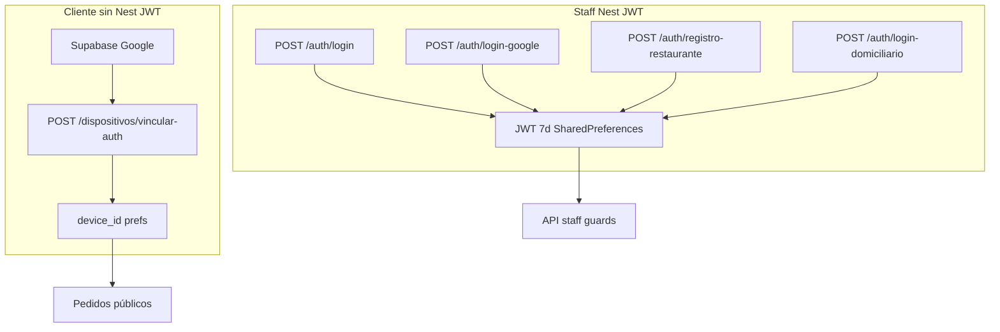

# Foody — Auditoría Autenticación y JWT (Prompt 05)

> **Fecha:** 2026-08-06  
> **Alcance:** NestJS (`foody_backend/src/core/auth`, dispositivos, pedidos públicos) + Flutter (`lib/core/sesion`, `lib/core/red`, OAuth).  
> **Método:** lectura estática. Sin fuzzing de tokens ni prueba de desactivación en runtime en esta pasada.  
> **Predecesoras:** AQ-\* · BN-\* · FL-\* · [`AUDITORIA_APIS_REST.md`](AUDITORIA_APIS_REST.md) (API-\*).  
> **Sucesora Prompt 06 (RBAC):** [`AUDITORIA_RBAC.md`](AUDITORIA_RBAC.md) — RBAC-\*.  
> **Estado oficial:** hallazgos en [`MASTER_STATUS.md`](MASTER_STATUS.md) § Auth / JWT (AUTH-\*).  
> **Al cerrar un AUTH-\*:** marcar ✅ aquí + MASTER + viñeta en `AVANCE_PROYECTO.md`.

---

## Veredicto

| Dimensión | Nota | Una línea |
|-----------|------|-----------|
| Login / roles | B | Email + Google + registro + domi indep. cubiertos; cliente = `device_id` (sin Nest JWT) |
| Refresh / logout | D+ | **Sin** refresh, **sin** logout server-side, **sin** blacklist |
| Expiración mid-action (Flutter) | C+ | Detecta `exp` local + 401 → login; **no** reintenta la acción en curso |
| Revocación al desactivar | B | `UsuarioActivoGuard` consulta BD **cada request** → JWT firmado muere en el siguiente call |
| Almacenamiento token cliente | C− | Staff JWT en **SharedPreferences** (no secure storage); web = localStorage-equivalente |
| WhatsApp OTP | N/A | **No implementado** (ni backend ni Flutter Foody) |

**Global Prompt 05:** ~**62 / 100** disciplina auth (sesión usable para piloto; débil en refresh, storage y TTL largo).

**Qué ya está bien (no rehacer):**

- Rate-limit en login/registro/Google (`@RateLimitPublico`, activo en prod).
- bcrypt cost 10; Passport JWT con `ignoreExpiration: false`.
- `UsuarioActivoGuard` revalida `activo` / `estado_cuenta` en cada request guardado.
- Flutter: margen 30s en `JwtStaff.expirado`; debounce re-login 3s ante 401 concurrentes.
- Separación cliente Google (`vincular-auth`) vs staff (`login-google`) — no mezclan Nest JWT.

---

## Índice de hallazgos

| Prefijo | Tema | Abiertos (aprox.) |
|---------|------|------------------:|
| AUTH-FLOW-* | Login / refresh / logout por rol | 8 |
| AUTH-EXP-* | Expiración y mid-action | 5 |
| AUTH-REV-* | Revocación de sesión | 4 |
| AUTH-STORE-* | Almacenamiento cliente | 4 |
| AUTH-OTP-* | WhatsApp OTP | 3 |
| AUTH-FIX-* | Remediaciones priorizadas | 6 |

Leyenda: `🟣 abierto` · `🟡 parcial / aceptado` · `✅ cerrado` · `📅 post-piloto` · `🚫 no aplica / ausente`

---

## 1. Flujos login / refresh / logout por rol (AUTH-FLOW)

### Mapa de autenticación

### Endpoints auth Nest

| Método | Ruta | Actor | Rate (prod) |
|--------|------|-------|-------------|
| POST | `/auth/login` | Staff + super_admin | 15/min |
| POST | `/auth/login-google` | Staff (email en `usuarios`) | 20/min |
| POST | `/auth/registro-restaurante` | Dueño nuevo | 5/min |
| POST | `/auth/login-domiciliario` | Domi independiente | 15/min |
| POST | `/auth/registro-domiciliario` | Domi indep. alta | 10/min |
| GET | `/auth/perfil` | JWT + UsuarioActivo | — |
| POST | `/auth/registrar-fcm` / `desactivar-fcm` | JWT | — |
| POST | `/dispositivos/registrar` | Cliente guest | rate |
| POST | `/dispositivos/vincular-auth` | Cliente Google | rate |

**No existen:** `POST /auth/refresh`, `POST /auth/logout`, OTP WhatsApp.

### Por rol

| Rol | Login | Refresh | Logout server | Evidencia |
|-----|-------|---------|---------------|-----------|
| admin / gerente / cajero / mesero / cocina / domi planta | email o Google → Nest JWT | ❌ | ❌ (solo clear prefs + opcional FCM off) | `auth.service` emitirSesionStaff; Flutter `SesionStaffService` |
| super_admin | mismo `/auth/login` → dashboard `foody_control` | ❌ | ❌ | `redireccion_staff.dart` |
| domiciliario_independiente | `/auth/login-domiciliario` → mismo prefs staff | ❌ | ❌ | repo independientes |
| cliente guest | `device_id` UUID | N/A | N/A | `DispositivoService` |
| cliente Google | Supabase session + `vincular-auth` | Supabase refresh interno | `signOut` cliente | **sin** Nest JWT |

### Hallazgos FLOW

| ID | Estado | Sev | Hallazgo | Evidencia |
|----|--------|-----|----------|-----------|
| **AUTH-FLOW-01** | ✅ | — | `POST /auth/refresh` re-emite access JWT (mismo `tv`) | `auth.controller` + `auth.service.refresh` |
| **AUTH-FLOW-02** | ✅ | — | `POST /auth/logout` bumpea `token_version` | mig `084` + `UsuarioActivoGuard` |
| **AUTH-FLOW-03** | ✅ | — | Login email + Google staff + registro restaurante + domi indep. | `auth.controller.ts` |
| **AUTH-FLOW-04** | ✅ | — | Cliente sin Nest JWT (regla Foody) — `device_id` | `dispositivo_service.dart`, pedidos públicos |
| **AUTH-FLOW-05** | 🟡 | Baja | `GET /auth/perfil` puede re-emitir token si cambian plan/permisos/`tv` | `auth.service` perfil |
| **AUTH-FLOW-06** | 🟡 | Baja | JWT TTL default **7 días** — acortable con `JWT_EXPIRACION` | `auth.module.ts` |
| **AUTH-FLOW-07** | ✅ | — | Logout Flutter llama `/auth/logout` antes de clear local | `auth_repository.logout` |
| **AUTH-FLOW-08** | ✅ | — | Guards en orden típico JWT → UsuarioActivo → Suscripción → Rol | Controllers staff |

---

## 2. Expiración de tokens mid-action (AUTH-EXP)

### Comportamiento Nest

- Passport `ignoreExpiration: false` → JWT vencido = **401** antes de guards de negocio (`jwt.strategy.ts`).

### Comportamiento Flutter (staff)

| Momento | Qué pasa |
|---------|----------|
| Antes del request | `SesionStaffService.obtenerToken()` → si `JwtStaff.expirado` (margen 30s) → `cerrar()` → interceptor cancela + `solicitarReLogin()` |
| Durante request (API 401) | `ManejoErrorSesion` → clear sesión → `go('/admin/login')` |
| Reintento automático de la mutación | **No** — la acción en curso se pierde (usuario debe repetir) |
| Refresh silencioso | **No** |

Evidencia: `jwt_staff.dart:9-16`, `sesion_staff_service.dart:62-65,90-92`, `cliente_dio.dart:30-64`, `manejo_error_sesion.dart`.

| ID | Estado | Sev | Hallazgo |
|----|--------|-----|----------|
| **AUTH-EXP-01** | 🟡 | Media | Retry 1× tras refresh en Dio (AUTH-FIX-04); mutación no-idempotente aún puede fallar si refresh no salva |
| **AUTH-EXP-02** | ✅ | — | Check local `exp` evita enviar JWT muerto (margen 30s) |
| **AUTH-EXP-03** | ✅ | — | Debounce 3s + flag `_enCurso` reduce tormenta de redirects ante N×401 |
| **AUTH-EXP-04** | 🟣 | Baja | Cliente Supabase: Foody no gestiona refresh mid-call en Dio staff; Bearer cliente solo en `/pedidos/mios` puntual |
| **AUTH-EXP-05** | 🟡 | Media | Dio renueva si `porExpirar` (30m); TTL default 7d sigue largo (mitigado por `tv` + refresh) |

---

## 3. Revocación de sesión (AUTH-REV)

### Pregunta del prompt: ¿token sigue tras desactivar usuario?

| Escenario | ¿Token firmado válido? | ¿API acepta? |
|-----------|------------------------|--------------|
| `usuarios.activo = false` | Sí hasta `exp` (7d) | **No** — `UsuarioActivoGuard` lanza 401 en el **siguiente** request |
| Domi indep. `estado_cuenta ≠ activo` | Sí | **No** — mismo guard |
| Cambio de contraseña | Sí | **No** — bumpea `token_version` (JWT viejo → 401 `SESION_REVOCADA`) |
| Logout cliente | Sí | **No** — `POST /auth/logout` bumpea `tv` |

Evidencia: mig `084`; `usuario-activo.guard.ts` compara `jwt.tv` vs BD; `cambiarContrasenaUsuario` + `auth.service.logout`.

| ID | Estado | Sev | Hallazgo |
|----|--------|-----|----------|
| **AUTH-REV-01** | ✅ | — | Desactivar usuario **corta** acceso API de inmediato (guard por request) — respuesta correcta al prompt |
| **AUTH-REV-02** | ✅ | — | Cambio de password invalida JWTs (`token_version++`) | |
| **AUTH-REV-03** | ✅ | — | `token_version` + claim `tv` (sin jti/blacklist Redis) | |
| **AUTH-REV-04** | 🟡 | Baja | Flutter no polléa `activo`; solo falla en próximo call / splash `sincronizarPermisos` | Aceptable si UX muestra error rápido |

**Respuesta corta al usuario:** si desactivas un usuario, su token **firma** sigue “válido” criptográficamente, pero **deja de funcionar en la API** en el siguiente request protegido (401). Logout o cambio de password también invalidan JWTs vivos vía `token_version`.

---

## 4. Almacenamiento del token en el cliente (AUTH-STORE)

| ID | Estado | Sev | Hallazgo | Evidencia |
|----|--------|-----|----------|-----------|
| **AUTH-STORE-01** | ✅ | — | Staff JWT: **móvil** `flutter_secure_storage` (+ fallback prefs); **web** SharedPreferences (AUTH-WEB-01) | F4 + AUTH-WEB-01 |
| **AUTH-STORE-02** | 🟡 | Media | `device_id` + perfil cliente Google también en prefs | Esperable para guest; Google access token vive en sesión Supabase |
| **AUTH-STORE-03** | ✅ | — | JWT staff **no** se imprime en `debugPrint` en el flujo Foody | `JwtStaff` solo decodifica `exp` |
| **AUTH-STORE-04** | 🟡 | Baja | Legacy `StorageService.saveAuthToken` huérfano (`auth_token`) — deuda, no usado por Foody auth | `storage_service.dart` |

**Veredicto seguridad storage:** móvil OK Keystore/Keychain vía secure storage. Web = prefs del origen (XSS = riesgo). TTL default 7d → **a pulir** con `JWT_EXPIRACION` corto en prod. Detalle residual: [`REMEDIACION_NEST_AUTH_2026-08-07.md`](../../REMEDIACION_NEST_AUTH_2026-08-07.md) §3.2.

---

## 5. WhatsApp OTP (AUTH-OTP)

| ID | Estado | Hallazgo |
|----|--------|----------|
| **AUTH-OTP-01** | 🚫 | **No implementado** en Foody (Nest ni Flutter features) |
| **AUTH-OTP-02** | 🚫 | Sin rate-limit OTP / expiración de código / reintentos — N/A hasta diseño |
| **AUTH-OTP-03** | 🟡 | Hits “WhatsApp” = legacy reservas / stories UI — **no** auth |

Si se planifica OTP: requerirá proveedor (Twilio/Meta), tabla códigos, TTL corto (p.ej. 5 min), max intentos, rate-limit por teléfono+IP, y **no** sustituir JWT staff sin decisión de producto.

---

## 6. Backlog remediación (AUTH-FIX)

| ID | Prioridad | Acción | Cierra | Prod-risk |
|----|-----------|--------|--------|-----------|
| **AUTH-FIX-01** | P1 | ~~`flutter_secure_storage` móvil~~ ✅ F4 | AUTH-STORE-01 | — |
| **AUTH-FIX-02** | P1 | ~~Refresh~~ ✅; TTL corto opcional vía `JWT_EXPIRACION` (default 7d) | AUTH-FLOW-01, AUTH-EXP-05 | Bajo residual |
| **AUTH-FIX-03** | P2 | ~~`token_version` + invalidar password/logout~~ ✅ mig `084` | AUTH-REV-02/03 | — |
| **AUTH-FIX-04** | P2 | ~~Interceptor retry 1× tras refresh~~ ✅ `cliente_dio.dart` | AUTH-EXP-01 | Residual si JWT ya revocado |
| **AUTH-FIX-05** | P3 | ~~Logout server bump version~~ ✅ `POST /auth/logout` | AUTH-FLOW-02/07 | — |
| **AUTH-FIX-06** | 📅 | WhatsApp OTP solo si producto lo pide — spec + rate/TTL/intentos | AUTH-OTP-* | — |

**No hacer ahora:** inventar OTP “por completar el prompt”; el hallazgo es ausencia documentada.

---

## 7. Matriz de conteo

| Grupo | 🟣 | 🟡 | ✅ | 🚫/📅 |
|-------|---:|---:|---:|------:|
| AUTH-FLOW | 0 | 2 | 6 | 0 |
| AUTH-EXP | 1 | 2 | 2 | 0 |
| AUTH-REV | 0 | 1 | 3 | 0 |
| AUTH-STORE | 0 | 2 | 2 | 0 |
| AUTH-OTP | 0 | 1 | 0 | 2 |
| **Total** | **1** | **8** | **13** | **2** |
| AUTH-FIX | ~~01/03/04/05~~ ✅ · **a pulir** FIX-02 TTL prod · 📅 FIX-06 OTP | | | |

**A pulir (Auth):** ver [`REMEDIACION_NEST_AUTH_2026-08-07.md`](../../REMEDIACION_NEST_AUTH_2026-08-07.md) §3.2 — TTL 7d, retry residual, perfil re-emite token, OTP post-producto.

---

## 8. Cómo verificar al remediar

| Fix | Evidencia mínima |
|-----|------------------|
| AUTH-FIX-01 storage | Token no legible en SharedPreferences plain en Android; login/logout OK |
| AUTH-FIX-02 refresh | Access corto; refresh rota; curl con access vencido → 401; refresh → 200 |
| AUTH-FIX-03 version | Cambiar password → request con JWT viejo → 401 |
| AUTH-FIX-04 retry | Simular 401 mid-cobro → un retry exitoso sin doble cobro (idempotencia API-FIX-03) |
| Desactivar usuario | `PATCH activo=false` → siguiente API staff → 401 + Flutter a `/admin/login` |

Scripts: `scripts/verificar-auth-flow.ps1` (login → refresh → logout → 401 → refresh fail).

---

## Changelog de este documento

| Fecha | Cambio |
|-------|--------|
| 2026-08-07 | **Doc a pulir** — enlace `REMEDIACION_NEST_AUTH_2026-08-07.md`; AUTH-STORE-01 sincronizado ✅ F4/web; residuales TTL/retry/OTP explícitos |
| 2026-08-07 | **Remediación AUTH-FLOW/REV** — `084`, `/auth/refresh`, `/auth/logout`, Flutter Dio refresh + logout server; AUTH-FIX-03/05 ✅ |
| 2026-08-06 | Enlace a Prompt 06 (`AUDITORIA_RBAC.md`) |
| 2026-08-06 | **Creación** Prompt 05 — AUTH-FLOW/EXP/REV/STORE/OTP + AUTH-FIX-01…06; enlazado MASTER / AVANCE / README / ROADMAP |

---

*Fin — Auditoría Autenticación y JWT (Prompt 05).*
