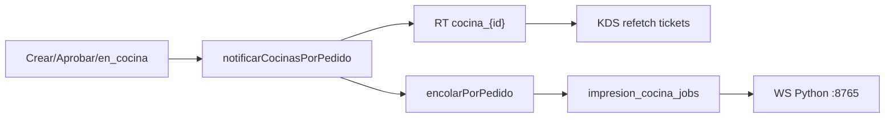

# Auditoría — Cocina / KDS (Prompt 12)

## Antigüedad de pedidos listos — 2026-11-25

La consulta de tickets del KDS incluye `pedidos.created_at`, pero la tarjeta “Listos” solo mostraba un check. La inspección visual del Tunnel encontró seis tarjetas listas sin antigüedad visible; el Centro de operación a la misma hora mostraba pedidos operativos de 113 días. Lectura directa filtrada por Sede principal dentro de `BEGIN READ ONLY`/`ROLLBACK` confirmó que los seis tickets mostrados tienen más de 30 días de antigüedad (creación UTC entre 2026-07-02 y 2026-08-04). No se seleccionaron datos de clientes y no se actualizó ninguna fila. La vista no permitía distinguir a simple vista un ticket reciente de un pedido antiguo por retirar.

**Corrección UX:** la tarjeta lista muestra `Pedido <antigüedad>` usando exclusivamente `pedidos.created_at`, con tooltip que aclara que es la antigüedad desde creación y no el tiempo desde que quedó listo. Después de 24 h destaca en ámbar y después de 30 días en rojo; el tooltip pide verificar el pedido antes de reimprimir o retornarlo a cocina. Si la respuesta no trae fecha, conserva el check anterior. No cambia transiciones, cobro, cocina ni impresión.

**Verificación:** `flutter test --no-pub test/kds_screen_test.dart` 17/17 (incluye 320/390/820/1440 px, ámbar a 27 h y rojo a 113 d 9 h); `dart analyze` focalizado sin incidencias. Se generó build release candidato `build/web_equipo_kds_candidate` con flavor Equipo (main JS 6.96 MB, SHA-256 `ab700bb24fdae4dfc8f1740b7fdb152086abfc7a13acd071dfcf80fd4e120001`), copiando recursos `web/` y aplicando cache bust por hash. Compilación JS exitosa; el dry-run WASM reporta incompatibilidad heredada de `dart:html`/USB, sin bloquear el build JS. La acción de publicación local que detenía el proceso Python en :8080 y reemplazaba el directorio fue rechazada por revisión automática; no se intentó otro método. Comprobación posterior: :8080 200, :8081 200, `equipo.foodyy.store/admin/panel` 200; Cloudflared PID 8940 sigue activo. El bundle publicado sigue siendo anterior; ni CORS/WOMPI ni OAuth se tocaron.

## Validación de conectividad runtime — RT + impresión (2026-11-25)

Lectura inicial de `GET /api/v1/health`, `/health/realtime` y `/health/impresion` en API activa `:3000` (PID 20152): Postgres y Realtime respondían, pero `ws://127.0.0.1:8765` inicialmente daba `ECONNREFUSED`. Tras iniciar el agente Python configurado en modo `archivo`, una nueva lectura confirmó `conectado=true`. Health global sigue `degradado` por 0 pendientes, **317 jobs `error`** y 0 enviados últimas 24 h.

Las 317 filas no se reintentaron ni limpiaron. El worker consulta solo `estado='pendiente'`; los estados `error` no se reproducen automáticamente. `POST /impresion/procesar-cola` tampoco recupera esos estados; `reimprimirPedido` genera un trabajo nuevo. No hay forma de saber por la health si las comandas anteriores ya salieron en papel antes de quedar en error; replay masivo podría duplicarlas. Para no ocultar pedidos perdidos ni duplicar comandas, falta clasificar por sede/fecha/último error y decidir una recuperación individual confirmada por operador.

**Verificación local:** Nest unitarias de aislamiento de impresión y broadcast Realtime 3/3. El agente Python se probó de forma aislada en `127.0.0.1:18765`, `modo=archivo`, con ping y ticket sintético; proceso y temporal se retiraron. Luego, para restaurar el endpoint local configurado, se inició el agente real en `127.0.0.1:8765` en modo `archivo`; health de Nest confirmó conexión. El directorio configurado contiene 246 archivos preexistentes, así que no se escribió allí otro ticket sintético. No hubo escrituras a `impresion_cocina_jobs`, replays ni impresión física; la cola histórica permanece intacta. Tunnel y API :3000 no se reiniciaron. El agente actual permite guardar tickets nuevos como archivo, no confirma salida por hardware.

## COC-PAID-KDS-01 — Cocina bloqueada tras cobro excepcional (2026-11-25)

El flujo VIE-05/13 permite a admin/gerente completar el cobro con motivo aunque haya líneas de Cocina pendientes. `listarTickets()` incluía esos tickets pagados con líneas no resueltas, pero `cambiarEstadoItem()` los rechazaba porque `pagado` era inmutable; el pedido permanecía visible en Cocina, sin poder terminarse. El E2E existente ya cubría el cobro excepcional, pero no el paso posterior de Cocina.

**Corrección en fuente:** el guard de Cocina ahora permite avanzar exclusivamente líneas existentes `pendiente`/`preparando` de un pedido `pagado` cuyo `monto_pagado` cubra el total. Permite estados destino `preparando`, `listo` o `no_disponible`; no permite volver una línea lista/no disponible a pendiente, ni actuar con pedido cancelado o saldo incompleto. Al concluir, el estado global sigue `pagado` y no se altera caja/pago. Las líneas no disponibles siguen los efectos existentes de alerta, merma y desactivación de catálogo; su ajuste económico continúa abierto en COC-NODISP-COMMERCE-01.

**UX y verificación local:** KDS ya rendereaba el chip «Cobrado» y acciones para líneas no resueltas; se añadió test del caso. `flutter test --no-pub test/kds_screen_test.dart`: 15/15; analyzer KDS limpio. Nest `pedido-estados.cocina-completa.spec.ts`: 7/7; `npm run build` OK. El E2E focalizado `VIE-05/13 [C]` ahora pasó (1 prueba; 8 omitidas por el filtro) contra API Nest temporal `:3001` conectada a un clon descartable `foody_diseno_qa_codex_kds_20261125`, no el QA compartido: abono parcial no cierra, intento de cajero se rechaza, admin con motivo cobra, KDS todavía lista el ticket y Cocina completa la línea manteniendo `pagado`. `FOODY_QA_SIN_EFECTOS=1` pausó integraciones, cron, realtime e impresión. API temporal detenida; clon descartado; QA original conserva 4 sedes; API :3000 PID 20152 y salud local intactos. Tunnel no se modificó. La activación nueva en :3000 sigue pendiente; no cerrar antes de revisión controlada del runtime.

| ID | Estado | Sev | Hallazgo / corrección | Evidencia |
|---|---|---|---|---|
| **COC-PAID-KDS-01** | 🟡 Fuente + `dist` QA verificados; activación :3000 pendiente | Alta | Cobro admin/gerente con motivo podía cerrar el estado global y dejar Cocina bloqueada. Se permite solo avance de líneas existentes totalmente pagadas, conservando estado `pagado`. | Nest build + unitarias; KDS 15/15; E2E focalizado 1/1 sobre clon descartable de QA; API :3000 sigue con PID anterior |

## Complemento — COC-NODISP-CUSTOMER-01 (2026-11-25)

El cierre de cocina consideraba `no_disponible` como resuelto para calcular el estado general. En domicilio, ese pedido podía aparecer `listo` mientras la barrera de despacho bloqueaba asignación/oferta. El endpoint público `GET /pedidos/:id/estado` devolvía estado, total e historial, sin líneas no disponibles; Seguimiento solo mostraba el estado global.

**Corrección:** después de autorizar por token de seguimiento o capability, el API añade `items_no_disponibles` con nombre y cantidad. La pantalla cliente muestra un aviso y aclara que el total todavía no se ha ajustado. El cambio no altera precio, estados, cobros, despacho ni permisos y no expone el motivo interno de Cocina.

**Verificación:** E2E Cocina→estado público con token dentro de `verificar-e2e-jest.ps1`, 8/8 suites y 37/37; Nest unitario 50/50 suites, 127/127, build OK; widget del aviso 5/5 en anchos 320/390/820/1440 y analyzer focalizado limpio. QA aislada limpiada; Nest QA temporal detenido. El backend `:3000` sigue anterior al build y el cambio todavía no está activo por Tunnel.

## Actualización integral — 2026-11-24

La inspección actual contrastó API, KDS Flutter, reglas de estado, impresión, permisos, alertas, inventario y despacho. El estado de abajo reemplaza las conclusiones históricas donde se indique; las secciones originales sirven como registro de hallazgos y ya no deben leerse como estado vigente.

**Camino verificado:** pedido creado/aprobado/enviado a cocina → ítems agrupados por estación → KDS obtiene tickets por polling/Realtime → cambios de ítem → recálculo del pedido mirando todas sus líneas (incluidas otras estaciones) → en domicilio se intenta despacho solo al resolver todas las líneas → alerta/impresión/inventario según acción. El KDS aplica filtro por sucursal y estación al leer/escribir; cocina de equipo solo opera la estación asignada. Los DTO aceptan estados conocidos, pero no implementan una máquina de transiciones estricta; la vuelta de Listos a Preparando es una corrección explícita actualmente soportada.

**Efectos relevantes de “Fallo de preparación”:** exige motivo en API, registra alerta, registra merma si el inventario ya se descontó, genera trabajo de impresión, desactiva el producto en el menú de esa sucursal y recalcula el pedido. En domicilio, el pedido puede quedar `listo`, pero la barrera de despacho impide ofertar/asignar hasta resolver la línea no disponible. Antes de esta actualización, el diálogo aceptaba confirmar el motivo vacío y la API devolvía validación después del envío (`COC-MOTIVO-UI-01`, severidad baja). Ahora el diálogo lo valida antes del envío y explica los efectos operativos.

**Verificación actual:** E2E de Cocina 3/3 en API Nest :3001 + PostgreSQL `foody_diseno_qa`; `flutter test test/kds_screen_test.dart` 10/10 (incluye 4 anchos y motivo obligatorio); `flutter analyze lib/features/cocinas/presentation/kds_screen.dart test/kds_screen_test.dart --fatal-infos` sin incidencias. Se restauró horario QA 08:00–22:00 y se detuvo el proceso temporal. La suite no prueba impresora térmica física. El proceso de producción/piloto `:3000` no se reinició; Tunnel y credenciales no se modificaron.

**Pendientes operativos:** al marcar una línea no disponible no existe acción KDS para deshacerla/restablecerla; catálogo permite reactivar producto, pero no restaura la línea del pedido. Diseñar la recuperación requiere decidir cómo ajustar total, consentir sustitución/reembolso, revertir merma y tratar abonos. `Todo listo` se implementa como varias llamadas secuenciales: un error a mitad deja algunos cambios guardados; UI informa el error pero no hay operación masiva atómica. La impresión en QA no se completa porque el agente de impresora de prueba no corre en `127.0.0.1:8765`; esto no demuestra fallo del agente local del piloto.

## Complemento — banner Realtime y antigüedad de tickets (2026-11-24)

Inspección visual autenticada en el panel de Equipo, incluido viewport móvil de 390 px, encontró que cuando la consulta de salud agotaba tiempo el banner mostraba el `DioException` completo. Se saneó la presentación: ahora distingue Realtime no configurado, temporalmente caído o sin respuesta, informa que se mantiene polling, y nunca presenta el detalle recibido del servidor/transporte. Reintento y ocultar aviso se conservan. `test/realtime_aviso_banner_test.dart` cubre detalle interno, excepción de red, reintento y recuperación; 2/2 y `dart analyze` limpio. Suite Flutter global: 216 aprobadas, 5 omitidas, 0 fallidas. Bundle de Equipo actualizado; SHA-256 local y por Tunnel coincide: `600684D3F80E18F8A32BED4226AF1CD44D60E0C0D32511CE8BDB3A9E7A98B807`. API :3000 y Cloudflare siguieron activos; el polling de las vistas no se cambió.

En la cola KDS real se observaron tickets con antigüedad extrema que siguen apareciendo bajo estado demorado y ofrecen acciones operativas. No se exponen identificadores en este informe ni se modificaron pedidos. Es un riesgo de operabilidad/datos históricos, no una prueba suficiente de corrupción: definir política de archivo/reapertura, umbral y permisos antes de limpiar automáticamente. Hay que distinguir órdenes activas legítimas de residuos históricos y mantener trazabilidad/auditoría.

**Mejora de legibilidad y caché:** el badge temporal ahora cambia de horas totales a días + horas al superar 24 h (`112d 3h`), sin alterar prioridad, estados, ordenamiento ni acciones. Una inspección por Tunnel detectó que el navegador seguía mostrando un bundle viejo aunque el JS descargado coincidía con el build. El iniciador ahora añade el SHA-256 del `main.dart.js` a las URL de `flutter_bootstrap.js` y `main.dart.js`; tras la publicación, la vista autenticada mostró `112d 3h` y no alteró los pedidos. `kds_screen_test.dart` 13/13; Flutter global 217 aprobadas/5 omitidas/0 fallidas; analyzer focalizado limpio. Build Equipo y JS descargado desde Tunnel coinciden SHA-256 `42831E2BE7CF4882C072A7AD49C147AFE931792D77262D6FEA211F059A805442`. El valor legible no archiva ni resuelve pedidos: el backlog sigue requiriendo clasificación humana y regla de retención.

### Estado vigente de hallazgos

| ID | Estado 2026-11-24 | Evidencia / decisión |
|---|---|---|
| COC-NODISP-01 | ✅ Cerrado | `no_disponible` cuenta resuelto; E2E verifica pedido `listo`. |
| COC-NODISP-DOM-01 | 🟡 Fuente corregida y aislada probada | Despacho automático/manual/oferta se bloquean si sigue una línea no disponible; falta activar código en `:3000` y cerrar política de ajuste/consentimiento. |
| COC-UI-PRIO-01 | ✅ Cerrado | `KdsScreen` usa `marcarPrioridadItem`; estación ve prioridad y ordena tickets por urgencia/demora. |
| COC-REIMP-01 | ✅ Cerrado en API/UI | `POST /impresion/reimprimir`, guardas `ver_cocina`, sucursal y botón KDS. Requiere comprobar térmica física. |
| COC-CANCEL-01 | 🟡 Parcial / política UX pendiente | Cocina registra no disponible; eliminación real sigue en flujo staff con efectos inventario/alerta. La recuperación de una línea marcada por error no está disponible. |
| COC-FSM-01 | 🟡 Riesgo bajo | Estado validado por enum, pero se permiten saltos/reversiones; `pendiente→listo` habilita despacho más rápido y Listos→Preparando sirve para corrección. Definir si se necesita auditoría de transición antes de restringir. |
| COC-MOTIVO-UI-01 | ✅ Corregido | Motivo obligatorio validado en el diálogo; widget test confirma que vacío no llama API. |
| COC-ALL-READY-01 | 🟡 UX/riesgo parcial | Acción masiva envía un PATCH por ítem, no transacción única; ante fallo parcial queda progreso parcial persistido. |

> **Fecha:** 2026-08-06  
> **Alcance:** sync Realtime pedido→KDS, cancelación de ítem en preparación, priorización de tickets, reimpresión de comandas.  
> **Verificación:** `scripts/verificar-kds.ps1` (OK, exit 0).  
> Código: `foody_backend/src/modulos/cocinas/` · `lib/features/cocinas/` · `impresion.service.ts`.

Leyenda: 🟣 abierto · 🟡 aceptado/parcial · ✅ cerrado / comprobado OK

---

## Resumen ejecutivo

| Pregunta | Respuesta |
|----------|-----------|
| Sync realtime pedido nuevo → KDS | **Sí** — `notificarCocinasPorPedido` → canal `cocina_{id}` evento `cocina_actualizada` + poll 90/45 s; KDS refetch + sonido/haptic |
| Cancelar ítem ya en preparación | **Parcial** — cocina **no** DELETE (404); marca `no_disponible`. Staff sí `DELETE /pedidos/:id/items/:itemId` (merma+alerta); KDS lo pierde al refetch |
| Priorización / orden tickets | Backend FIFO `ORDER BY p.created_at ASC`; Flutter reordena: `[URGENTE]` → ≥20 min → ≥10 min → resto |
| Reimpresión comandas | **Sí** — endpoint `POST /impresion/reimprimir`, botón KDS y cola con incremento `comanda_copia`; la impresión física depende de agente/impresora |

---

## Arquitectura KDS



### Endpoints

| Método | Ruta | Rol |
|--------|------|-----|
| GET | `/cocina/cocinas` | Estaciones visibles (filtradas por `cocina_id` del usuario) |
| GET | `/cocina/tickets/:cocina_id` | Tickets activos FIFO |
| PATCH | `/cocina/items/:id/estado` | `pendiente\|preparando\|listo\|no_disponible` |
| PATCH | `/cocina/items/:id/observaciones` | Nota libre |
| PATCH | `/cocina/items/:id/prioridad` | Prefijo `[URGENTE]` en obs |
| POST | `/impresion/reimprimir` | Reencolar comanda por pedido y sucursal |
| DELETE | `/pedidos/:id/items/:itemId` | Staff — cancelar línea (no es ruta `/cocina`) |

### Flutter
- `KdsScreen` → `FoodyRealtime.suscribirCocina` + `PollRealtimeRespaldo`
- Sonido/haptic al detectar ticket nuevo
- Tabs Cocina / Listos; chip URGENTE si obs contiene `[URGENTE]`
- Llama `PATCH .../prioridad`, permite editar nota y reimprimir desde el ticket.

---

## Hallazgos

| ID | Estado | Sev | Hallazgo | Evidencia |
|----|--------|-----|----------|-----------|
| **COC-NODISP-01** | ✅ | — | Cerrado: `no_disponible` cuenta como resuelto al recalcular pedido. | E2E vigente `test/flujos/cocina.e2e-spec.ts` |
| **COC-CANCEL-01** | 🟡 | Media | Cancelar ítem en prep: cocina solo tiene `no_disponible` (ítem permanece). Cancelación real = DELETE staff con merma+alerta. Hueco UX: cocina no puede “quitar” del ticket. | DELETE `/cocina/items` → 404; staff DELETE OK |
| **COC-UI-PRIO-01** | ✅ | — | KDS sí expone urgencia, usa PATCH y conserva las observaciones existentes. | `kds_screen.dart`, `cocinas_repository.dart` |
| **COC-FSM-01** | 🟡 | Baja | Sin máquina de estados en ítem: `pendiente→listo` directo permitido. | Script F OK |
| **COC-REIMP-01** | ✅ | — | `POST /impresion/reimprimir` + botón KDS; reencola (`comanda_copia`). Térmica física sigue pendiente. | `core/impresion/impresion.controller.ts`, `kds_screen.dart` |
| **COC-ORDER-01** | ✅ | — | Backend FIFO por `created_at`; cliente prioriza urgencia/tiempo. | `listarTickets` ORDER BY; `_prioridadSort` |
| **COC-RT-01** | ✅ | — | Pedido nuevo visible en tickets; `comanda_copia≥1`; canal RT documentado. | Script A |
| **COC-FLOW-01** | ✅ | — | `preparando` parcial mantiene `en_cocina`; todos `listo` → pedido `listo`. | Script B |
| **COC-DEL-01** | ✅ | — | DELETE staff de ítem `preparando` → desaparece del KDS + alerta. | Script C |

---

## Sync realtime (detalle)

| Paso | Mecanismo |
|------|-----------|
| Emit | `PedidosSoporteService.notificarCocinasPorPedido` → `realtime.cocinaActualizada` |
| Canal | `cocina_{cocinaId}` / evento `cocina_actualizada` |
| Payload típico | `{ cocina_id, pedido_id, sucursal_id, accion? }` |
| Cliente | debounce 300 ms → `GET /cocina/tickets` |
| Fallback | poll 90 s (45 s si RT caído) |
| Impresión | misma llamada encola job (cola 5 s → WS Python) |

Triggers de notificación: crear/`en_cocina`, aprobar QR, agregar/eliminar/editar ítems (si `reimprimir`).

---

## Cancelación ítem en preparación

| Actor | Acción | Resultado |
|-------|--------|-----------|
| Cocina | `estado_cocina=no_disponible` | Ítem permanece visible como N/D; alerta, posible merma, job de impresión y producto oculto del menú. Cuenta como resuelto para `listo`; en domicilio despacho queda bloqueado hasta ajustar la línea. No existe reversión KDS directa. |
| Staff (mesero/caja/admin) | `DELETE /pedidos/.../items/...` | Borra fila; merma si ya preparando/listo; realtime `item_eliminado`; KDS refetch lo pierde |
| Cocina | DELETE | **No existe** (404) |

---

## Priorización

1. **SQL:** `ORDER BY p.created_at ASC` (FIFO estricto).
2. **Flutter:** re-sort — `[URGENTE]` (0) → demora ≥20 min (1) → ≥10 min (2) → resto (3); tie-break `cocina_desde`.
3. **API urgencia:** escribe/quita prefijo en `observaciones` (sin columna BD).
4. **Demoras:** `CocinasDemorasCronService` procesa como máximo 200 pedidos cada 5 min, excluye alertas pendientes y usa advisory lock `9200009`; el GET de tickets es read-only en la fuente vigente. El backlog histórico debe clasificarse antes de limpiar o deduplicar alertas.

---

## Reimpresión

| Mecanismo | Qué hace |
|-----------|----------|
| `encolarPorPedido` | `comanda_copia++`, INSERT job con pie `Copia N`, `procesarCola` |
| Disparadores | Crear a cocina, aprobar, agregar ítems, editar (si `reimprimir`), eliminar |
| Endpoint dedicado | Sí: `POST /api/v1/impresion/reimprimir`; valida sucursal/pedido y que existan líneas con cocina. |
| KDS UI | Botón “Reimprimir”; cola separada del request que actualiza el ticket. |

Verificado: editar cantidad → `reimprimir=true`, `comanda_copia` 2→3, jobs 2→3.

---

## Backlog remediación (orden)

1. **COC-FIX-01 / COC-NODISP-01** — Cerrado en fuente y E2E vigente.
2. **COC-FIX-02 / COC-UI-PRIO-01** — Cerrado en Flutter y API; verificar físicamente en dispositivo.
3. **COC-FIX-03 / COC-CANCEL-01** — Pendiente definir recuperación de ítem no disponible, consentimiento y ajuste de cobro/stock.
4. **COC-FIX-04 / COC-FSM-01** — Decidir si se restringen transiciones o se conservan reversiones por operación; añadir auditoría de operador/motivo si se decide endurecer.
5. **COC-FIX-05 / COC-REIMP-01** — Endpoint y botón cerrados; falta QA con agente/impresora térmica reales.
6. **COC-ALL-READY-UX-01 / COC-RETURN-UX-01** — acciones secuenciales con error parcial visible, refresh y recuperación ya cubiertos en Flutter; API atómica queda como decisión solo si el negocio exige todo-o-nada. QA autenticada y dispositivo/impresora física pendientes.

---

## Verificación

```text
.\scripts\verificar-kds.ps1
→ Verificacion KDS OK (exit 0)
```

**Gaps:** click-through KDS en dispositivo; impresión física térmica (R5); agente Python no requerido para este script (solo cola BD).

## Complemento — operaciones masivas KDS (2026-11-24)

Se corrigieron “Todo listo” y “Volver a cocina”: bloquean doble envío por ticket, operan ítems secuencialmente, detienen la operación ante el primer error, actualizan tickets y comunican cambios confirmados y pendientes. En una reversión parcial se activa Cocina para mantener accesible el pedido. La prueba inyecta error en el segundo ítem y verifica que el tercero no se envía, que el primero permanece actualizado y que se ve el ticket. Widget 12/12; regresión Flutter 211/5 omitidas; analyzer limpio.

Launcher `scripts/iniciar1/iniciar-foody-subdominios.bat`: builds Cliente/Equipo completados; los dos sitios y API salud responden HTTP 200 local y por Tunnel. Verificación SHA-256 del JavaScript público contra build: Cliente exacto `3FEBF2CEA21595853506AAF7870DABC16C57A5E156865F181FA86C0E6D221239`; Equipo exacto `9C8287E1883D2C2531D5E5D7AABE69F51A8E8ACC5ED2330000038930E6DB8297`. API :3000 y cloudflared continuaron activos. Sin cambios Nest, OAuth ni datos. Avisos Wasm/CupertinoIcons no bloquearon el build. Falta QA autenticada y física; el flujo secuencial permite estados parciales y no garantiza atomicidad global.


## Actualización — COC-ALL-READY-UX-01 (2026-11-24)

“Todo listo” procesaba ítems secuencialmente pero abortaba ante la primera excepción sin refrescar el ticket ni informar qué ya se había guardado. Ahora registra resultados por ítem, se detiene al primer fallo para no enviar cambios contra una lista obsoleta y recarga el ticket en `finally`; la interfaz explica éxitos parciales y deja visibles los pendientes para reintento. Un éxito total conserva el mensaje y acción existentes.

**Evidencia:** `test/kds_screen_test.dart` 11/11, incluye fallo en segundo ítem y valida detenerse, recargar, informar y conservar pendiente; `flutter analyze --fatal-infos lib/features/cocinas/presentation/kds_screen.dart test/kds_screen_test.dart` limpio; Flutter global 210 aprobadas/5 omitidas/0 fallidas. Builds release Cliente/Equipo completados con `scripts/iniciar1/iniciar-foody-subdominios.bat`; Cliente, Equipo y API salud local/público HTTP 200; API :3000 PID 7564 y Tunnel activo.

**Alcance y pendientes:** solo Flutter/prueba; no cambia contrato ni reglas del servidor. Esta secuencia permite resultado parcial y recuperación, no ofrece atomicidad global; evaluar endpoint transaccional si la operación comercial requiere todo-o-nada. Falta QA autenticada, interacción física KDS e impresión térmica. Build mostró avisos Wasm/dependencias web y fuente CupertinoIcons no incluida; no impidieron compilar.

### COC-KDS-IMMUTABLE-01 — bloquear mutaciones tardías en pedido cerrado/transferido (2026-11-25)

**Hallazgo:** `CocinasService.cambiarEstadoItem()` actualizaba `pedido_items.estado_cocina` antes de comprobar si el pedido estaba en `pagando`, `asignado`, `en_camino`, `entregado` o terminal. Preservaba el estado global del pedido, pero aun podía cambiar la línea y, si se solicitaba `no_disponible`, generar alerta, merma, trabajo de impresión y desactivar el producto.

**Corrección:** con el pedido bloqueado bajo `FOR UPDATE`, Nest comprueba `ESTADOS_PEDIDO_INMUTABLES_DESDE_COCINA` antes de la primera escritura. Responde HTTP 409 `PEDIDO_COCINA_CERRADO`; no cambia el ítem ni produce efectos derivados. La regla coincide con el comentario existente de que Cocina no modifica pedidos en cobro, ruta o estado terminal. No se endureció la FSM de líneas para estados operativos: permitir volver de Listo a Preparando sigue siendo una corrección soportada.

**Verificación:** E2E Cocina+caja+QR 24/24 en clon PostgreSQL limpio; el caso crea pedido, fija línea `preparando`, presenta cuenta y trata de marcarla N/D; recibe 409 y la lectura de detalle confirma que sigue `preparando`. Regresión Nest 51 suites/128 unitarias y build OK. Clon QA/API :3001 temporales retirados; `foody_diseno_qa` y Cloudflare quedaron intactos. El API de trabajo se reinició con PID 20152 y el túnel se revalidó al publicar. Pendiente click-through KDS autenticado y QA visual de rol cocina; no se cambió producto/catálogo ni hubo merma en el escenario rechazado.
### COC-CANCEL-NODISP-MERMA-01 — merma duplicada al cancelar pedido con línea N/D (2026-11-24)

Al marcar un ítem `no_disponible`, `CocinasService.actualizarEstadoItem()` ya registra la merma de esa línea si el pedido descontó stock. Luego, al cancelar el pedido todavía en `en_cocina`, `PedidosEstadoService` llama a `registrarMermaPedidoCompleto()`, que antes incluía todas las líneas y volvía a insertar la merma de la misma línea N/D.

**Corrección en fuente:** `registrarMermaPedidoCompleto()` ahora lee `estado_cocina` y omite las filas `no_disponible`; conserva la merma para las demás líneas según la regla actual. No restaura inventario ni cambia importe/pago. Unitaria nueva verifica omisión de N/D y permanencia de las demás líneas. E2E nueva cancela un pedido de dos líneas y comprueba que la cantidad de mermas se duplica solo por la segunda línea. Unitarias inventario/Caja 4/4, build Nest OK y TypeScript del spec E2E sin errores. La E2E no se ejecutó por falta de API QA :3001; el control automático también rechazó reiniciar :3000, de modo que el runtime no contiene todavía el fix.

**Pendiente de política/validación:** la decisión existente considera merma todas las otras líneas si el estado general anterior era `en_cocina`, aunque su estado individual sea `pendiente`. No cambié esa regla; confirmar si entrar a la cola KDS equivale a iniciar preparación o si la merma debe basarse solo en el estado de cada línea.
# Complemento 2026-11-25 — confirmación de reimpresión

La acción del KDS `Reimprimir` crea copias físicas adicionales, incrementa `pedidos.comanda_copia` y encola el ticket. Antes se disparaba inmediatamente al tocar el botón. Ahora aparece una confirmación que advierte sobre una copia adicional y recuerda comprobar que la impresión anterior no esté en proceso. Cancelar no invoca el repositorio; confirmar hace exactamente una solicitud.

Verificación: `flutter test --no-pub test/kds_screen_test.dart` 16/16, incluyendo 320/390/820/1440 y un caso que confirma cancelar sin efecto y reimprimir con una llamada. `flutter analyze --no-pub` en KDS/test: limpio. Sin prueba en térmica física ni escritura en DB real.
