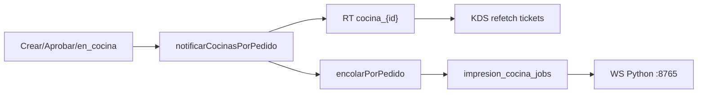

# Auditoría — Cocina / KDS (Prompt 12)

> **Fecha:** 2026-08-06  
> **Alcance:** sync Realtime pedido→KDS, cancelación de ítem en preparación, priorización de tickets, reimpresión de comandas.  
> **Verificación:** `scripts/verificar-kds.ps1` (OK, exit 0).  
> Código: `foody_backend/src/modulos/cocinas/` · `lib/features/cocinas/` · `impresion.service.ts`.

Leyenda: 🟣 abierto · 🟡 aceptado/parcial · ✅ cerrado / comprobado OK

---

## Resumen ejecutivo

| Pregunta | Respuesta |
|----------|-----------|
| Sync realtime pedido nuevo → KDS | **Sí** — `notificarCocinasPorPedido` → canal `cocina_{id}` evento `cocina_actualizada` + poll 90/45 s; KDS refetch + sonido/haptic |
| Cancelar ítem ya en preparación | **Parcial** — cocina **no** DELETE (404); marca `no_disponible`. Staff sí `DELETE /pedidos/:id/items/:itemId` (merma+alerta); KDS lo pierde al refetch |
| Priorización / orden tickets | Backend FIFO `ORDER BY p.created_at ASC`; Flutter reordena: `[URGENTE]` → ≥20 min → ≥10 min → resto |
| Reimpresión comandas | **Sí indirecta** — `encolarPorPedido` ++`comanda_copia` + job cola; sin `POST /impresion/reimprimir` |

---

## Arquitectura KDS



### Endpoints

| Método | Ruta | Rol |
|--------|------|-----|
| GET | `/cocina/cocinas` | Estaciones visibles (filtradas por `cocina_id` del usuario) |
| GET | `/cocina/tickets/:cocina_id` | Tickets activos FIFO |
| PATCH | `/cocina/items/:id/estado` | `pendiente\|preparando\|listo\|no_disponible` |
| PATCH | `/cocina/items/:id/observaciones` | Nota libre |
| PATCH | `/cocina/items/:id/prioridad` | Prefijo `[URGENTE]` en obs |
| DELETE | `/pedidos/:id/items/:itemId` | Staff — cancelar línea (no es ruta `/cocina`) |

### Flutter
- `KdsScreen` → `FoodyRealtime.suscribirCocina` + `PollRealtimeRespaldo`
- Sonido/haptic al detectar ticket nuevo
- Tabs Cocina / Listos; chip URGENTE si obs contiene `[URGENTE]`
- **No** llama `PATCH .../prioridad` (repo sin método)

---

## Hallazgos

| ID | Estado | Sev | Hallazgo | Evidencia |
|----|--------|-----|----------|-----------|
| **COC-NODISP-01** | 🟣 | **Alta** | `no_disponible` **no cuenta** como “listo” al recalcular pedido. Con 1 ítem `no_disponible` + resto `listo`, el pedido **nunca** pasa a `listo` (queda `en_cocina`). Bloquea cocina/caja/domicilio. | `cocinas.service.ts:379-399`; script C: got=`en_cocina` |
| **COC-CANCEL-01** | 🟡 | Media | Cancelar ítem en prep: cocina solo tiene `no_disponible` (ítem permanece). Cancelación real = DELETE staff con merma+alerta. Hueco UX: cocina no puede “quitar” del ticket. | DELETE `/cocina/items` → 404; staff DELETE OK |
| **COC-UI-PRIO-01** | 🟣 | Media | API `PATCH .../prioridad` funciona; Flutter KDS **no expone** botón ni llama el endpoint — solo lee `[URGENTE]` si alguien lo puso por API/SQL. | `cocinas_repository.dart` sin prioridad; `kds_screen.dart:1313` solo lectura |
| **COC-FSM-01** | 🟡 | Baja | Sin máquina de estados en ítem: `pendiente→listo` directo permitido. | Script F OK |
| **COC-REIMP-01** | ✅ | Baja | `POST /impresion/reimprimir` + botón KDS; reencola (`comanda_copia`) | `impresion.controller` + `kds_screen` |
| **COC-ORDER-01** | ✅ | — | Backend FIFO por `created_at`; cliente prioriza urgencia/tiempo. | `listarTickets` ORDER BY; `_prioridadSort` |
| **COC-RT-01** | ✅ | — | Pedido nuevo visible en tickets; `comanda_copia≥1`; canal RT documentado. | Script A |
| **COC-FLOW-01** | ✅ | — | `preparando` parcial mantiene `en_cocina`; todos `listo` → pedido `listo`. | Script B |
| **COC-DEL-01** | ✅ | — | DELETE staff de ítem `preparando` → desaparece del KDS + alerta. | Script C |

---

## Sync realtime (detalle)

| Paso | Mecanismo |
|------|-----------|
| Emit | `PedidosSoporteService.notificarCocinasPorPedido` → `realtime.cocinaActualizada` |
| Canal | `cocina_{cocinaId}` / evento `cocina_actualizada` |
| Payload típico | `{ cocina_id, pedido_id, sucursal_id, accion? }` |
| Cliente | debounce 300 ms → `GET /cocina/tickets` |
| Fallback | poll 90 s (45 s si RT caído) |
| Impresión | misma llamada encola job (cola 5 s → WS Python) |

Triggers de notificación: crear/`en_cocina`, aprobar QR, agregar/eliminar/editar ítems (si `reimprimir`).

---

## Cancelación ítem en preparación

| Actor | Acción | Resultado |
|-------|--------|-----------|
| Cocina | `estado_cocina=no_disponible` | Ítem sigue en ticket (pestaña Listos si todos listos/no_disp); alerta; job impresión especial; **pedido puede quedar trabado** (COC-NODISP-01) |
| Staff (mesero/caja/admin) | `DELETE /pedidos/.../items/...` | Borra fila; merma si ya preparando/listo; realtime `item_eliminado`; KDS refetch lo pierde |
| Cocina | DELETE | **No existe** (404) |

---

## Priorización

1. **SQL:** `ORDER BY p.created_at ASC` (FIFO estricto).
2. **Flutter:** re-sort — `[URGENTE]` (0) → demora ≥20 min (1) → ≥10 min (2) → resto (3); tie-break `cocina_desde`.
3. **API urgencia:** escribe/quita prefijo en `observaciones` (sin columna BD).
4. **Demoras:** al listar tickets, alerta `demora_cocina` si ítem pendiente/preparando >20 min.

---

## Reimpresión

| Mecanismo | Qué hace |
|-----------|----------|
| `encolarPorPedido` | `comanda_copia++`, INSERT job con pie `Copia N`, `procesarCola` |
| Disparadores | Crear a cocina, aprobar, agregar ítems, editar (si `reimprimir`), eliminar |
| Endpoint dedicado | **No** (`POST /impresion/reimprimir` = 404) |
| KDS UI | Sin botón “Reimprimir comanda” |

Verificado: editar cantidad → `reimprimir=true`, `comanda_copia` 2→3, jobs 2→3.

---

## Backlog remediación (orden)

1. **COC-FIX-01** — Recalcular pedido: tratar `no_disponible` como “resuelto” (contar con `listo` para pasar a `listo`, o forzar merma/cancelación de línea). Relacionados Prompt 29: **CONS-KDS-UI-01**, **CONS-NODISP-STOCK-01** (`AUDITORIA_CONSISTENCIA_MODULOS.md`). Prompt 30: **VIE-09** (agotado mid-prep — decisión A/B/C en `AUDITORIA_CASOS_VIERNES.md`).
2. **COC-FIX-02** — UI KDS: botón Urgente → `PATCH .../prioridad` (+ opcional Reimprimir que llame encolar).
3. **COC-FIX-03** — Decidir producto: ¿cocina puede cancelar línea o solo `no_disponible`? Documentar en UX mesero. (= parte **VIE-02**)
4. **COC-FIX-04** (opcional) — Validar transiciones ítem o al menos bloquear saltos absurdos.
5. **COC-FIX-05** — Endpoint o acción explícita `POST /impresion/reimprimir/:pedido_id` (= **VIE-10**).

---

## Verificación

```text
.\scripts\verificar-kds.ps1
→ Verificacion KDS OK (exit 0)
```

**Gaps:** click-through KDS en dispositivo; impresión física térmica (R5); agente Python no requerido para este script (solo cola BD).
