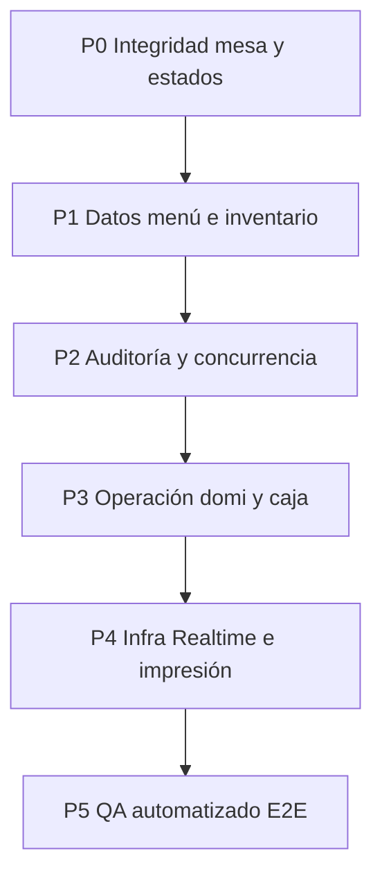

# Foody — Auditoría E2E de flujos operativos

> **ARCHIVADO 2026-06-28** — Resumen ejecutivo obsoleto. Estado vivo: **`docs/MASTER_STATUS.md`** + **`docs/REGISTRO_IRREGULARIDADES_FLUJOS.md`**. Este archivo conserva el trazado E2E útil.

> **Documento histórico** — resultado de auditoría QA Lead + Software Architect (2026-06-19).

**Última actualización:** 2026-06-19 — P0–P5 implementados salvo P4.1 impresión física.

**Próximo paso recomendado del plan:** **P4.1** impresión física (pospuesto). Validar con scripts en `scripts/verificar-*.ps1`.

---

## Resumen ejecutivo

| Área | Veredicto | Bloqueador principal |
|------|-----------|----------------------|
| Mesa QR → mesero → cocina → caja (happy path con cobro) | 🟡 Usable en demo | R1: `entregado` libera mesa sin `pagado` |
| Domicilio planta / independiente | 🟡 Parcial | R3, R8: saltos de estado y dispatch condicionado |
| Mesero crea pedido → cocina | ✅ | R10: race stock en QR (aceptable con validación al aprobar) |
| Cocina → listo → mesero/domi | 🟡 | R11: regresión KDS a `confirmado` |
| Caja → pago → liberación mesa | 🟡 | R1, R2: liberación y `estado_operativo` |
| Inventario agotado → menú | 🟡 | R4: ajuste manual no propaga |
| Transferencia mesa | 🟡 | R6, R7: auditoría y concurrencia |
| Cierre caja | ✅ contable | R13: no bloquea operación abierta |

**Total hallazgos:** 13 riesgos (R1–R13). **4 críticos (P0)**, **4 altos (P1)**, **3 medios (P2)**, **2 infra (P3–P4)**.

---

## Leyenda

| Símbolo | Significado |
|---------|-------------|
| 🔴 P0 | Corrupción de negocio / dinero / mesa mal liberada — corregir antes de producción |
| 🟠 P1 | Integridad operativa — corregir en la misma semana |
| 🟡 P2 | Auditoría, UX, concurrencia — siguiente sprint |
| 🔵 P3 | Infra / observabilidad — paralelo o sprint dedicado |
| ⏳ P4 | Spec pospuesta (impresión, DIAN) — según roadmap |

---

## 1. Flujos trazados (origen → destino)

### 1.1 Cliente → QR → Mesero → Cocina → Caja (mesa)

| # | Pantalla origen | Endpoint | Servicio backend | Tablas principales | Evento Realtime / FCM | Pantalla destino |
|---|-----------------|----------|------------------|-------------------|----------------------|------------------|
| 1 | `MesaQrEntradaScreen` (`/mesa/:qrToken`) | `GET /menu/mesa/:qr_token` | `MenuService.obtenerPorMesaQr` | `mesas`, `sucursales`, `productos`, `categorias` | — | `MenuScreenFoody` |
| 2 | `MenuScreenFoody` + carrito | `POST /pedidos` (público) | `PedidosCrearService.crear` | `pedidos` (`pendiente_aprobacion`), `pedido_items`, `dispositivos_cliente`, `estados_pedido_historial` | `pedido_actualizado`, `qr_aprobacion_urgente`, FCM mesero | `SeguimientoPedidoScreen` |
| 3 | `MesasGridWidget` (mesero) | `PATCH /pedidos/:id/aprobar` | `PedidosEstadoService.aprobarMesa` | `pedidos`→`en_cocina`, `stock_descontado=true`, `mesas.mesera_asignada_id` | `pedido_actualizado`, `catalogo_disponibilidad` | Kanban / KDS |
| 4 | `KdsScreen` | `PATCH /cocinas/tickets/items/:id/estado` | `CocinasService.cambiarEstadoItem` | `pedido_items.estado_cocina`, `pedidos.estado` | `cocina_actualizada`, `pedido_actualizado`, `estado_actualizado` (canal pedido) | Kanban columna **Listo** |
| 5 | Kanban / sheet mesa | `PATCH /pedidos/:id/estado` → `pagando` | `PedidosEstadoService.cambiarEstado` | `estados_pedido_historial` | `pedido_actualizado` | Columna **Pagando** |
| 6 | `MesaPedidosSheet` / cajero | `POST /pedidos/mesa/:mesaId/cobrar` | `PedidosPagosService.cobrarCuentaMesa` | `pagos_pedido`, `movimientos_caja`, `pedidos`→`pagado`, `mesas`→libre | `mesas_actualizadas`, `caja_movimiento` | Grid mesas **libre** |

**Archivos Flutter clave:** `lib/features/mesa/presentation/mesa_qr_entrada_screen.dart`, `lib/features/menu/presentation/menu_screen_foody.dart`, `lib/features/admin/presentation/widgets/mesas_grid_widget.dart`, `lib/features/cocinas/presentation/kds_screen.dart`, `lib/features/mesa/presentation/mesa_pedidos_sheet.dart`.

**Archivos backend clave:** `foody_backend/src/modulos/menu/`, `foody_backend/src/modulos/pedidos/pedidos-crear.service.ts`, `pedidos-estado.service.ts`, `pedidos-pagos.service.ts`, `foody_backend/src/modulos/cocinas/cocinas.service.ts`.

---

### 1.2 Cliente → QR → Mesero → Cocina → Domiciliario

> **Nota:** El flujo QR es siempre `tipo=mesa`. La variante **domicilio** empieza en checkout cliente o pedido staff.

| # | Origen | API | Servicio | Tablas | Evento | Destino |
|---|--------|-----|----------|--------|--------|---------|
| 1 | Checkout domicilio | `POST /pedidos` | `PedidosCrearService` | `pedidos` (`pendiente`), `zonas_cobertura` | `pedido_actualizado` | Seguimiento |
| 2 | Kanban | `PATCH /pedidos/:id/estado` → `en_cocina` | `PedidosEstadoService` | stock descuenta | cocina + catálogo | KDS |
| 3 | KDS | ítems → `listo` | `CocinasService` | `pedidos`→`listo` | dispatch hook | Kanban |
| 4a | Kanban (manual) | `POST /domiciliarios/asignar` | `DomiciliariosService.asignarPlanta` | `asignaciones_domicilio`, `asignado` | `domiciliario_{usuarioId}` | App domi planta |
| 4b | Auto (sin planta libre) | (post `listo`) | `DispatchService.intentarDispatchAutomatico` | `ofertas_pedido` | `oferta_nueva` + FCM | App independiente |
| 5 | App domi | `PATCH .../en-camino`, confirmar entrega | `DomiciliariosService` | `en_camino` → `entregado` | Realtime | Historial |

---

### 1.3 Mesero → Pedido → Cocina

| Origen | API | Servicio | Tablas | Evento | Destino |
|--------|-----|----------|--------|--------|---------|
| `PedidoCajeroScreen` / mesa libre | `POST /pedidos/staff` | `PedidosCrearService` (`en_cocina` directo) | `pedidos`, items, stock descontado | `pedido_actualizado`, cola impresión | `KdsScreen` |

Turno mesero: `assertMeseraPuedeTomarMesa` si `rol=mesero`. Cajero: sin bloqueo (`modoCajero`).

---

### 1.4 Cocina → Pedido listo → Mesero

| Origen | API | Servicio | Tablas | Evento | Destino |
|--------|-----|----------|--------|--------|---------|
| `KdsScreen` | `PATCH .../items/:id/estado` = `listo` | `CocinasService.cambiarEstadoItem` | `pedidos.estado=listo` | `pedido_actualizado` | `PedidosKanbanWidget` / grid mesas |

No hay canal Realtime dedicado al mesero; usa broadcast `sucursal_{id}`.

---

### 1.5 Cocina → Pedido listo → Domiciliario

Igual que §1.2 pasos 3–5. Dispatch automático **no** corre si hay planta libre (espera asignación manual en Kanban).

---

### 1.6 Caja → Pago → Liberación de mesa

| Origen | API | Servicio | Tablas | Evento | Destino |
|--------|-----|----------|--------|--------|---------|
| Sheet mesa / cajero | `POST /pedidos/mesa/:id/cobrar` | `PedidosPagosService.cobrarCuentaMesa` | `pagos_pedido`, `movimientos_caja`, `pagado`, mesa libre | `mesas_actualizadas` | Grid |
| Kanban llevar | `POST /pedidos/:id/cobrar` | `cobrarPedidoCaja` | Igual sin mesa | `caja_movimiento` | Kanban |

**Precondición:** caja abierta (`exigirCaja: true` en `PedidosCajaAuditoriaService`).

---

### 1.7 Inventario → Stock agotado → Menú

| Origen | API | Servicio | Tablas | Evento | Destino |
|--------|-----|----------|--------|--------|---------|
| Venta / aprobar pedido | (transacción pedido) | `PedidosInventarioService.descontarStockPedido` | `ingredientes`, `productos.disponible` | `catalogo_disponibilidad` | `MenuScreenFoody` (refresh) |
| Admin toggle | `PATCH /catalogo/productos/:id/disponibilidad` | `CatalogoService.cambiarDisponibilidad` | `productos` | `catalogo_disponibilidad` | Menú |
| Ajuste / conteo manual | `PATCH /inventario/ingredientes/:id` | `InventarioService.actualizarIngrediente` | Solo `ingredientes` | **Ninguno** | Menú **no actualiza** 🔴 |

---

### 1.8 Admin → Transferencia de mesa

| Origen | API | Servicio | Tablas | Evento | Destino |
|--------|-----|----------|--------|--------|---------|
| `MesasGridWidget` | `POST /mesas/transferir` | `MesasService.transferir` | `pedidos.mesa_id`, `transferencias_mesa` | `mesas_actualizadas` | Grid origen/destino |

**Gap:** no escribe `auditoria_logs`; no actualiza `estado_operativo`.

---

### 1.9 Admin → Cierre de caja

| Origen | API | Servicio | Tablas | Evento | Destino |
|--------|-----|----------|--------|--------|---------|
| Panel caja | `POST /caja/cerrar` | `CajaService.cerrar` | `cajas`, `auditoria_logs`, alerta cuadre | — | Reportes / nueva apertura |

---

## 2. Matriz consolidada

| FLUJO | TABLAS | APIS | EVENTOS REALTIME / FCM | RIESGOS | ESTADO |
|-------|--------|------|------------------------|---------|--------|
| Cliente→QR→Mesero→Cocina→Caja | `mesas`, `pedidos`, `pedido_items`, `estados_pedido_historial`, `ingredientes`, `movimientos_ingrediente`, `pagos_pedido`, `movimientos_caja`, `cajas`, `margenes_venta` | `GET /menu/mesa/:token`, `POST /pedidos`, `PATCH .../aprobar`, `PATCH cocina item`, `PATCH estado`, `POST .../mesa/:id/cobrar` | `qr_aprobacion_urgente`, `pedido_actualizado`, `cocina_actualizada`, `catalogo_disponibilidad`, `mesas_actualizadas`, `caja_movimiento`, FCM | R1, R2, R5, R9 | 🟡 |
| Cliente→…→Domiciliario | + `asignaciones_domicilio`, `ofertas_pedido`, `zonas_cobertura` | + `POST /domiciliarios/asignar`, dispatch | `oferta_nueva`, `pedido_asignado`, FCM | R3, R8, R12 | 🟡 |
| Mesero→Pedido→Cocina | creación staff | `POST /pedidos/staff` | `pedido_actualizado` | R10 | ✅ |
| Cocina→Listo→Mesero | `pedido_items`, `pedidos` | `PATCH cocina item` | `pedido_actualizado` | R11 | 🟡 |
| Cocina→Listo→Domi | `asignaciones_domicilio` | asignar + app | `domiciliario_*` | R3, R8 | 🟡 |
| Caja→Pago→Libera mesa | `pagos_pedido`, `mesas` | cobrar mesa / pedido | `mesas_actualizadas` | R1, R2 | 🟡 |
| Inventario→Menú | `ingredientes`, `productos`, `receta_items` | venta; PATCH catálogo | `catalogo_disponibilidad` | R4 | 🟡 |
| Transferencia mesa | `transferencias_mesa` | `POST /mesas/transferir` | `mesas_actualizadas` | R6, R7 | 🟡 |
| Cierre caja | `cajas`, `movimientos_caja` | `POST /caja/cerrar` | — | R13 | ✅ |

---

## 3. Registro de riesgos (detalle)

### R1 — 🔴 Mesa liberada sin cobro (`entregado` ≠ `pagado`)

**Qué pasa:** Kanban permite `pagando → entregado`. Al llegar a `entregado`, `PedidosEstadoService` llama `liberarMesaSiSinPedidosActivos`, que **no** exige saldo cero ni estado `pagado`.

**Código:**

- `foody_backend/src/modulos/pedidos/pedido-estados.ts` — `pagando: ['entregado', 'cancelado']`
- `foody_backend/src/modulos/pedidos/pedidos-estado.service.ts` — liberación en `entregado`
- `foody_backend/src/modulos/pedidos/pedidos-cuenta-mesa.service.ts` — pedidos activos excluyen `entregado`

**Impacto:** mesa libre + pedido impago = pérdida contable y dato huérfano.

**Estados imposibles:** `entregado` con `monto_pagado < total` y mesa `libre`.

---

### R2 — 🟠 `estado_operativo` desincronizado

**Qué pasa:** Crear pedido mesa no pone `mesas.estado_operativo = 'ocupada'`. El grid infiere ocupación por LATERAL en `pedidos` activos. Tras liberar solo se limpia `mesera_asignada_id`. El color «pagando» del spec no existe en BD.

**Archivos:** `pedidos-crear.service.ts`, `mesas.service.ts` (listar), `pedidos-pagos.service.ts` (liberar).

---

### R3 — 🔴 Domicilio puede saltarse repartidor

**Qué pasa:** `listo → entregado` permitido para `tipo=domicilio` (no hay guard en `transicionEstadoPermitida`).

**Impacto:** pedido «entregado» sin `asignado` / `en_camino` / fila en `asignaciones_domicilio`.

---

### R4 — 🔴 Inventario manual no actualiza menú

**Qué pasa:** `InventarioService.actualizarIngrediente` (ajuste, conteo) solo toca `ingredientes`. No recalcula `productos.disponible` ni emite `catalogo_disponibilidad`.

**Contraste:** `PedidosInventarioService.descontarStockPedido` sí pone `disponible=false` y notifica.

**Archivos:** `foody_backend/src/modulos/inventario/inventario.service.ts` vs `pedidos-inventario.service.ts`.

---

### R5 — 🔵 Impresión física no operativa

Cola `impresion_cocina_jobs` + gateway NestJS existen; agente `python-escpos` ⏳ pospuesto. Cocina depende 100 % del KDS web.

---

### R6 — 🟡 Transferencia sin `auditoria_logs`

`MesasService.transferir` inserta en `transferencias_mesa` pero no en `auditoria_logs` (a diferencia de `unirMesas` y `salioSinPagar`).

---

### R7 — 🟡 Race en transferencia de mesa

Validación «destino libre» + `UPDATE pedidos.mesa_id` sin `FOR UPDATE` en mesa destino: dos transferencias concurrentes pueden colisionar.

---

### R8 — 🟠 Dispatch automático condicionado

`DispatchService.intentarDispatchAutomatico` retorna `planta_disponible` si hay domi planta libre — **no** asigna solo. Si nadie asigna en Kanban, pedido queda en `listo` indefinidamente.

---

### R9 — 🔵 Realtime silencioso sin env

Sin `SUPABASE_URL` + `SUPABASE_SERVICE_KEY`, `RealtimeBroadcastService` no emite (log warn). UIs tienen poll de respaldo (KDS 60 s) pero Kanban puede quedar stale.

---

### R10 — 🟡 Race stock QR

Cliente QR: valida stock al crear (`pendiente_aprobacion`), descuenta al aprobar. Dos mesas pueden pasar validación al crear; una falla al aprobar — **comportamiento aceptable** si se documenta.

---

### R11 — 🟠 KDS regresa pedido a `confirmado`

Si todos los ítems vuelven a `pendiente`, `CocinasService.cambiarEstadoItem` setea `pedidos.estado = 'confirmado'` (legacy), fuera del Kanban v2.

**Archivo:** `foody_backend/src/modulos/cocinas/cocinas.service.ts` ~línea 308.

---

### R12 — 🟠 Domicilio `entregado` sin `pagado`

Flujo domi termina en `entregado`; cobro en caja es path separado. Pedidos con `metodo_pago=pendiente` pueden quedar sin cuadrar en reportes.

---

### R13 — 🟡 Cierre caja con operación abierta

`CajaService.cerrar` no valida pedidos en `pagando`/`listo`/mesas con saldo pendiente.

---

## 4. Procesos sin auditoría

| Proceso | Historial / auditoría | Gap |
|---------|----------------------|-----|
| Crear pedido | ✅ `auditoria_logs` + `estados_pedido_historial` | — |
| Cambio estado Kanban | ✅ `estados_pedido_historial` | — |
| Cobro mesa/caja | ✅ `pagos_pedido` + `movimientos_caja` | — |
| Transferencia mesa | ⚠️ Solo `transferencias_mesa` | Falta `auditoria_logs` (R6) |
| Ajuste inventario | ✅ `movimientos_ingrediente` | Falta efecto menú (R4) |
| Cierre caja | ✅ `auditoria_logs` + alerta cuadre | — |
| KDS marcar ítem | ⚠️ Historial a nivel pedido | Sin log por ítem cocina |
| Asignar domiciliario | ⚠️ `estados_pedido_historial` | Sin fila dedicada en `asignaciones` audit |

---

## 5. Conexiones rotas o parciales

| Conexión | Estado | Acción plan |
|----------|--------|-------------|
| Backend → Supabase Realtime | 🟡 Depende env | P4.2 health check |
| Backend → Python impresora | ⏳ | P4.1 roadmap Módulo 3 |
| Inventario ajuste → menú cliente | 🔴 | P1.1 |
| FCM web deep link segundo plano | 🟡 | Backlog FCM |
| Menú escucha `catalogo_disponibilidad` | ✅ | `MenuScreenFoody` + `FoodyRealtime.suscribirCatalogo` |
| Scripts QA API | ✅ | `scripts/verificar-todos-e2e.ps1` — **4/4 OK** (2026-06-19) |

**Scripts de verificación existentes:**

- `scripts/verificar-todos-e2e.ps1` — limpieza demo + P0 pagos + P0.2/P0.3 domi + P1.1 inventario + P2 transferencia
- `scripts/limpiar-demo-qa.ps1` — cancela pedidos activos + restaura stock demo
- `scripts/verificar-paso0.ps1` — fundación API+BD
- `scripts/verificar-operacion-mesas.ps1` — cajero + mesero
- `scripts/verificar-pagos-mesa.ps1` — cobro mesa + P0.1 + health Realtime
- `scripts/verificar-flujo-domicilio.ps1` — P0.2/P0.3 domicilio
- `scripts/verificar-inventario-menu.ps1` — P1.1 stock → menú
- `scripts/verificar-transferencia-mesa.ps1` — P2 transferencia mesa
- `scripts/verificar-cuadre-caja.ps1` — cuadre contable
- `scripts/verificar-cajero-mesas.ps1` — cajero sin turno

---

## 6. Plan de remediación — orden correcto y prioritario

> **Regla:** no saltar fases. P0 corrige dinero/mesas; P1 cierra loops de datos; P2 endurece operación; P3–P4 infra y pulido.



---

### Fase 0 — P0: Integridad mesa y máquina de estados (1–2 días)

**Objetivo:** que ningún cierre operativo (`entregado` / liberar mesa) ocurra sin cobro cuando aplique mesa.

#### P0.1 — R1: Liberación de mesa solo con cobro completo

| Campo | Detalle |
|-------|---------|
| **Prioridad** | 🔴 1 (primero) |
| **Depende de** | — |
| **Archivos** | `pedidos-cuenta-mesa.service.ts`, `pedidos-estado.service.ts`, `pedido-estados.ts`, `lib/features/admin/domain/pedido_admin_model.dart`, `docs/FLUJO_ESTADOS_PEDIDOS.md` |

**Pasos:**

1. **Backend — helper de liberación:** En `PedidosCuentaMesaService`, cambiar `liberarMesaSiSinPedidosActivos` para considerar pedidos activos como aquellos con `estado NOT IN ('cancelado','rechazado','pagado')` **Y** `(estado != 'entregado' OR monto_pagado < total - 0.01)` para pedidos con `mesa_id`.
2. **Backend — no liberar en `entregado` sin pago:** En `PedidosEstadoService.cambiarEstado`, antes de llamar liberación en `entregado`, verificar:
   - Si `tipo` es `mesa` o tiene `mesa_id` y `monto_pagado < total`, **no** liberar mesa (o rechazar transición si se prefiere cierre estricto).
3. **Backend — regla de transición (elegir A o B):**
   - **Opción A (recomendada):** Mantener `pagando → entregado` solo para `para_llevar` sin mesa; para `mesa`, exigir `pagando → pagado` vía cobro API (quitar `entregado` de destinos permitidos cuando `mesa_id != null`).
   - **Opción B:** Permitir `entregado` como «se fueron» pero mesa sigue ocupada hasta `pagado` o acción admin «salió sin pagar».
4. **Flutter — Kanban:** En `PedidoAdminModel.accionRapida`, ocultar botón «Entregado» en columna Pagando cuando el pedido tiene `mesa_id` (forzar cobro en sheet).
5. **Documentar** en `FLUJO_ESTADOS_PEDIDOS.md` la regla elegida.
6. **Test:** Extender `scripts/verificar-pagos-mesa.ps1` con caso: pedido `pagando` → intentar `entregado` → mesa **sigue ocupada**; cobrar → mesa libre.

**Criterio de aceptación:** Tras marcar entregado sin cobrar en mesa, la mesa **permanece** con pedido activo visible en grid; tras `POST .../cobrar`, mesa libre.

---

#### P0.2 — R3: Bloquear `listo → entregado` en domicilio

| Campo | Detalle |
|-------|---------|
| **Prioridad** | 🔴 2 |
| **Depende de** | — |
| **Archivos** | `pedido-estados.ts`, tests unitarios si existen |

**Pasos:**

1. En `transicionEstadoPermitida`, añadir:
   ```typescript
   if (estadoNuevo === 'entregado' && estadoActual === 'listo' && tipo === 'domicilio') {
     return false;
   }
   ```
2. Permitir `entregado` solo desde `en_camino` para domicilio (ya permitido).
3. **Flutter Kanban:** ocultar acción «Entregado» en columna Listo para `tipo=domicilio`; mostrar UI asignar repartidor.
4. **Test API:** PATCH estado `listo` → `entregado` en pedido domicilio → 400 `TRANSICION_ESTADO_INVALIDA`.

**Criterio de aceptación:** Imposible cerrar domicilio como entregado sin pasar por asignación y `en_camino`.

---

#### P0.3 — R12: Política de cobro domicilio al entregar

| Campo | Detalle |
|-------|---------|
| **Prioridad** | 🔴 3 |
| **Depende de** | P0.2 |
| **Archivos** | `domiciliarios.service.ts` (`confirmarEntrega`), `pedidos-pagos.service.ts`, UI app domi |

**Pasos:**

1. **Decisión producto (documentar en este archivo):**
   - **Prepagado** (cliente pagó online): `metodo_pago != 'pendiente'` al crear → `entregado` OK.
   - **Contra entrega:** domiciliario captura método en `ConfirmarEntregaDto` → si no pagado, pedido queda `entregado` + flag `cobro_pendiente` o estado intermedio `entregado_pendiente_cobro` (migración SQL si hace falta).
2. **Mínimo viable sin migración:** En `confirmarEntrega`, si `metodo_pago` es `pendiente`, no pasar a `entregado` hasta registrar pago (`POST /pedidos/:id/cobrar`) o marcar método en DTO y crear `movimientos_caja` si caja abierta.
3. **Reportes:** incluir pedidos `entregado` con saldo en cuadre caja.

**Criterio de aceptación:** Ningún domicilio `entregado` con `monto_pagado=0` y `metodo_pago=pendiente` sin alerta admin.

---

### Fase 1 — P1: Cerrar loop inventario → menú y estado mesa (2–3 días)

#### P1.1 — R4: Propagación inventario → `productos.disponible`

| Campo | Detalle |
|-------|---------|
| **Prioridad** | 🟠 4 |
| **Depende de** | P0 completo (evitar mezclar PRs) |
| **Archivos** | Nuevo helper compartido o método en `CosteoService` / `PedidosInventarioService`; `inventario.service.ts`; `catalogo.service.ts` |

**Pasos:**

1. **Extraer** lógica de «recalcular disponibilidad por ingrediente» desde `PedidosInventarioService` a servicio compartido, p. ej. `CatalogoDisponibilidadService`:
   - Input: `sucursal_id`, `ingrediente_id` (opcional: todos).
   - Query productos cuya receta (directa o vía `producto_items_incluidos`) usa ese ingrediente con `descontar_stock=true`.
   - Para cada producto: si **algún** ingrediente crítico tiene `stock_actual <= 0` → `disponible=false`; si todos > 0 → `disponible=true`.
2. **Invocar** al final de:
   - `InventarioService.actualizarIngrediente` (cuando cambia `stock_nuevo`)
   - `InventarioService.registrarCompra` / conteo físico (mismos paths que mutan stock)
   - Traslados entre sedes (origen y destino)
3. **Emitir** `realtime.catalogoDisponibilidad` con lista de `producto_ids` afectados (mismo patrón que `PedidosSoporteService.notificarCatalogoDisponibilidad`).
4. **Test manual:** bajar stock de ingrediente base a 0 vía admin inventario → menú cliente oculta plato sin recargar app (Realtime).

**Criterio de aceptación:** Ajuste manual 0 stock → broadcast + `GET /menu/:sucursal` refleja `disponible=false`.

---

#### P1.2 — R2: Sincronizar `estado_operativo` en mesas

| Campo | Detalle |
|-------|---------|
| **Prioridad** | 🟠 5 |
| **Depende de** | P0.1 (misma lógica de «activo») |
| **Archivos** | `pedidos-crear.service.ts`, `pedidos-estado.service.ts`, `pedidos-pagos.service.ts`, `mesas.service.ts` |

**Pasos:**

1. Al crear pedido con `mesa_id` y estado no terminal → `UPDATE mesas SET estado_operativo = 'ocupada'`.
2. Al pasar a `pagando` (PATCH estado) → `estado_operativo = 'pagando'` (opcional, mejora UX grid).
3. Al liberar mesa (cobro completo o cancelación total) → `estado_operativo = 'libre'` (ya parcial en `pedidos-pagos`).
4. **Flutter:** usar `estado_operativo` como refuerzo visual si existe; mantener LATERAL como fuente de verdad.
5. **Test:** `verificar-operacion-mesas.ps1` — assert `estado_operativo` tras crear y cobrar.

---

#### P1.3 — R11: KDS no debe regresar a `confirmado`

| Campo | Detalle |
|-------|---------|
| **Prioridad** | 🟠 6 |
| **Depende de** | — |
| **Archivos** | `cocinas.service.ts` |

**Pasos:**

1. En `cambiarEstadoItem`, rama `else` (ningún ítem en proceso): usar `en_cocina` en lugar de `confirmado`.
2. Migración datos opcional: `UPDATE pedidos SET estado = 'en_cocina' WHERE estado = 'confirmado'` en entornos demo.
3. **Test:** marcar todos ítems `pendiente` de nuevo → pedido permanece visible en columna En cocina del Kanban.

---

#### P1.4 — Cobro pedido caja libera mesa (gap menor)

| Campo | Detalle |
|-------|---------|
| **Prioridad** | 🟠 7 |
| **Depende de** | P0.1 |
| **Archivos** | `pedidos-pagos.service.ts` (`cobrarPedidoCaja`) |

**Pasos:**

1. Tras cobro total en `cobrarPedidoCaja`, si pedido tiene `mesa_id`, llamar `liberarMesasGrupo` / `liberarMesaSiSinPedidosActivos`.
2. Emitir `mesas_actualizadas`.

---

### Fase 2 — P2: Auditoría y concurrencia (1–2 días)

#### P2.1 — R6: Auditoría en transferencia de mesa

**Pasos:**

1. En `MesasService.transferir`, tras INSERT en `transferencias_mesa`:
   ```sql
   INSERT INTO auditoria_logs (sucursal_id, usuario_id, accion, tabla_afectada, registro_id, datos_despues)
   VALUES (..., 'TRANSFERIR_MESA', 'mesas', pedido_id, jsonb)
   ```
2. Incluir en JSON: origen, destino, numero_pedido, motivo.

---

#### P2.2 — R7: Lock en mesa destino al transferir

**Pasos:**

1. En transacción `transferir`, `SELECT ... FROM mesas WHERE id = destino FOR UPDATE`.
2. Re-validar pedidos activos en destino dentro del lock.
3. Opcional: índice parcial en `pedidos(mesa_id) WHERE estado NOT IN (...)`.

---

### Fase 3 — P3: Operación domicilio y caja (2 días)

#### P3.1 — R8: Alerta pedido listo sin asignar

**Pasos:**

1. Cron o hook post-`listo`: si `tipo=domicilio` y sin `asignaciones_domicilio` activa tras N minutos → `alertas` tipo `domicilio_sin_asignar`.
2. Kanban: badge visible en columna Listo.
3. Opcional: auto-asignar planta libre más antiguo (feature flag).

---

#### P3.2 — R13: Validación blanda al cerrar caja

**Pasos:**

1. En `CajaService.cerrar`, consultar COUNT pedidos activos (`pagando`, `listo`, `en_cocina`) con saldo > 0.
2. Si > 0: devolver warning en respuesta `{ advertencias: [...] }` o exigir `forzar: true` en DTO (admin).
3. **Flutter:** modal confirmación en pantalla cierre.

---

#### P3.3 — R10: Documentar race stock QR

**Pasos:**

1. Añadir nota en `docs/FLUJO_ESTADOS_PEDIDOS.md` y en respuesta API `STOCK_INSUFICIENTE` al aprobar.
2. Opcional futuro: reserva optimista con TTL en ingredientes (no implementar ahora).

---

### Fase 4 — P4: Infraestructura (paralelo / sprint dedicado)

#### P4.1 — R5: Impresión física (Módulo 3 roadmap)

Ver `docs/MODULOS_ESTADO.md` §7. Orden: agente Python → WebSocket → ticket por `cocina_id` al entrar `en_cocina`.

---

#### P4.2 — R9: Health Realtime

**Pasos:**

1. `GET /health/realtime` — intenta broadcast de prueba o reporta `configurado: boolean`.
2. Log ERROR al arranque si faltan vars Supabase.
3. Banner admin si Realtime desactivado.

---

#### P4.3 — FCM web deep link (backlog)

Ver `docs/MODULOS_ESTADO.md` §18 — `notificationclick` segundo plano.

---

### Fase 5 — P5: QA automatizado E2E (continuo)

#### P5.1 — Extender scripts PowerShell

| Script nuevo / extensión | Cubre |
|--------------------------|-------|
| `verificar-pagos-mesa.ps1` + caso entregado sin cobro | P0.1 |
| `verificar-flujo-domicilio.ps1` (nuevo) | P0.2, P0.3, asignar → en_camino → entregar |
| `verificar-inventario-menu.ps1` (nuevo) | P1.1 |
| `verificar-transferencia-mesa.ps1` (nuevo) | P2.1, P2.2 |

#### P5.2 — Checklist manual por rol (antes de demo cliente)

1. **Cliente QR:** escanear → pedir → seguimiento actualiza Realtime.
2. **Mesero:** aprobar QR → KDS ticket → listo → pagando → cobrar (no «entregado» sin cobro).
3. **Cajero:** caja abierta → cobro mixto mesa → cuadre 0.
4. **Cocina:** ítem listo → Kanban listo.
5. **Domi:** listo → asignar → en camino → entregar → reporte.
6. **Inventario:** ajuste a 0 → menú oculta producto.
7. **Admin:** transferir mesa → historial + grid correcto.

---

## 7. Orden de implementación resumido (tabla)

| Orden | ID | Riesgo | Tarea | Esfuerzo | Bloquea |
|-------|-----|--------|-------|----------|---------|
| 1 | P0.1 | R1 | Mesa no libera en entregado sin cobro | M | Producción mesa |
| 2 | P0.2 | R3 | Bloquear listo→entregado domicilio | S | Integridad domi |
| 3 | P0.3 | R12 | Cobro domicilio al entregar | M | Cuadre caja domi |
| 4 | P1.1 | R4 | Inventario → menú Realtime | M | Spec agotado |
| 5 | P1.2 | R2 | `estado_operativo` mesas | S | UX grid |
| 6 | P1.3 | R11 | KDS sin `confirmado` | S | Kanban |
| 7 | P1.4 | — | `cobrarPedidoCaja` libera mesa | S | Cobro llevar en mesa |
| 8 | P2.1 | R6 | Auditoría transferencia | S | Compliance |
| 9 | P2.2 | R7 | Lock transferencia | S | Concurrencia |
| 10 | P3.1 | R8 | Alerta domi sin asignar | M | Operación domi |
| 11 | P3.2 | R13 | Warning cierre caja | S | Cierre turno |
| 12 | P3.3 | R10 | Doc race stock QR | S | — |
| 13 | P4.1 | R5 | Impresión Python | L | Cocina física |
| 14 | P4.2 | R9 | Health Realtime | S | Observabilidad |
| 15 | P5.x | — | Scripts E2E | M | Regresión |

**Esfuerzo:** S = ≤4 h · M = 1–2 días · L = sprint.

---

## 8. Changelog de este documento

| Fecha | Cambio |
|-------|--------|
| 2026-06-19 | **P0–P3 implementados** — ver tabla §8.1 |
| 2026-06-19 | Auditoría E2E inicial: 9 flujos, matriz, 13 riesgos, plan P0–P5 |

### 8.1 Implementación (2026-06-19)

| ID | Estado | Resumen |
|----|--------|---------|
| P0.1 R1 | ✅ | Mesa no libera sin cobro; Kanban sin «Entregado» en mesa |
| P0.2 R3 | ✅ | Domicilio `entregado` solo desde `en_camino` |
| P0.3 R12 | ✅ | Cobro obligatorio en `confirmarEntrega` |
| P1.1 R4 | ✅ | `CatalogoDisponibilidadService` + inventario |
| P1.2 R2 | ✅ | `estado_operativo` mesas |
| P1.3 R11 | ✅ | KDS → `en_cocina` |
| P1.4 | ✅ | `cobrarPedidoCaja` libera mesa |
| P2.1–P2.2 | ✅ | Auditoría + lock transferencia |
| P3.1–P3.2 | ✅ | Alerta domi + advertencias cierre caja |
| P4.1 R5 | ⏳ | Impresión Python |
| P4.2 R9 | ✅ | `GET /health/realtime` + banner admin |
| P5 | ✅ | Scripts QA (`verificar-flujo-domicilio`, inventario-menu, transferencia, pagos-mesa+) |

---

## 9. Plantilla para cerrar un ítem del plan

Al completar P0.1, P1.1, etc.:

```markdown
### [Px.y] — YYYY-MM-DD
- Estado: ✅
- PR / commit: ...
- Archivos: ...
- Script QA: ... → OK
- Actualizado: FLUJO_ESTADOS_PEDIDOS.md / MODULOS_ESTADO.md
```

Marcar el ítem en §7 como ✅ y mover riesgo a «Resuelto» en §3.
