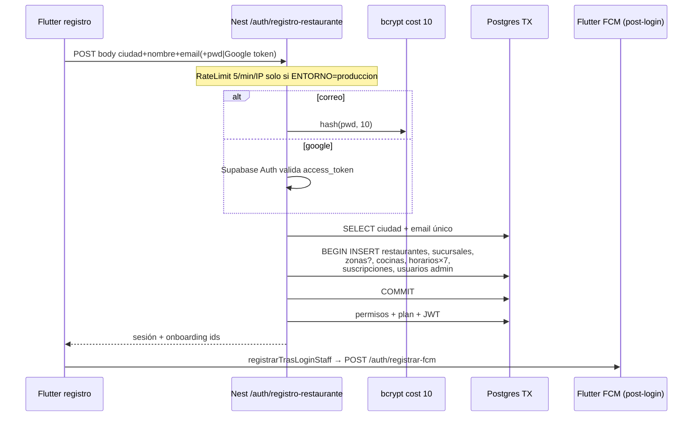

# Auditoría — Simulación de viralización / spike de registros (Prompt 32)

> **Fecha:** 2026-08-06  
> **Escenario:** Foody se vuelve viral; registros nuevos en **días**, no meses.  
> **Picos:** Día 1 = **500** · Día 2 = **5 000** · Día 3 = **20 000** · Día 4 = **40 000**.  
> **Método:** trazo del flujo real Nest/Flutter + límites medidos (Prompt 23/26/31) + límites externos documentados (Meta/FCM).  
> Relacionados: [`AUDITORIA_CAPACITY_PLANNING.md`](AUDITORIA_CAPACITY_PLANNING.md) · [`AUDITORIA_AUTH_JWT.md`](AUDITORIA_AUTH_JWT.md) · [`AUDITORIA_FACTURACION.md`](AUDITORIA_FACTURACION.md) · [`AUDITORIA_PERF_BACKEND.md`](AUDITORIA_PERF_BACKEND.md).

Leyenda: 🟣 abierto · 🟡 aceptado/parcial · ✅ cerrado · 🚫 no implementado · 📅 planificado

---

## Resumen ejecutivo

| Pregunta | Respuesta |
|----------|-----------|
| ¿Qué hace el registro **hoy**? | `POST /auth/registro-restaurante` → bcrypt (correo) o validación Google → **1 TX** crea restaurante+sede+zona+cocina+7 horarios+suscripción+admin → JWT. **Sin OTP WhatsApp. Sin MATIAS. Sin push de bienvenida FCM desde Nest.** |
| ¿Día 1 (500)? | **Sobrevive si se reparte en el día**; **falla o se degrada fuerte** si llegan en &lt;1 h (pool 25 + bcrypt CPU). |
| ¿Día 2–4? | **Colapso progresivo** de Nest/PG; cola HTTP; 502 Tunnel; posibles timeouts de TX. |
| ¿Qué falla primero? | **Pool PG + CPU bcrypt + event-loop Nest** — **antes** que OTP/WhatsApp/MATIAS/FCM (esos no están o no disparan en onboarding). |
| ¿Límite externo que pega primero **si** se añade OTP Meta? | **WhatsApp messaging limit** (tier inicial **250** únicos/24 h) — ya el Día 1. |
| ¿FCM? | Registro de token staff OK; cuota FCM ~**600k msg/min** no es el cuello a 40k. Cola `notificaciones_pendientes` sí hincha BD. |
| ¿Escalar primero? | **1)** cola + lista de espera / registro diferido · **2)** Redis + PgBouncer · **3)** Nest réplicas · **4)** Postgres dedicado. |

**Veredicto:** con el código actual, un pico viral **no** se gestiona con “más VPS y ya”. Hace falta **degradación elegante (waitlist)** + **trabajo async** antes de multiplicar instancias.

---

## A) Flujo real de registro / onboarding (código)



| Paso producto (prompt) | Estado en Foody hoy | Evidencia |
|------------------------|---------------------|-----------|
| Crear cuenta | ✅ Síncrono en request | `auth.service.ts` `registrarRestaurante` · `onboarding-restaurante.service.ts` |
| Verificación OTP WhatsApp (Meta) | 🚫 **No existe** | AUTH-OTP-01 |
| Config inicial restaurante | ✅ Embebida en TX (sede, cocina, horarios 08–22, zona centro si ciudad conocida, plan **gratis**) | `onboarding-restaurante.service.ts` L83–163 |
| Creación de menú | ❌ **Vacío** — admin crea productos después (`POST` catálogo) | No seed menú en onboarding |
| Invitación empleados | ❌ Post-onboarding: `POST /usuarios` + bcrypt otra vez | `usuarios.service.ts` `crear` |
| Notificación bienvenida FCM | ❌ Solo **registro de token** cliente→Nest; no hay `encolar('bienvenida')` en registro | `servicio_fcm_foody.dart` · onboarding sin FCM |

### Coste por registro (aprox.)

| Recurso | Detalle |
|---------|---------|
| CPU | `bcrypt.hash(..., 10)` ~50–150 ms en event-loop (bloqueante para ese request) |
| Conexión PG | 1 cliente del pool durante TX (~8–12 statements) + queries sesión |
| Filas | ~1 + 1 + 0–1 + 1 + **7** + 1 + 1 ≈ **12–13 inserts** |
| Rate Nest | `@RateLimitPublico(5, 60_000)` por IP — **solo prod** |
| Memoria RL | `Map` estático IP×path — crece con IPs virales (AQ-SCALE-05) |

---

## B) Línea de tiempo día por día

**Hipótesis de pico:** % material del día llega en **1–3 h** (típico post-mención viral), no uniforme 24 h.  
**Capacidad lab (Prompt 23/31):** Nest 1 proceso · pool **25** · PG `max_connections=100` · techo ~**8–20 RPS** lecturas; writes peores por bcrypt+TX.

### Día 1 — 500 registros

| Pregunta | Respuesta |
|----------|-----------|
| ¿Qué pasa exactamente? | Si 500 en **8–12 h** (~1/min): **sobrevive** con latencia alta ocasional. Si 500 en **30–60 min** (~8–15/min): cola pool, p50 multi-segundo, algunos 429 por IP (si prod), timeouts. Clientes existentes (KDS/caja) notan lentitud. |
| Falla primero | **Pool PG + bcrypt CPU** en `POST /auth/registro-restaurante`. OTP/WhatsApp N/A. FCM token register marginal. |
| Proceso VPS más caro | **Node bcrypt** (+ Nest serializando JSON JWT). PG I/O secundario. |
| Límites externos | Meta OTP N/A. Si se activara OTP: **tier 250** ya insuficiente. FCM OK. MATIAS N/A. |
| ¿Caída total? | Improbable; **degradación** + errores intermitentes en registro. |

**Incidente esperado:** “Registro lento / a veces falla; panel staff ya clientes se pone pesado”.

### Día 2 — 5 000 registros

| Pregunta | Respuesta |
|----------|-----------|
| ¿Qué pasa? | ~**70–80/min** sostenidos 1 h o ~**10/min** en 8 h. En burst: **pool 25 agotado**, Nest event-loop saturado por bcrypt, PG backends→100, Auth/Realtime Supabase compiten por slots → **502/504 Tunnel**, login staff existente roto. |
| Falla primero | **Escritura BD / pool** (onboarding TX) y **endpoint registro**. Luego salud Realtime. |
| Proceso | bcrypt + `postgres` CPU/conexiones. Disco: +~5k×13 filas + crecimiento `notificaciones` si hay ruido FCM. |
| Externos | Meta OTP (si existiera) **agotado desde día 1**. FCM aún holgado. |
| ¿Caída? | **Sí para onboarding**; riesgo alto de tumbar operación de restaurantes ya activos (**prod-risk**). |

**Incidente esperado:** “No puedo crear cuenta”; “Foody caído” en redes; tickets de sedes demo/pago.

### Día 3 — 20 000 registros

| Pregunta | Respuesta |
|----------|-----------|
| ¿Qué pasa? | Infra actual **no absorbe**. Cola infinita; OOM posible en Nest (Map RL + canales); PG thrashing; backups/cron fallan. |
| Falla primero | Misma cadena (registro→pool→PG); **efecto colateral**: pedidos/caja/KDS de tenants existentes. |
| Proceso | Postgres + Node; disco por filas + logs Docker sin rotación (DK-LOG / INF-DISK). |
| Externos | Meta: irrelevante (bloqueado); FCM: OK en cuota pero cola local `notificaciones_pendientes` ya es bomba (CAP-GROW-01). |
| ¿Caída? | **Outage completo** probable. |

**Incidente esperado:** outage SaaS + pérdida de confianza; datos parciales si TX a medias (menos probable: TX atómica, pero requests abortados).

### Día 4 — 40 000 registros

| Pregunta | Respuesta |
|----------|-----------|
| ¿Qué pasa? | Misma falla ×2; recuperación manual (reinicio) **insuficiente** sin waitlist. Tabla `restaurantes`/`usuarios`/`horarios_sucursal` crecen ~40k×7 horarios = **280k** filas horarios solo ese día. |
| Falla primero | Infra completa; operación + onboarding. |
| Proceso | I/O disco + PG. |
| Externos | Igual. |
| ¿Caída? | **Catástrofe operativa** sin plan previo. |

---

## C) Hallazgos VIRAL-\*

| ID | Estado | Sev | Hallazgo | Evidencia |
|----|--------|-----|----------|-----------|
| **VIRAL-FLOW-01** | ✅ | — | Onboarding real = TX síncrona multi-INSERT + JWT; menú/empleados **después** | `onboarding-restaurante.service.ts` |
| **VIRAL-OTP-01** | 🚫 | Info | OTP WhatsApp Meta **no implementado** — no es cuello **hoy**; sí el día 1 **si** se añade sin cola/tier | AUTH-OTP-01 |
| **VIRAL-FE-01** | 🚫 | Info | MATIAS/FE no se dispara en registro (plan gratis, sin factura) | FE-MATIAS-01 · onboarding plan `gratis` |
| **VIRAL-FCM-01** | 🟡 | Baja | Post-registro solo registra token; **no** hay blast bienvenida Nest | `registrarTrasLoginStaff` |
| **VIRAL-CPU-01** | 🟡 | Prod | `BCRYPT_ROUNDS` 8–12 (default 10) | `registro-antispike.ts` |
| **VIRAL-POOL-01** | 🟡 | Prod | Horarios/zona post-commit; techo pool sigue | onboarding |
| **VIRAL-RL-01** | 🟡 | Alta | IP RL + `REGISTRO_MAX_POR_MINUTO` | auth + env |
| **VIRAL-SYNC-01** | 🟣 | Alta | Todo onboarding es **síncrono** en el HTTP request — sin cola | ausencia Bull/Redis jobs |
| **VIRAL-DEG-01** | ✅ | — | Flag + cupo diario + UI waitlist | `GET /auth/registro-estado` |
| **VIRAL-SIDE-01** | 🟡 | Prod | Cupo/flag mitiga spike; mismo nodo aún | CAP-LOAD |
| **VIRAL-MENU-01** | 🟡 | Info | Menú vacío post-registro reduce carga inmediata de catálogo; el pico es **cuenta**, no menú | onboarding |
| **VIRAL-META-01** | 📅 | Alta | Si OTP Meta: tier **250→2k→10k…** únicos/24h; Día 1 ya supera 250 | Meta Messaging Limits |
| **VIRAL-FCMQ-01** | 🟡 | Info | FCM HTTP v1 default **~600k msg/min** — no es primer cuello a 40k registros | Firebase throttling docs |

---

## D) ¿Qué escalar primero? (orden recomendado)

| Prioridad | Acción | Por qué antes que otras |
|-----------|--------|-------------------------|
| **1** | **Cola + waitlist / registro diferido** (BullMQ/Redis o tabla `registros_pendientes`) | Protege PG y tenants existentes; OTP futuro también encola |
| **2** | **Redis** (caché ciudades + rate-limit compartido) | Barato; evita thrash y RL roto multi-réplica |
| **3** | **PgBouncer / subir `max_connections` + afinado** | El pool Nest no puede crecer sin esto |
| **4** | **Réplicas Nest (PM2/compose)** | Solo **después** de 1–3; si no, N× bcrypt + N× cron + RL Map |
| **5** | **Postgres en servidor dedicado** (o managed) | Cuando API y DB pelean RAM/CPU en el mismo VPS |
| **6** | Réplica lectura / partición | Para reportes y retención a escala (Prompt 31), no el spike de altas |

**No** escalar primero solo “más Nest” sin cola: multiplica bcrypt y multiplica conexiones a un PG de 100 slots.

---

## E) Optimizar **sin** más infra (horas–días de código)

| Optimización | Efecto | Riesgo |
|--------------|--------|--------|
| Diferir horarios×7 + zona a job post-commit (defaults lazy) | TX más corta → libera pool | Baja |
| Cachear `ciudades` (ya PERF-CACHE-02) | Menos SELECT en cada alta | Baja |
| Cupo diario / feature flag `REGISTRO_PAUSADO` + pantalla waitlist | Evita outage | Producto |
| Contador Redis/PG `registros_hoy` + 503 con mensaje amable | Degradación elegante | Baja |
| Mover bcrypt a `worker_threads` o hash async pool | Menos bloqueo event-loop | Media |
| No crear cocina/horarios hasta “primer login admin” | Menos writes Día 2–4 | Media UX |
| Purge `notificaciones_pendientes` (CAP-FIX-03) | Disco/BD en spike | Baja |
| Rate-limit **global** de registro (no solo por IP), p.ej. 30/min total | Protege PG | Producto |

---

## F) Degradación elegante (debe existir)

En vez de caer:

1. **Lista de espera:** `POST /auth/registro-interes` guarda email/teléfono/ciudad **sin** TX pesada; responde `202` + posición estimada.  
2. **Registro diferido:** worker crea tenant en background; email/push “tu cuenta está lista”.  
3. **Cupo soft:** si `depth(cola) > N` o `pool.waiting > M` → no aceptar altas nuevas; operación existente **intacta**.  
4. **OTP (futuro):** cola Meta; si tier agotado → SMS fallback o “te avisamos en 24 h” — **nunca** bloquear el event-loop esperando Graph API.  
5. **Separación de planes:** freemium onboarding en cola; clientes de pago (si aplica) vía canal prioritario / super-admin.

---

## G) Plan de mitigación: parche rápido vs solución real

| Día / riesgo | Parche rápido (horas) | Solución real (infra + costo Hetzner-ish) |
|--------------|----------------------|------------------------------------------|
| **Pre-viral / Día 0** | Flag `REGISTRO_HABILITADO=false` o cupo 50/día; mensaje waitlist en Flutter; monitorear `/salud` + alertas | Doc runbook; feature waitlist en prod |
| **Día 1 (500)** | Subir VPS a **CPX31/CX32** (4–8 vCPU, 8–16 GB) si un solo nodo; `DB_POOL_MAX=25` explícito; rate-limit global registro 20–30/min; cache ciudades | Redis (~CX22 auxiliar o same box) + cola `registros_pendientes` + worker 1 proceso · **~€10–25/mes** extra |
| **Día 2 (5k)** | Pausar registro público; procesar waitlist a mano / batch nocturno; comunicar “alta en cola” | Nest ×2–4 detrás LB + **PgBouncer** + PG **dedicado** CX32/CX42 · **~€40–90/mes** |
| **Día 3 (20k)** | Solo waitlist; no TX onboarding en caliente; comunicados redes | Cola Redis/BullMQ + workers horizontales; OTP Meta con tier escalado **antes**; FCM sin spam · **~€100–250/mes** |
| **Día 4 (40k)** | Idem; priorizar tenants que ya pagan/operan | Arquitectura Prompt 31 (1k+): réplica lectura, purge, posible 2 regiones · **€250+/mes** + ops |

Costos = orden de magnitud Hetzner Cloud EU (2026); ajustar al momento de compra.

---

## H) Planificación a futuro — roadmap de escalado (acoplado a CAP)

Orden **secuencial** para ir creciendo sin rehacer todo:

| Fase | Trigger (señal) | Entregar | Depende de | CAP/VIRAL |
|------|-----------------|----------|------------|-----------|
| **F0 Go-live chico** | ≤20–50 sedes | VPS + tunnel systemd + backups R2 + `DB_POOL_MAX` documentado | P0-05 | CAP-FIX-02 |
| **F1 Antispike código** | Antes de campaña/prensa | Waitlist + cupo diario + defer horarios/zona + purge notif | F0 | VIRAL-DEG-01 · CAP-FIX-03 |
| **F2 Redis** | >50 sedes o 1ª campaña | Redis: caché menú/ciudades + RL compartido + cola jobs | F1 | CAP-FIX-05 · VIRAL-SYNC-01 |
| **F3 API multi-proceso** | Pico registro >30/min o RPS >30 | PM2/compose replicas **con** locks cron + RL Redis | F2 | CAP-FIX-06 |
| **F4 PG reforzado** | Backends >70% `max_connections` o CPU PG >API | PgBouncer + `max_connections`↑ + PG dedicado | F2–F3 | CAP-POOL · VIRAL-POOL-01 |
| **F5 OTP Meta (si producto)** | Decisión AUTH-FIX-06 | Cola OTP + tier Meta ≥2k **antes** de campaña; fallback SMS/email | F2 | VIRAL-META-01 · VIRAL-OTP-01 |
| **F6 Lectura/archivo** | Reportes lentos / 50k+ pedidos | Réplica lectura + retención auditoría + partición | F4 | CAP-FIX-07/09 |
| **F7 Masivo** | 1k–5k sedes activas | Multi-nodo / shard región; Observability; on-call | F6 | CAP 5k–10k |

**Principio:** cada fase se activa por **métrica**, no por vanity (“tenemos 10k registros”). Spike viral se absorbe en **F1–F2**; sin eso, F3–F4 solo retrasan el outage.

### Métricas mínimas a instrumentar (antes del viral)

| Métrica | Umbral amarillo | Umbral rojo (waitlist) |
|---------|-----------------|------------------------|
| `pg_stat_activity` count | >60 | >85 |
| Nest pool waiting / acquire latency | >100 ms | >1 s |
| `POST /auth/registro-restaurante` p95 | >2 s | >5 s o error rate >5% |
| Registros / min (global) | >20 | >40 (hoy) |
| Disco VPS | >70% | >85% |

---

## I) Backlog remediación (VIRAL-FIX)

| ID | Prio | Acción | Cierra |
|----|------|--------|--------|
| **VIRAL-FIX-01** | P0 | Feature flag / cupo diario registro + UI waitlist | VIRAL-DEG-01 · VIRAL-SIDE-01 |
| **VIRAL-FIX-02** | P0 | Tabla/cola `registros_pendientes` + worker (incluso sin Redis: `SKIP LOCKED`) | VIRAL-SYNC-01 |
| **VIRAL-FIX-03** | P1 | Diferir horarios×7 + zona post-commit | VIRAL-POOL-01 |
| **VIRAL-FIX-04** | P1 | Rate-limit **global** registro (+ Redis cuando exista) | VIRAL-RL-01 |
| **VIRAL-FIX-05** | P1 | bcrypt en worker thread o reducir costo con política documentada | VIRAL-CPU-01 |
| **VIRAL-FIX-06** | P2 | Runbook “campaña viral” (flags, cupos, comunicados) | ops |
| **VIRAL-FIX-07** | 📅 | OTP Meta solo vía cola + tier upgrade previo (AUTH-FIX-06) | VIRAL-META-01 |
| **VIRAL-FIX-08** | 📅 | Separar pool/DB onboarding vs operación (schema o DB) | VIRAL-SIDE-01 a escala |

---

## Verificación (esta sesión)

```text
Flujo: auth.controller registro-restaurante → onboarding.crear TX → emitirSesionStaff
OTP WhatsApp: 0 impl (AUTH-OTP)
MATIAS en registro: 0
FCM bienvenida Nest: 0 (solo token post-login)
RateLimit: 5/min/IP, solo produccion
Baseline capacidad: AUDITORIA_CAPACITY_PLANNING + PERF 200 conc
```

**Gaps:** no se inyectaron 500 POSTs reales de registro en lab (evitar ensuciar BD demo); simulación basada en coste por request + techos medidos. Recomendado: script `verificar-spike-registro.ps1` sintético en entorno throwaway.

---

## Solapes

| VIRAL | Ya existía |
|-------|------------|
| VIRAL-POOL / CPU | CAP-POOL · PERF-LOAD · AQ-SCALE-01 |
| VIRAL-OTP | AUTH-OTP-* |
| VIRAL-FE | FE-MATIAS-01 · CAP-FE-01 |
| VIRAL-RL | AQ-SCALE-05 · SEC-RLIMIT |
| Roadmap F0–F7 | CAP-FIX-01…10 |
