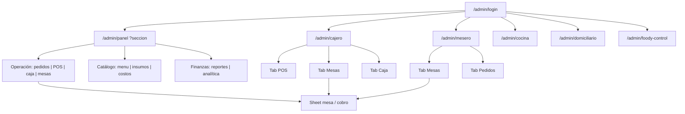

# Foody — Mapa de navegación y arquitectura UX

> **Rol:** UX Architect  
> **Fuente:** `app_router.dart`, `menu_admin_*.dart`, `redireccion_staff.dart`, flavors  
> **Última actualización:** 2026-07-02  
> **Complementa:** `FRONTEND_UX_AUDITORIA.md`, `FRONTEND_ACCESOS_RAPIDOS.md`, `FRONTEND_ROADMAP.md`

---

## Resumen ejecutivo

| Hallazgo | Cantidad | Severidad |
|----------|----------|-----------|
| Rutas GoRouter registradas | **22** paths (+ query) | — |
| Secciones panel admin (estado interno) | **21** | Solo `?seccion=` al entrar |
| Pantallas sin ruta propia (embed/sheet) | **15+** | Deep link limitado |
| Rutas redundantes (mismo widget, distinto path) | **6** pares | Media |
| Pantallas huérfanas / casi inaccesibles | **3** | Baja |
| Bucles de navegación problemáticos | **2** | Media |
| Acciones escondidas (sin affordance) | **12+** | Alta operación |
| Complejidad sidebar admin | **8 grupos · 20 ítems** | Alta |

---

## Árbol de rutas GoRouter

```
/  → redirect flavor inicial
/splash                          [solo flavor cliente]
/cliente                         CiudadesScreenFoody
/cliente/mis-pedidos
/cliente/escanear-qr
/ciudades/:slug/restaurantes
/restaurantes/:id/sucursales
/mesa/:qrToken                   MesaQrEntradaScreen → /menu/...
/menu/:sucursalId                ?mesa_id & mesa_nombre
/carrito/:sucursalId
/checkout/:sucursalId
/pedidos/:pedidoId/seguimiento   ?token

/admin/login                     StaffLoginScreen
/admin/registro                  RestauranteRegistroScreen
/admin/panel                     PanelRestauranteScreen  ?seccion & ?pago_id
/admin/mejorar-plan              → redirect /admin/panel?seccion=mejorar_plan
/admin/cajero                    PanelCajeroScreen
/admin/mesero                    PanelMeseroScreen
/admin/cocina                    KdsScreen(standalone)
/admin/domiciliario              DashboardDomiciliarioScreen
/admin/foody-control             PanelFoodyControlScreen

/domiciliario/login
/domiciliario/registro
/domiciliario/documentos
/domiciliario/espera
/domiciliario/independiente
```

### Flavors (bloqueo cruzado)

| Flavor | Inicio | Bloqueado |
|--------|--------|-----------|
| `cliente` | `/splash` | Rutas `/admin/*`, `/domiciliario/*` |
| `equipo` | `/admin/login` | Rutas cliente (`/cliente`, `/menu`, …) |

---

## Panel admin — secciones internas (`?seccion=`)

No hay `GoRoute` por módulo; la URL **no cambia** al navegar el sidebar (salvo carga inicial).

| seccion | Pantalla / widget | Permiso |
|---------|-------------------|---------|
| `dashboard` | Dashboard resumen + gráficos | `ver_dashboard` |
| `pedidos` | PedidosKanbanWidget | `ver_pedidos` |
| `nuevo_pedido` | PedidoCajeroScreen | `crear_pedido` |
| `menu` | MenuAdminScreen | `editar_productos` |
| `cocinas` | CocinasAdminScreen | `editar_productos` |
| `cocina_kds` | KdsScreen(embedded) | `ver_cocina` |
| `sucursales` | SucursalesAdminScreen | `gestionar_sucursales` |
| `zonas` | ZonasAdminScreen | `gestionar_sucursales` |
| `horarios` | HorariosAdminScreen | `gestionar_sucursales` |
| `insumos` | InventarioAdminScreen | `ver_inventario` |
| `costos_margenes` | CostosMargenesScreen | `ver_inventario` |
| `domiciliarios` | DomiciliariosAdminScreen | `gestionar_domiciliarios` |
| `caja` | CajaAdminScreen | `ver_caja` |
| `mesas` | MesasGridWidget | `gestionar_mesas` |
| `analitica` | AnaliticaScreen | `ver_analitica` o `ver_reportes` (+ tab Rentabilidad: `ver_finanzas`) |
| `finanzas` | FinanzasAdminScreen | `ver_finanzas` |
| `reportes` | ReportesAdminScreen | `ver_reportes` |
| `facturacion` | FacturacionAdminScreen | `ver_facturacion` |
| `alertas` | AlertasAdminScreen | `ver_alertas` |
| `promociones` | PromocionesAdminScreen | `editar_productos` |
| `usuarios` | UsuariosAdminScreen | `gestionar_usuarios` |
| `mejorar_plan` | MejorarPlanScreen | admin + plan ≠ enterprise |

**Huérfano de código:** `case 'inventario':` en `panel_restaurante_screen.dart` — el menú usa `insumos`; ningún ítem apunta a `inventario`.

### Grupos sidebar (acordeón)

| Grupo | Ítems |
|-------|-------|
| Inicio | dashboard |
| Operación | pedidos, nuevo_pedido, caja, mesas |
| Menú e inventario | menu, insumos, costos_margenes, promociones |
| Cocina | cocinas, cocina_kds |
| Domicilio | domiciliarios, zonas |
| Sucursal | sucursales, horarios |
| Finanzas | reportes, analitica, finanzas, facturacion |
| Equipo | usuarios |
| Sistema | alertas, mejorar_plan |

---

## Capas sin ruta (sheets / diálogos / push local)

| UI | Cómo se abre | Rol típico |
|----|--------------|------------|
| `mesa_pedidos_sheet` | Tap mesa en grid | Mesero, cajero, admin |
| `PedidoCajeroScreen` en sheet/fullscreen | Mesa libre → pedir | Mesero |
| Acciones kanban sheet | Tap tarjeta pedido | Admin, mesero |
| Diálogos insumo/producto | FAB inventario / menú admin | Admin |
| `detalle_producto_sheet` | Tap producto menú cliente | Cliente |
| Cobro mesa (dentro sheet) | Mesa ocupada | Cajero, admin |
| QR aprobar/rechazar | Tile naranja o kanban | Mesero |

**Problema UX:** estas rutas no son enlazables ni miden analytics de navegación.

---

## Hallazgos de arquitectura

### 1. Pantallas huérfanas

| Ítem | Detalle |
|------|---------|
| `/splash` en flavor `equipo` | Ruta existe pero flavor redirige a login; nunca se usa en staff |
| `seccion=inventario` | Switch case sin entrada en menú |
| `DomiciliarioEsperaScreen` | Solo tras documentos; sin link de vuelta al panel |

### 2. Rutas redundantes (mismo destino, distintos caminos)

| Función | Caminos | Clics extra admin vs rol dedicado |
|---------|---------|-----------------------------------|
| **KDS** | `/admin/cocina` vs panel `cocina_kds` | Cocina: 0 vs admin: 2–3 |
| **POS** | `/admin/cajero` tab vs `nuevo_pedido` en panel | 0 vs 2 |
| **Mesas** | cajero tab / mesero tab / panel `mesas` | 0 vs 2 |
| **Kanban** | mesero tab / panel `pedidos` | 0 vs 2 |
| **Caja** | cajero tab / panel `caja` | 0 vs 2 |
| **Domiciliario operativo** | `/admin/domiciliario` vs panel `domiciliarios` (gestión) | Roles distintos pero nombre confunde |

### 3. Navegación circular / trampas

| Bucle | Riesgo |
|-------|--------|
| Staff login ↔ Domiciliario login ↔ Staff login | Usuario perdido entre apps de equipo |
| Cliente AppBar → `/admin/login` (flavor cliente) | Entra a login que flavor puede bloquear al volver |
| Mesa QR sesión → bloquea `/cliente` → redirect menú | Correcto por negocio; usuario no puede cambiar restaurante sin limpiar sesión |
| `mejorar_plan`: banner + redirect `/admin/mejorar-plan` + sidebar | Mismo sitio por 3 vías (no circular, redundante) |

### 4. Acciones escondidas

| Acción | Dónde está | Quién la descubre |
|--------|------------|-------------------|
| Escanear QR mesa | Icono AppBar ciudades | Cliente avanzado |
| Mis pedidos | Icono AppBar ciudades | Cliente recurrente |
| Staff login desde cliente | Icono AppBar ciudades | Staff confundido |
| Abrir app cliente | Icono panel admin | Admin en flavor equipo |
| Long-press opciones mesa | Solo grid sin modo piso | Admin |
| Acción rápida kanban | Botón en tarjeta | Mesero entrenado |
| Ir a costos desde producto | Callback menú admin | Admin catalogador |
| Google OAuth / registro restaurante | Links pie login staff | Onboarding |
| Aprobar QR desde tile vs kanban | Dos lugares | Mesero |
| «Ya abrí la caja — continuar» | Cajero tras apertura | Cajero nuevo |

### 5. Menús mal organizados

| Problema | Impacto |
|----------|---------|
| 20 ítems en acordeón sin favoritos ni búsqueda | Admin/gerente: scroll y caza |
| `nuevo_pedido` separado de `pedidos` | Misma operación, dos entradas |
| `cocinas` (config) junto a `cocina_kds` (operación) | Cocina staff no necesita config |
| Finanzas: reportes + analítica + facturación | Solapamiento conceptual |
| Gerente cadena: selector sucursal en AppBar, no en sidebar | Fácil de ignorar |
| Sin breadcrumbs ni «estás aquí» fuera del título AppBar | Orientación pobre |

---

## Post-login por rol (backend `resolverDashboard`)

| Rol | Dashboard API | Ruta Flutter |
|-----|---------------|--------------|
| `super_admin` | `foody_control` | `/admin/foody-control` |
| `admin` | `restaurante` | `/admin/panel` |
| `gerente` / `gerente_cadena` | `restaurante` | `/admin/panel` (+ multi-sucursal si cadena) |
| `cajero` | `cajero` | `/admin/cajero` |
| `mesero` | `mesero` | `/admin/mesero` |
| `cocina*` | `cocina` | `/admin/cocina` |
| `domiciliario_planta` | `domiciliario` | `/admin/domiciliario` |
| `domiciliario_independiente` | `domiciliario_independiente` | `/domiciliario/independiente` |

---

## Recorridos por rol — actual vs óptimo

Escala complejidad: **Baja** · **Media** · **Alta**  
Tiempos estimados en turno real (usuario entrenado, red local).

### Administrador (`admin@foody.demo`)

| Tarea | Ruta actual | Clics | Tiempo | Complejidad | Óptimo propuesto | Clics ópt. |
|-------|-------------|------:|-------:|:-----------:|------------------|----------:|
| Ver pedido activo | panel → Operación → Pedidos | 3 | ~25s | Media | Dashboard KPI → kanban | **1** |
| Cobrar mesa | panel → Mesas → tap → sheet cobrar | 4+ | ~45s | Alta | Desde pedido kanban «Cobrar» | **2** |
| Crear producto | panel → Menú → tab → FAB | 4+ | ~60s | Media | Acceso directo favorito «Menú» | **2** |
| Ver alerta stock | panel → Sistema → Alertas | 3 | ~30s | Media | Dashboard → alerta | **1** |
| Abrir KDS | panel → Cocina → KDS | 3 | ~25s | Media | Solo si admin opera cocina; si no, quitar del menú default |

### Gerente (`gerente@foody.demo`) — sede única

Shell tipo admin **sin** selector multi-sede ni «Copiar menú» (eso es `gerente_cadena` / admin con `gestionar_sucursales`). Sidebar muestra el **nombre real de su sede** (NAV-MG-01). Cadena Menú↔Insumos↔Costos: ver `FRONTEND_AUDITORIA_NAV_MENU_COSTEO.md` (NAV-MG).

| Tarea | Clics actual | Fricción | Óptimo |
|-------|-------------:|----------|--------|
| Ver menú / costos de su sede | 2 (sidebar) | Baja | OK |
| Ver stock otras sedes (RO) | Insumos → «Otras sedes» | Baja | CTA NAV-MG-04 |
| Pedir copia de menú matriz | Empty Menú + pedir a cadena | Media | NAV-MG-02 copy claro |

### Gerente de cadena (`gerente_cadena`)

Igual shell que admin: **selector sucursal** en AppBar + copiar menú.

| Tarea | Clics actual | Fricción | Óptimo |
|-------|-------------:|----------|--------|
| Cambiar sede y ver pedidos | 2 (dropdown + sidebar pedidos) | Media | Sede en sidebar + última usada |
| Comparar sedes | Finanzas → Analítica → tab Sedes | 4 | Alta | Dashboard consolidado ya existe → link directo |
| Asignar mesero a mesa | Operación → Mesas → long press | 4+ | Alta | Modo «turno mesas» en 1 pantalla |

### Cajero (`cajero.test@foody.demo` / demo)

Shell `/admin/cajero`: tabs **POS · Mesas · Caja**. Sin Menú/Insumos/Costos. Ver `FRONTEND_AUDITORIA_NAV_CAJERO.md` (NAV-CJ).

| Tarea | Ruta actual | Clics | Notas |
|-------|-------------|------:|-------|
| Abrir turno | Tab Caja → monto → Abrir | 2–3 | Auto-salta a POS (NAV-CJ-02) |
| Venta POS | Tab POS | 5+ | Header único; nav arriba ≥720px |
| Cobrar mesa | Mesas → filtro Por cobrar → tap | 2–3 | Filtro en stats (NAV-CJ-08) |
| POS sin caja | Tap POS/Mesas | 1 | SnackBar + va a Caja (NAV-CJ-03) |

### Mesero (`mesero@foody.com`)

| Tarea | Ruta actual | Clics | Tiempo | Complejidad | Óptimo | Clics ópt. |
|-------|-------------|------:|-------:|:-----------:|--------|----------:|
| Tomar pedido mesa libre | Mesas → tap → Pedir → POS sheet | 4+ | ~60s | Media | Tap mesa → POS inline | **2** |
| Aprobar QR | Tab Pedidos → banner/tarjeta → acción | 3–4 | ~30s | Media | Push + tile en tab Mesas | **2** |
| Ver mesas asignadas | Tab Mesas (filtro mesera) | 1 | ~5s | Baja | OK ✅ |
| Estado pedido cocina | Tab Pedidos kanban | 2 | ~15s | Baja | Notificación → tap | **1** |

### Cocina (`cocina@foody.demo`)

| Tarea | Ruta actual | Clics | Tiempo | Complejidad | Óptimo | Clics ópt. |
|-------|-------------|------:|-------:|:-----------:|--------|----------:|
| Marcar ítem listo | Login → KDS → tap ticket | 2–3 | ~15s | **Baja** | Referencia ✅ | — |
| Cambiar cocina (multi) | Chips arriba | 1 | ~5s | Baja | OK ✅ |

**Mejor recorrido del sistema** — login directo a única pantalla.

### Domiciliario planta (`domi@foody.demo`)

| Tarea | Ruta actual | Clics | Tiempo | Complejidad | Óptimo | Clics ópt. |
|-------|-------------|------:|-------:|:-----------:|--------|----------:|
| Ver pedido asignado | Login → tab Activos | 2 | ~15s | Baja | OK ✅ |
| Marcar entregado | Activos → acción | 2 | ~20s | Baja | Swipe o botón grande | **1** |
| Ver mapa | Dentro detalle | 2+ | ~20s | Media | Mapa en tab principal | **1** |

**Confusión:** panel admin `domiciliarios` (gestión) vs `/admin/domiciliario` (campo) — nombres casi iguales.

---

## Diagrama navegación staff (simplificado)



---

## Propuestas de mejora (priorizadas)

### P0 — Operación diaria

| ID | Mejora | Afecta | Ver |
|----|--------|--------|-----|
| NAV-01 | **URL sync:** `context.go('/admin/panel?seccion=pedidos')` al cambiar sidebar | Deep links, favoritos | AR-28 |
| NAV-02 | **Favoritos sidebar** (3 pins por usuario) | Admin, gerente | AR-29 |
| NAV-03 | **Dashboard KPIs → módulo** (pedidos, mesas, alertas) | Admin | FF-04 |
| NAV-04 | **Kanban → mesa / caja / factura** en 1 tap | Todos staff | AR-01, AR-17 |
| NAV-05 | Renombrar UI: «Mi ruta» vs «Gestionar domiciliarios» | Domi | Claridad |

### P1 — Reducir redundancia

| ID | Mejora |
|----|--------|
| NAV-06 | Admin/gerente: opción «Modo operación» = shell cajero/mesero sin sidebar |
| NAV-07 | Unificar entrada KDS: solo `/admin/cocina` para rol cocina; admin usa embed |
| NAV-08 | Eliminar `case 'inventario'` muerto; solo `insumos` |
| NAV-09 | `nuevo_pedido` como FAB dentro de `pedidos`, no ítem sidebar |

### P2 — Cliente y onboarding

| ID | Mejora |
|----|--------|
| NAV-10 | Cliente: bottom nav Inicio / Buscar / Pedidos / QR |
| NAV-11 | Staff login: quitar link domi o usar selector claro de «tipo de cuenta» |
| NAV-12 | Mesa sesión: botón «Salir de mesa» visible (FF-01) |

### P3 — Medición

| ID | Mejora |
|----|--------|
| NAV-13 | Telemetría navegación: `seccion`, `tab`, `sheet` (sin PII) |
| NAV-14 | Script QA: contar clics mínimos por flujo en `CHECKLIST_QA_ROLES.md` |

---

## Matriz clic-tiempo-complejidad (tareas críticas)

| Tarea | Rol | Clics hoy | Tiempo hoy | Complejidad | Clics meta |
|-------|-----|----------:|-----------:|:-----------:|----------:|
| Login → trabajo | Cocina | 1 | 10s | Baja | 1 |
| Login → trabajo | Cajero (+ abrir caja) | 3 | 45s | Media | 2 |
| Aprobar QR mesa | Mesero | 3–4 | 30s | Media | 2 |
| Cobrar mesa | Cajero | 3+ | 50s | Alta | 2 |
| Cobrar mesa | Admin | 4+ | 60s | Alta | 2 |
| Pedido POS mostrador | Cajero | 5+ | 90s | Media | 4 |
| Ver pedido en cocina | Cocina | 2 | 15s | Baja | 2 |
| Cliente: menú → pedido | Cliente | 6+ | 120s | Media | 5 |
| Admin: stock bajo → insumo | Admin | 3+ | 40s | Media | 2 |

---

## Relación con otros docs

| Documento | Uso |
|-----------|-----|
| `FRONTEND_ACCESOS_RAPIDOS.md` | Implementación AR-XX de enlaces |
| `FRONTEND_ROADMAP.md` | Fase 4 navegación + Fase 8 (NAV) |
| [`../CHECKLIST_QA_ROLES.md`](../CHECKLIST_QA_ROLES.md) | Validar recorridos por rol |
| `INFRAESTRUCTURA/foody_flujo_completo_pantallas.html` | Spec histórica |

---

*Próxima revisión: tras NAV-01 (URL sync sidebar) y NAV-02 (favoritos).*
